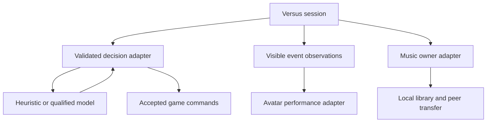

# Hapa Versus: Avatar opponents and music discovery

**Version:** 1.0, proposed 24 November 2026  
**Audience:** CJ, game/design developers, and the owners of Avatar Builder, Mesh Avatar, Hapa Harness, Second Brain, Music Library/Song Registry and Overwind  
**Status:** Future integration design. No implementation, service deployment, capability approval, human acceptance, or new automatic development goal is implied.

## 1. Product direction

Make a match feel like meeting someone in Hapa. The opponent has a recognizable identity, voice, manner and playing style. They can react to the match and introduce music. A player can keep a song they discover, return to their own library later, and remember who introduced it without losing the original creator's credit.

The central experience is:

> I sit down to play Red. He greets me, plays his side, reacts when something interesting happens, and contributes songs he likes. A track catches my attention. I press **Keep song**, continue playing, and later find that exact recording in my library, credited to its creator and linked to the encounter with Red. Red can remember the encounter through Hapa's memory owner when that memory is permitted.

This combines three useful loops: a satisfying match, an ongoing relationship with an Avatar, and music discovery through other people's taste. Each should remain useful when another is unavailable. A voice outage should leave a playable opponent. A missing music source should leave a responsive game. A disconnected introducer should not remove a copy already retained in the listener's library.

The reusable unit is a **participant in an experience**. Shopkeeper and opponent are roles for an Avatar, with different permitted actions. The shared performer, identity and memory connections should also work in a future world, classroom, music room or cooperative game.

### Scope of this document

This proposal describes product behavior, ownership, interfaces, failure handling and bounded acceptance journeys. It preserves the current Versus rules and the single-Ready interaction. New interfaces are explicitly proposals; existing routes are identified as source evidence. See the [contract notes](avatar-opponents-and-music-discovery-v1-contracts.md) for implementation detail and the [source register](avatar-opponents-and-music-discovery-v1-sources.json) for exact source pins.

The current coding run should complete the assigned playtest work. This proposal is separately available for the next integration decision; it is not another item to silently add to an ongoing goal.

## 2. What the reviewed ecosystem already provides

### Evidence boundary

The review inspected checked-in source at the revisions below, plus the saved `Hapa_World_Review.html` report dated 14 November. A connection to the known local Mesh address on port 8860 was refused, so no live Avatar performance was observed in this pass. The saved report describes a concrete Prawn Shop composition, but it is historical evidence, not a fresh demonstration. Some Mesh and Builder repository commits predate the shop pilot. Local code may contain reusable improvements absent from the published snapshots.

| Owner/source | Inspected revision | Useful capability and material limit |
| --- | --- | --- |
| Versus | Reviewed source `2d8a5ff2a1c5686101b3dc3c2c8e0cee33c6df4f`; latest documentation head observed `8505ec97b95e0fac4975098856c2a99ba43e74f4` | Deterministic rules, heuristic opponent, public planning and playback. Current bot entry points are synchronous; no qualified asynchronous model controller is established. [S1] |
| Mesh Avatar | `a6fc5111f1e772548a4c241187e59d8fd82daeee` | General mesh control and a separate Red Drive voice/pose performer. General control broadcasts to connected players; Drive is a full-page app with shared CLI conversation scope, not a ready match-scoped widget. [S2] |
| Avatar Builder | `c7e16f4ddba3d2278f257fc76fab98d726a78e82` | Avatar attachment, curated Mind projection, scoped voice generation, song/media sources, shared listening and bounded artifact handling. These are separate contracts that require a deliberate integration. [S3–S6] |
| Hapa Harness | `c3a0f63568fe86e2136877dec8dc0309495c8205` | Identity mounts, authenticated operations, request provenance and cancellation machinery. Game integration is marked unverified; participant context is explicitly unqualified. [S7] |
| Song Registry | `0276cc211cb4db71abfaf910c49c062386e463f5` | Local music library, playback, stems and history through Electron IPC. No general Registry HTTP API or durable arbitrary-player playlist service was found in this source. [S8] |
| Overwind | `086d4fe148680de990b07d1008949ebae0f26b94` | Card identity, acknowledged metadata/history and lineage. A Card acknowledgement does not establish possession of the music bytes. [S9] |
| Prawn Shop | Saved world review, 14 November; current local source not inspected here | Existing composition of engine, Avatar, Campfire, speech, Catalog and test orders. Reuse its actual performer attachment after examining the local source; do not infer its present state from older ecosystem summaries. [S10] |

“Hapa Music Library” may refer to additional local work. This review established the Song Registry and Builder paths; it did not establish a separate current Music Library service. Resolve that owner during integration before creating a competing catalog.

### Four findings that change the implementation plan

1. **Embodiment is reusable, but session isolation must be added or recovered from the shop.** The general Mesh endpoint broadcasts controls. The inspected Drive player does not enforce that an incoming speech bundle's `avatarId` matches its loaded renderer package. The full-page Drive response also disallows framing. Build or reuse a supported mount/perform/stop/dispose adapter in the Mesh owner; do not embed the existing page by weakening its policy. [S2]

2. **The Harness must be attached through an actual participant contract.** Its current conversation operation accepts text and mount/conversation metadata; that does not establish a legal game-decision API. Its current policy rejects participant context. Qualify a bounded game view through the owner instead of changing the participant into an author to pass the check. [S7]

3. **Shared playback timing already has a useful implementation.** Builder's Score Dust sessions have revision checks, a room clock, scoped guest access and playback synchronization. Reuse that logic. Its current sources and session lifetime do not make it a general persistent playlist service or peer music network. [S5]

4. **Card provenance and music delivery are separate jobs.** Builder's current Card Hypercore contains a bounded origin record; the inspected peer worker exchanges origin announcements. It does not replicate audio, and the custody reader expects a one-record history. Add media acquisition through an explicit owner contract rather than appending new events behind that reader or calling an announcement a transfer. [S6]

## 3. Ownership and the three clocks

Keep the integration small enough to live as adapters in the existing owners before introducing another service.

| Concern | Owner and responsibility |
| --- | --- |
| Game truth | Versus rules validate commands and produce accepted game events. Only the host's existing command path changes game state. |
| Opponent decisions | A controller proposes plans/responses from a permitted snapshot. The host validates, admits once and commits Ready. A model may be one controller provider. |
| Stable Avatar identity | Builder resolves exact Avatar identity, assets and permitted persona projections. Second Brain remains the canonical memory owner. |
| Model execution | Harness or another qualified adapter routes bounded work, tracks provenance and cancels requests. It does not own the game rules. |
| Embodiment | Mesh/voice owners generate and perform scoped utterances, expose actual playback state, and stop on request. |
| Match soundtrack | Versus owns selected contributions, queue presentation and encounter context. A small coordinator orders shared playback. |
| Durable music | The Music Library owner owns saved references, playlist revisions, retained assets, import and export. |
| Peer delivery | A native/local owner adapter owns discovery, authenticated transfer, resumption, verification and storage budgets. |
| Cross-app metadata | Existing Card/Overwind contracts carry origin and acknowledged lineage when appropriate. Listening does not wait for publication. |

There are three independent clocks:

| Clock | Drives | Must not wait for |
| --- | --- | --- |
| Game time | Tick/phase rules and deterministic replay | Speech, music buffering, downloads, a background memory summary |
| Performance time | Lip motion, gesture and caption timing against actual voice playback | The next Tick or another Avatar's queue |
| Listening time | Shared track position, buffering and local audio playback | Board movement or lane activation |

A finite controller deadline is a host policy, not a new rules clock. The host can wait briefly for a decision where the current game is waiting for that seat, then use an admitted fallback. Speech and media operations never become conditions for Ready or resolution.

The session correlates these activities. It does not give the performance or music adapter a path to modify rules.

## 4. Avatar opponent: identity, play and personality

### 4.1 Bind the identity explicitly

Distinguish the player/seat, Avatar, model, controller, renderer package, voice package and Commander piece. They are related but not interchangeable identities.

At match attachment, resolve and pin:

- Seat and session ID, plus an epoch that changes on restart or rebinding.
- Exact `avatarId` and identity revision; the visible name is a label, not a lookup key.
- Allowed persona/Mind projection and its source revisions.
- Renderer package and asset revision, with an explicit matching Avatar binding.
- Permitted voice Card/package and its revision or digest.
- Controller kind, difficulty/play policy and any qualified model/provider binding.

Red remains Red when a controller falls back or the model changes. The inspection surface can show which provider/controller acted, the exact capability status, and the provenance of a response. That detail belongs behind inspection rather than in every turn's main UI.

An opponent represented by Red with heuristic game decisions is a useful first integration, but report it accurately as such. Persona speech from a model does not establish model-generated strategy. The later model-control milestone must demonstrate actual admitted model decisions. [S1, S3, S7]

### 4.2 Give the opponent a fair, bounded game interface

The controller receives an immutable, permitted game packet: rules/profile references, current phase, seat, public facts available under the selected game policy, the seat's own draft, and any exact pending response request. It returns a typed proposal using the existing command vocabulary.

The host checks legality, affordability and freshness. It retains ownership of spending, movement, response consumption and Ready. A model does not receive arbitrary shell access, direct mutable state, or a browser-clicking loop to play.

The input policy must be explicit. Current public plans may be included when the rules permit them; calling all opponent information secret would be equally wrong. Exclude private owner memory, hidden future outcomes, and information from a later point than the admitted snapshot.

For every decision:

1. Create a unique request tied to match, epoch, seat binding, Tick, phase/choice, state hash, exact input digest and own draft revision.
2. Compute a legal heuristic fallback once. Use a legal empty plan or Pass where appropriate if no useful fallback exists.
3. Make at most one model request inside the admitted budget.
4. Validate a timely reply through the shared game validator. Invalid, expired or unavailable output selects the stored fallback; it does not launch a chain of repair prompts.
5. Atomically consume the request once and publish through the existing plan/Ready or response path.
6. Fence late output and request cancellation of remaining work. A cancellation request alone is not evidence that backend compute has stopped.

A suggested first casual-play configuration is a maximum five-second planning budget and 1.5-second response budget, both adjustable. These are proposed interaction caps enforced by fallback, not measured model performance or new multiplayer protocol defaults. Evaluate them in a real match before choosing shipping values. A remote human timeout must follow the peer protocol; it cannot be converted into an invented decision or concession.

Existing engine/rules code remains deterministic. Replay stores accepted plans, choice answers and checkpoint fingerprints; it never reruns a language model. Keep provider, timing and fallback receipts in separate diagnostics linked by match/request IDs, unless a deliberately versioned replay extension is selected. Preserve archived profile and peer hash semantics. [S1]

### 4.3 React to what the player has actually seen

Versus computes resolved results before visual playback has revealed all of them. The social observer must receive only the displayed event prefix, not the already-computed future result. Otherwise Red can announce a casualty or victory before it appears.

Use a separately hashed public observation: displayed Tick, playback cursor, visible facts and newly shown events. The inspection projection is not a complete authoritative game state and must not be passed to the rules fingerprint as though it were one. Keep observer input separate from a decision's frozen input. [S1]

Curate reaction moments rather than invoking a model on every frame or every Tick. Useful initial triggers are greeting, a significant visible maneuver, a setback, a direct human question, and match result. Examples below are writing direction, not facts to hardcode:

| Visible event | Possible short reaction | Constraint |
| --- | --- | --- |
| Match begins | “Good to see you. I brought a few tracks.” | Only if a playlist contribution actually exists |
| A visible route is cut off | “That puts my left side in trouble.” | Ground the observation in the shown board state |
| Red loses a valuable party | “I left that exposed. Nicely played.” | Describe the event without inventing a hidden reasoning trace |
| Human asks why a move was made | Brief explanation from accepted action, permitted board facts and policy | A post-hoc explanation is not proof of the model's internal deliberation |
| A track is kept | “Glad you liked that one.” | Only after a saved-reference receipt; do not claim the download has finished |

Personality may influence candidate ranking, brevity, word choice and expression. Difficulty remains a separate control: a theatrical opponent need not be stronger, slower or unfair. Offer Quiet, Normal and Talkative presets; start Normal with sparse event-driven reactions. No repeated “thinking” monologue is needed.

### 4.4 Reuse the shopkeeper performer

Inspect the current local Prawn Shop integration first. Recover its supported attachment path, request cancellation, audio playback receipts and environment composition before implementing a second copy. The desired reusable performer contract is small: attach identity, perform an utterance, stop, observe playback state, detach. Shop tools and game tools are role-specific attachments.

The existing Drive plan uses a bounded vocabulary for text, expression, turn, gesture and wink. Use the owner-supported vocabulary, including its normalized turn scale, instead of generating arbitrary animation names. The general mesh control schema and the Drive speech plan are different formats; an adapter must map them deliberately. [S2]

Each performance carries the match epoch, actor binding, utterance ID, source observation and voice/renderer identity. Reject mismatched identity, expired work and duplicate presentation. On reset, new opponent, mute/stop or disposal, stop local audio immediately and cancel supported provider jobs. A delayed bundle cannot begin speaking after the player has moved to a new match.

Separate these receipts: text produced, voice generation accepted, audio ready, actual local playback started, playback ended, cancelled, failed. Animate lips and duck music from actual playback. Audio generation success alone does not establish that the player heard anything. In source, Builder's scoped voice path already provides request IDs, polling, cancellation and provenance; use that boundary rather than putting an admin token in the game. [S3]

### 4.5 Keep memory coherent

Load a small, permitted persona and relevant relationship context before play. Avoid retrieving an entire Avatar biography every Tick. Treat match observations and conversation as session context; do not silently promote improvisation into canon.

When memory is enabled, append a compact post-match record through Second Brain with Avatar association, match reference, observed result, human-authored statements/preferences, source event IDs, producing model/harness and timestamp. Separate observed facts from interpretations or proposed memories. Corrections append through the owner's protocol. Durable relationship memory belongs there, not in a Versus-only memory database.

Do not block match exit on summarization. Queue one bounded owner operation and expose failure/retry status in diagnostics. Preserve the user's memory-access policy even where Avatars normally share knowledge. Sharing an Avatar's familiar identity does not automatically expose every author's private record to a game participant.

## 5. Music: discover through play, keep in your own library

### 5.1 Contributions and listening

At match setup, each player may contribute a selected playlist snapshot or a few recordings. The Avatar can have its own curated taste. Joining a match does not publish a player's entire library.

Recommended default: alternate A and B contributions by whole track, independently of Ticks and active columns. If only one contributes, use that collection. Keep a stable queue revision and entry IDs so both clients know which exact contribution is playing. Playlist edits later do not silently change the recording a listener already heard or kept.

Whole-track alternation is simple but not equal airtime: one long track can dominate a short match. Start with clear shared controls and local alternatives; do not add a complex voting system in the first connection. Assign one queue controller in the session and expose that role. A participant can request the next shared track without stopping play. Local choices—Shared, My selection, Opponent's selection, Music off—remain available regardless of that controller. A later fair-turn policy can constrain shared skipping if playtesting shows abuse.

Muting music locally never pauses the room. A local next action must say it affects only that listener, or be a deliberate shared queue command. Do not use one ambiguous Skip button for both. Unavailable queue entries advance after a bounded buffering policy rather than leaving the room stuck; a slow listener may locally fall behind without stalling everyone.

Reuse Score Dust's room-clock and revision concepts, while extending only the owner contract needed for general recording sources and playlist snapshots. This is casual synchronized listening, not sample-accurate remote music performance. [S5]

### 5.2 One primary action: Keep song

The primary player interaction should be fast:

1. Hear a song and open the small now-playing surface, or hover/focus its title.
2. See the creator and who introduced it.
3. Press **Keep song** once.
4. Continue playing while the configured music owner saves the reference and acquires a retained copy when supported and allowed.

Keep has two distinct durable outcomes behind one control. The UI must expose their progress accurately:

| State | Meaning |
| --- | --- |
| Saving… | A request exists; the library has not yet acknowledged a durable reference |
| Saved · downloading | Reference and discovery receipt exist; acquisition is in progress |
| Saved · waiting for source | The durable reference exists; no usable provider is currently reachable |
| Saved · paused | Acquisition is deliberately paused or storage/bandwidth policy requires it |
| Saved · reference only | Retention is unsupported or outside the offer's capability; do not pretend a transfer is pending |
| Verifying… | Required bytes have arrived; integrity/import checks are not yet complete |
| Available offline | Exact bytes are verified and the destination owner has committed retained storage and library membership |
| Download failed · reference saved | Acquisition failed; the saved discovery still exists and can be retried |

Bind the click to the exact playing recording and asset manifest, not a mutable URL or whatever occupies that queue slot later. Repeat clicks reuse the acquisition and stored bytes while preserving new discovery occasions. If the local owner is disconnected, identify the pending destination; a temporary browser cache must not impersonate that library.

Use the user's existing storage and sharing settings. Do not add a confirmation dialog for each song when the session/offer already grants the requested operation. A lack of retention capability should leave a useful saved reference. Download/import jobs belong to the music owner and survive match end or app restart.

### 5.3 Preserve four different kinds of attribution

| Dimension | Example | What it establishes |
| --- | --- | --- |
| Creator and source credit | “Artist Mira; recording from origin X” | The credited creator and the source asserting that credit |
| Introducer credit | “Discovered while playing Red” | The player/Avatar and encounter that led to discovery |
| Storage custody | “Retained in CJ's Music Library” | Which owner holds a verified copy |
| Sharing capability and rights metadata | Stream, retain, export, re-share; explicit source terms | What is offered and asserted; it is not inferred from mere possession |

The compact surface can say **Song title — Artist · introduced by Red**. Expanded inspection exposes recording/version, credits, original source, Card references and acquisition history. Red must not be credited as the songwriter merely because he recommended it. A recipient does not become the creator by keeping it.

Current ingestion/normalization has collection-specific author, album and rights defaults. Generic peer imports need a neutral owner path that preserves the offered credits and leaves unknown fields unknown. They must not inherit the local Dear Papa/Calder defaults. Hash/signature verification proves the relationship between bytes, manifest and issuer; it does not independently verify every creative credit or grant new rights. [S4, S8]

The intended default transfer is a retained copy. The source can keep its copy. This action does not transfer an exclusive Card, authorship, or signing keys. Listening, keeping and ordinary file export should not require minting a Song Card, rendering a music video, or purchasing an item.

### 5.4 Make discovery survive the match

Keep a lightweight **Songs encountered** list accessible from the existing history/collection surface and after the match. It preserves queue-entry and introducer references, the version heard, and acquisition status. It is optional to open, not a new mandatory end-of-turn or end-of-match acknowledgement.

Let a retained track be added to the player's own playlist and brought into a later encounter. Carry original credits forward while appending the new introduction event. This is the cultural propagation loop: discovery adds a relationship without rewriting origin.

Export can create an ordinary audio file plus a portable provenance sidecar, or supported embedded tags. Re-sharing is an explicit owner policy, not an automatic side effect of Keep. A network of retained copies can improve availability when the owners choose to seed them; avoid promising permanent availability from a source that may go offline.

## 6. Hypercore delivery and music identity

### 6.1 Put transport behind the native music owner

The browser game should consume a narrow local owner API for selection, playable audio, Keep, transfer progress and export. The local/native adapter handles Hypercore discovery, peer authorization, storage, resumption and verification. Keep media bytes out of game records and game hashes.

Evaluate Hyperdrive/Hyperblobs as owner-side file transport building blocks rather than implementing an ad-hoc album protocol inside Versus. Hypercore supports authenticated sparse replication; bounded acquisition is important because an open-ended download range never completes. Hyperdrive provides file streams and versioned checkouts that can help pin assets. Hyperswarm provides peer discovery/connections; application-level admission still needs its own boundary. Select compatible pinned versions and prove the actual two-node path. [S11–S13]

A direct-connection-only first transfer may be sufficient for local or reachable peers, but record that scope. Do not promise internet-wide reliability from a loopback test. If relays or persistent seed nodes are later needed, make them separate owners with explicit availability and operating-cost decisions.

### 6.2 Do not collapse every reference into “song ID”

| Reference | Meaning |
| --- | --- |
| `workId` | The composition/creative work, if established; nullable otherwise |
| `recordingId` | A particular performance, generation or take; retain namespaced origin IDs |
| `assetId` | Exact encoded bytes, identified by SHA-256, length, media type and role |
| `cardRef` | Canonical Card identity, revision/digest and aliases when available |
| `playlistId`, `revision`, `entryId` | A durable collection snapshot and an exact position/contribution |
| `discoveryId` | Receiver-owned encounter record: session, introducer, recording and manifest |
| `acquisitionId` | An idempotent operation retaining a specific asset in a selected destination |

An MP3 and WAV can be separate assets of one recording. A remaster or new take needs an explicit new recording/revision relationship. Title or lyric similarity is not sufficient for automatic identity merging. Multiple providers can offer identical bytes without becoming their creators.

### 6.3 Proposed portable offer

Define a versioned offer containing recording identity, optional work/Card references, title and explicit credits, exact file descriptors, source/provenance references, supported capabilities, and a bounded signature envelope. Preserve the original manifest and digest at import. Define its canonical serialization and signature algorithm before exchanging it; a JSON object with an unspecified signing procedure is not interoperable.

Keep transport locators separate from the signed asset identity so another provider can serve the same verified asset. If a feed or drive is used, pin the relevant immutable version/ranges and expected bytes instead of following an unrestricted mutable head. Do not treat the underlying log alone as the entire application's immutability policy.

Only offer selected recordings/assets. Do not replicate a full private library feed to make one track available. Exclude workstation paths, raw private exports, admin credentials and unrelated source material. Cover art is a separate bounded asset; it is not required for audio playback or completion.

Existing Builder audio URLs can resolve to replaced WAV/source bytes. Resolve and hash the selected asset at the owner before offering it. Use exact IDs; the local legacy title fallback is unsuitable for peer acquisition. Existing origin/custody receipts may be attached as supporting metadata but do not substitute for the audio manifest. [S4, S6]

### 6.4 Retention and failure handling

The receiver persists a transfer job, fetches bounded blocks into staging, verifies exact length/digest and supported media handling, then commits storage plus library membership with a recoverable receipt. An interruption between file publication and index update must be repairable without duplicating or losing the acquisition.

Do not call a header-only check full decode validation. Use the source's declared media type plus bounded validation appropriate to the supported formats. Start with formats the owner can actually play/export; the current Builder upload path accepts MP3/WAV. [S4]

Record verified progress separately from bytes received. Resume after restart against the same manifest; another provider is acceptable only for those same bytes. A changed source becomes a separate offer, never a silent replacement mid-download. Cancelling an incomplete acquisition retains the saved reference and follows the user's storage policy for partial bytes. Completed retained assets are pinned against ordinary streaming-cache eviction.

If the source leaves before completion, report waiting/paused honestly. If acquisition finished, demonstrate offline playback after source disconnection and receiver restart. If two providers claim the same identity but supply different bytes, reject the mismatch and preserve the source evidence. Do not automatically retry an unchanged failure forever.

## 7. Look, feel and controls

### Opponent presence

Use a small, responsive **opponent perch** near the opponent's board edge or a reserved screen corner: visible upper-body/avatar portrait, short name, current speaking indicator and optional compact caption. It should feel like someone across the table, with eye direction and occasional gesture suggesting attention to the board.

The perch must not cover legal destinations, retainer inspection or the Ready control. It can collapse to a portrait chip at close zoom or on small windows. Keep the Commander and chess identities on the board distinct from this social presence. World placement may follow camera framing, but labels and controls remain legible and stable during 360-degree rotation.

Clicking the portrait deliberately opens conversation/history. Hover or keyboard focus explains mute, stop, expand and controller status. Avoid making a large chat panel appear because a unit was selected. Offer reduced motion, captions, keyboard access and text-only operation. Start with text input; microphone capture and push-to-talk are a later explicit feature.

### Music presence

Use a small record sleeve, tabletop music object or compact now-playing strip that fits Hapa's pixel/tabletop aesthetic. Its essential contents are title, creator, introducer, Keep state and a local volume control. Larger cover art, queue, credits and transfer details appear on deliberate inspection.

Keep should give a small tactile/audio response and a persistent state change, without a full-screen confirmation or toast over the board. A verified transfer can gently resolve the icon into an offline mark. Do not animate downloads as if music were Mana, Supply, ownership of a territory or another game resource.

### Audio behavior

Use separate local buses for master, gameplay cues, voice and music. The local listener controls gains. Briefly duck music when Avatar speech actually starts, restoring it when playback ends or is stopped. Preserve intelligible game cues; do not let repeated banter erase the useful soundtrack.

First play should include one clear sound-enabling gesture where the browser requires it. Browser autoplay rules can suspend audible media/Web Audio before user interaction. Provide a silent, fully usable state until sound is enabled. [S14]

One speaking utterance and at most one pending reaction per Avatar is a useful initial limit. Coalesce low-value reactions, expire stale ones and let a new human request interrupt lower-priority banter. Do not queue several minutes of comments behind slow voice generation. Music buffering and background retention use bounded bandwidth/concurrency, and high-priority game decisions should not compete with optional context optimization/model loading.

### Useful emergent moments

After the basic journey works, add small expressive connections: Red nods with a favorite track, reacts briefly to a surprising move, or mentions a previously shared song from a permitted memory. Keep musical movement subtle and optional. Avoid costly beat analysis, continuous generation, elaborate emotional state machines and every-frame inference in the first milestone.

## 8. Implementation sequence under Loose Screws

The whole target is: **play against an embodied Avatar, hear appropriate reactions and a selected soundtrack, keep an encountered recording, and play it later from the receiving library with attribution preserved.** A model-controlled strategy layer is an explicit subsequent qualification within that broader direction, not a hidden claim about a talking heuristic bot.

### Milestone A — Red shares the table

Inspect the current local shop and Music Library owner first. Reuse one real Avatar/voice/performer and one existing playlist/source. Bind Red to the existing legal heuristic opponent. Add match-scoped performance, a handful of grounded reactions, text fallback, local audio controls and an unobtrusive perch. Attach real owner-backed song playback with the same small now-playing surface that the transfer milestone will use.

**Attachment proof:** a complete match with actual owner-sourced Avatar assets and at least one real voice performance; game remains usable through voice/music failure and reset. Clearly report the heuristic controller. If voice is unavailable, the text fallback is useful but the voice acceptance remains open.

### Milestone B — A song becomes yours to keep

Add the neutral Music Library import/retention contract, selected portable offers, a shared queue snapshot, and the native transfer path. Complete one real transfer between two nodes/libraries. A listener presses Keep during play, sees its status, ends the match, disconnects the source, restarts the receiver and plays the retained recording from the destination library.

**Attachment proof:** exact asset digest, committed library receipt, preserved creator/introducer attribution and offline playback. A metadata-only Card exchange or same-process loopback simulation does not close this milestone. It can be useful intermediate evidence if labeled accurately.

### Milestone C — Red makes model-assisted game decisions

Qualify the Harness's bounded participant context, or another explicitly permitted decision provider, and attach it at Versus's existing controller seams. Implement one-request admission, strict output validation, finite deadlines and heuristic fallback. Preserve single Ready and the current peer protocol. Keep social observation separate from frozen decision inputs.

**Attachment proof:** actual model-proposed commands admitted into a real match, plus observed fallback after timeout/invalid/late output. Inspectable receipts identify the provider without changing Red's visible identity. A conversation with a board pasted into the prompt is not sufficient evidence.

### Assembly discipline

Create a short checkpoint per integrated milestone and a grouped tightening list. During assembly, check an attachment when it is required to proceed, a critical boundary changed, or a concrete failure creates uncertainty. Do not run a broad suite because another file was edited, another prompt finished or a checkpoint was committed.

After the connected journey fits, run the repository's required `npm run check` once on the candidate and relevant owner gates for changed owners, then play the integrated journeys below. Fix related failures in batches. Do not loop on unmodified evidence or expand the assignment into a new ecosystem project. Stop with implementation, observed verification, unavailable owner capabilities and CJ acceptance clearly separated. [S1]

## 9. Acceptance journeys and evidence

These are future targets, not results of this research pass. Reuse one well-designed scenario to establish multiple behaviors rather than creating an exhaustive matrix for each small adapter.

| Journey | What must be observed |
| --- | --- |
| Ordinary embodied match | Red plays his assigned seat, performs a few timely reactions, and exposes text/mute/stop. Legal moves, Ready and board inspection remain usable. Controller kind is truthful. |
| Reset or opponent switch during work | Old model reply, audio bundle, speech playback and puppet controls cannot act in the new match. Another Avatar instance is unaffected. |
| Model failure | Invalid, duplicate, late and unavailable replies cannot double-spend or commit twice. A stored legal fallback completes the seat's turn without a repair loop. |
| Playback fairness | Pause before a future casualty/result. Social commentary reveals nothing beyond the displayed prefix. Controller requests contain only the permitted authoritative state at their exact decision boundary, never later computed results. |
| Sound and local control | Sound disabled, voice missing, music buffering, mute and reduced motion all leave a playable game. Local music mute does not pause the room. |
| Two-player music discovery | Selected contributions, exact queue entries and the Now Playing metadata agree. Keep saves the exact heard version and the correct introducer, not a changed source URL. |
| Retention under interruption | Partial transfer survives interruption/restart and resumes against the same manifest. Completed copy plays after source departure and receiver restart. Wrong bytes never produce Available offline. |
| Attribution and scope | A foreign creator remains credited through neutral import. Duplicate asset bytes can be reused while discovery events remain distinct. Only offered songs are exposed; Keep does not automatically seed or grant new rights. |

Record decision elapsed time and fallback reason, generation time separately from audio-ready/playback-start time, dropped/stale reactions, music buffering and drift, verified bytes and durable retention status. Include match/epoch/request IDs in developer diagnostics. Keep private memory and raw prompts out of ordinary game replays.

Performance targets should be measured on CJ's actual local setup at ordinary play conditions. Do not infer sub-second speech or model success rates from API availability. A finite deadline plus fallback can be guaranteed by the host even when model speed cannot.

## 10. Product choices for CJ, with usable defaults

These decisions can be revisited without blocking the current game review. Each question includes its context so it can be understood independently.

### A. Which version of an “AI opponent” should be the first visible delivery?

A Red avatar can speak and react while the game's existing heuristic chooses legal moves. Having a language model choose strategy requires a separate, currently unqualified game-participant attachment in the Harness. **Should the first visible delivery establish Red's presence with the existing opponent, or wait until model-generated strategy also works?**

**Recommendation:** deliver the embodied heuristic first, label the controller accurately in inspection, then qualify model decisions as Milestone C. This makes identity, voice and usability testable while the game remains reliable.

### B. How should two players' music contributions share the match?

Alternating whole tracks gives both players turns, but a long recording can dominate a short match. One shared queue also needs someone authorized to skip or seek. **Should default listening alternate full tracks, use time-limited excerpts, or follow one selected player's playlist?**

**Recommendation:** alternate full tracks, choose a visible queue controller, and retain each listener's local choice to follow either collection or turn music off. Revisit shared skipping and equal-airtime rules after actual play.

### C. What should Keep song do when the player has space and the source permits retention?

A saved reference remains useful even if the source later goes offline, but it does not make the recording playable without that source. An offline copy requires a real transfer into a selected library. **Should Keep start that transfer automatically, or should offline retention require a second action?**

**Recommendation:** one Keep action saves the reference and starts retention under existing settings. Show each stage honestly; use Reference only when copying is unavailable. Offer Export and Re-share separately.

### D. How much unsolicited conversation should Red initiate?

Spoken reactions can create personality, but frequent comments compete with game cues, music and thought. **Should the default opponent speak mainly at major moments, comment on most turns, or remain silent until addressed?**

**Recommendation:** sparse Normal mode: greeting, meaningful visible events and match result, with at most one queued reaction. Quiet and Talkative are local preferences; direct questions remain available.

### E. What should Red remember across matches?

Remembering that CJ enjoyed a song or uses a recurring tactic makes the same Avatar feel continuous. Saving every conversation and inferred trait would create a much larger memory commitment. **Should normal play append a compact factual match/discovery summary to the Avatar's permitted Second Brain memory, retain only explicitly requested memories, or keep session context temporary?**

**Recommendation:** use the user's established memory policy; where enabled, append compact sourced summaries and explicit preferences, with interpretations labeled. Keep raw conversation and canon changes outside automatic promotion. Make remembered sources inspectable.

### F. Which existing local app should own retained music and its playlists?

The reviewed Song Registry has local library/IPC functions, and Builder exposes curated song/media and listening routes. CJ may have a newer Music Library app not reflected in the inspected repositories. **Which current owner should receive a kept song and remain usable when Versus is closed?**

**Recommendation:** inspect that local owner before implementation, then extend its neutral import/playlist/retention surface. Versus should reference this library rather than create another persistent music database.

## 11. Sources and implementation reading order

Source statements above concern the pinned versions, not a claim of current runtime deployment. The machine-readable [source register](avatar-opponents-and-music-discovery-v1-sources.json) preserves the broader inspected paths. New implementers should first read the active review and current owner handoffs, then compare these pins against local work.

- **S1 — Versus:** [AGENTS and ownership](https://github.com/calderwong/hapa-verseUs-prototype/blob/2d8a5ff2a1c5686101b3dc3c2c8e0cee33c6df4f/AGENTS.md), [review pointer](../reviews/README.md), [Loose Screws](../workflows/LOOSE_SCREWS.md). Host/controller/playback paths are listed in the source register and contract notes. Engine pin reviewed: `ba838cca09ba43afceda0452b63d28df4cbf7f72`.
- **S2 — Mesh:** [general API](https://github.com/calderwong/hapa-mesh-avatar/blob/a6fc5111f1e772548a4c241187e59d8fd82daeee/server/api.mjs), [Drive server](https://github.com/calderwong/hapa-mesh-avatar/blob/a6fc5111f1e772548a4c241187e59d8fd82daeee/server/drive.mjs), [Drive player](https://github.com/calderwong/hapa-mesh-avatar/blob/a6fc5111f1e772548a4c241187e59d8fd82daeee/apps/drive/player.mjs), [performance contract](https://github.com/calderwong/hapa-mesh-avatar/blob/a6fc5111f1e772548a4c241187e59d8fd82daeee/packages/avatar-drive/contract.mjs).
- **S3 — Builder Avatar/voice:** [Avatar agent contract](https://github.com/calderwong/hapa-avatar-builder/blob/c7e16f4ddba3d2278f257fc76fab98d726a78e82/docs/AVATAR_AGENT_CONTRACT.md), [scoped voice consumers](https://github.com/calderwong/hapa-avatar-builder/blob/c7e16f4ddba3d2278f257fc76fab98d726a78e82/server/avatar-voice-consumer.mjs), [voice routes](https://github.com/calderwong/hapa-avatar-builder/blob/c7e16f4ddba3d2278f257fc76fab98d726a78e82/server/avatar-voice-routes.mjs).
- **S4 — Builder music:** [API/router](https://github.com/calderwong/hapa-avatar-builder/blob/c7e16f4ddba3d2278f257fc76fab98d726a78e82/server/api.mjs), [song normalization](https://github.com/calderwong/hapa-avatar-builder/blob/c7e16f4ddba3d2278f257fc76fab98d726a78e82/src/domain/song.js), [audio upload](https://github.com/calderwong/hapa-avatar-builder/blob/c7e16f4ddba3d2278f257fc76fab98d726a78e82/server/song-audio-upload.mjs).
- **S5 — Shared listening:** [Score Dust sessions](https://github.com/calderwong/hapa-avatar-builder/blob/c7e16f4ddba3d2278f257fc76fab98d726a78e82/server/echo-score-dust-sessions.mjs), [playback clock](https://github.com/calderwong/hapa-avatar-builder/blob/c7e16f4ddba3d2278f257fc76fab98d726a78e82/src/domain/echo-score-dust-shared-play.js).
- **S6 — Card/media limits:** [Card custody service](https://github.com/calderwong/hapa-avatar-builder/blob/c7e16f4ddba3d2278f257fc76fab98d726a78e82/server/card-custody-service.mjs), [origin peer worker](https://github.com/calderwong/hapa-avatar-builder/blob/c7e16f4ddba3d2278f257fc76fab98d726a78e82/server/card-origin-announcement-peer-worker.mjs), [Song Card editions](https://github.com/calderwong/hapa-avatar-builder/blob/c7e16f4ddba3d2278f257fc76fab98d726a78e82/docs/SONG_CARD_MINTING.md).
- **S7 — Harness:** [README](https://github.com/calderwong/hapa-harness/blob/c3a0f63568fe86e2136877dec8dc0309495c8205/README.md), [current build handoff](https://github.com/calderwong/hapa-harness/blob/c3a0f63568fe86e2136877dec8dc0309495c8205/docs/BUILD_STATE.md), [participant context policy](https://github.com/calderwong/hapa-harness/blob/c3a0f63568fe86e2136877dec8dc0309495c8205/src/model-context.mjs), [conversation admission](https://github.com/calderwong/hapa-harness/blob/c3a0f63568fe86e2136877dec8dc0309495c8205/src/conversation.mjs).
- **S8 — Song Registry:** [README](https://github.com/calderwong/hapa-song-registry/blob/0276cc211cb4db71abfaf910c49c062386e463f5/README.md), [IPC preload](https://github.com/calderwong/hapa-song-registry/blob/0276cc211cb4db71abfaf910c49c062386e463f5/src/preload.js), [ingestion](https://github.com/calderwong/hapa-song-registry/blob/0276cc211cb4db71abfaf910c49c062386e463f5/scripts/ingest_suno.py).
- **S9 — Overwind:** [Card read contract](https://github.com/calderwong/hapa-overwind-node/blob/086d4fe148680de990b07d1008949ebae0f26b94/docs/CARD_READ_SEARCH_API.md), [lineage contract](https://github.com/calderwong/hapa-overwind-node/blob/086d4fe148680de990b07d1008949ebae0f26b94/docs/CARD_LINEAGE_GRAPH_API.md).
- **S10 — Prawn Shop context:** CJ's saved [Hapa_World_Review.html](https://chatgpt.com/library?file_id=libfile_fde3_f-e94d8e42a1588191902651737669e6e1_3caedc9a413881919d437b56e22f8e88&account_id=personal), read for its shop/owner boundary description. Historical report, not a fresh local source or runtime audit.
- **S11 — Hypercore:** [official repository and API](https://github.com/holepunchto/hypercore), accessed 24 November 2026.
- **S12 — Hyperdrive:** [official repository and API](https://github.com/holepunchto/hyperdrive), accessed 24 November 2026.
- **S13 — Hyperswarm:** [official repository and API](https://github.com/holepunchto/hyperswarm), accessed 24 November 2026.
- **S14 — Browser audio:** [Chrome autoplay policy](https://developer.chrome.com/blog/autoplay), accessed 24 November 2026.

### Evidence limits

No game, model, audio generation, peer transfer or service deployment was run for this proposal. No performance targets are represented as measured results. The local shared grounding files requested by repository instructions were not available through the published Hapa snapshot; current user direction and the inspected repository instructions govern this design. Current local shop code, current Music Library ownership and live grants remain implementation discovery items. No private conversations, credentials or source audio are included.
