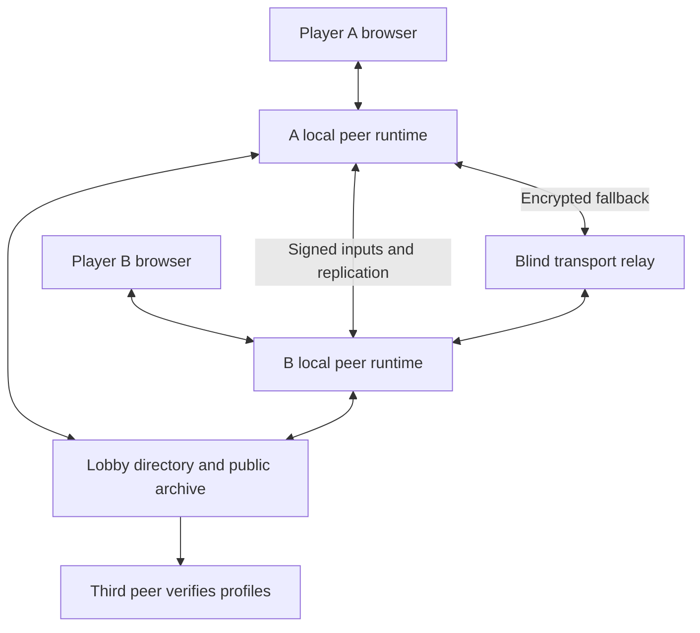

# Hapa Versus — P2P play and matchmaking v1

**26 November 2026 amendment:** [Addendum 09](../requirements/2026-11-26-human-feedback-addendum-09.md), [Friend test and resilient connectivity v1](friend-test-and-resilient-connectivity-v1.md) and [Assignment 19](../reviews/2026-11-26-next-agent-assignment-19.md) select the simple two-network native friend test and signed, replaceable service/contact history. Reconcile active Assignment 18 first. No VPS maintained by CJ or always-online archive is a prerequisite for this live two-person test. Preserve the earlier broader scope and archived semantics; newer direction governs conflicting infrastructure/delivery sequencing. This amendment is tasking only.

**Date:** 25 November 2026, America/Los_Angeles.  
**Status:** Implementation specification and research-backed working design. No internet match, installation, relay deployment or new runtime is claimed by this document.  
**Selected scope:** [Human-feedback addendum 07](../requirements/2026-11-25-human-feedback-addendum-07.md).  
**Build handoff:** [Assignment 16](../reviews/2026-11-25-next-agent-assignment-16.md).  
**Reviewed game:** `calderwong/hapa-verseUs-prototype@8036a3df0e4289ef203e54838df76ef22e053e53`; engine `ba838cca09ba43afceda0452b63d28df4cbf7f72`.  
**Evidence:** [Source register](p2p-matchmaking-v1-sources.json). Source findings below are inspection findings; existing tests were not rerun for this planning publication.

**Desktop amendment:** CJ subsequently selected [Addendum 08](../requirements/2026-11-25-human-feedback-addendum-08.md). [Electron desktop delivery v1](electron-desktop-v1.md) now governs the default player package, included runtime/assets, stable OS data root and desktop IPC bridge. The source/browser/headless paths remain supported. The network/game/result contracts below remain in force; this amendment does not claim an implemented installer.

## 1. The product we are building

A new player downloads/installs/opens the bundled Electron application, or uses the retained source-clone path to build/launch it. They enter a display name, join the public lobby, see who is available, challenge someone or open a table, and play that person on another internet connection. Both machines retain a replay and result. A third player can inspect their match records and verified win/loss statistics without either participant typing in a score.

The default installation must be independently useful. It must not depend on CJ's machine, a running Hapa Harness, paid inference, a wallet, Avatar Builder, a music node or a private memory service. Those owners add optional capabilities through existing contracts.

The first release is **public casual play using the current bundled rules and content**. The roster is the current lobby's observed players, not an assertion that one client can enumerate every person on the worldwide DHT. Presence, compatible game rules and a verified result are different facts and receive different UI states.

### What is included

1. A single local launcher, persistent player identity and supported clean installation.
2. Live peer discovery, availability, compact profiles and clear connection diagnostics.
3. Targeted challenges, an open table anyone compatible can join, and copy/paste invitations.
4. Remote human play through two player-owned Hypercores and the existing deterministic rules.
5. Recoverable disconnection and process restart.
6. Durable public replay/result evidence, deduplicated statistics and third-peer inspection.
7. A minimal headless directory/result-seeder mode, plus configuration and operational instructions for a supported transport relay.

### What this milestone does not add

Ranked Elo/Glicko, cash stakes, anti-cheat certification, identity/personhood verification, tournaments, spectators, hidden-information rules, global consensus, a mandatory multiwriter database, automated skill matching, internet voice/music transport, a new web UI framework or a public endpoint for local Hapa owner APIs. Electron itself is selected by the later desktop amendment. These are separate changes. A player may still listen to their locally available soundtrack while playing remotely.

## 2. What already exists, and the gaps that matter

| Existing source at the pinned baseline | Reuse | New connection or correction needed |
| --- | --- | --- |
| `rules/state.js`, `encoding.js`, `context.js` | Complete manifest, canonical fingerprints, deterministic safe-integer state | Authenticated agreement on exact manifest, participants, feeds and supported executable rules |
| `protocol/messages.js` | Domain-separated Ed25519 record signatures | Persistent identity; complete received schema/session/type/range validation |
| `protocol/agreement.js` | `own_plan_ready_v1`, monotonically revised public plans, own-plan commitment | Preserve this in remote human UI; do not reintroduce repeated acknowledgment |
| `protocol/peer.js` | One writer per participant, replicated logs, independent Tick resolution and receipts | Async human control, stronger input binding, persistent recovery and replay export |
| `tools/hapa/peers.mjs`, `tests/hapa/protocol.test.js` | Two-process and same-process reconnect attachment evidence | Internet discovery, actual remote browsers, NAT/relay, process restart and public result distribution |
| `presentation/app.js` | Board input, choice UI, traces, animation, ledger and inspection | Online session adapter: exactly one locally controlled seat, with no hotseat switch or locally simulated remote controller |
| `rules/session.js`, `rules/stats.js`, `tools/hapa/history.mjs` | Replay calculation and useful event projections | Public result verifier and durable, conflict-aware statistics index |
| `vite.config.js` | Loopback UI and server-side optional owner proxies | Authenticated local peer bridge; no public exposure of owner proxies |

Three source findings are required work before accepting untrusted remote data:

- `Peer.deliver()` currently drops a repeated author/sequence using a Set. It cannot distinguish an identical retransmission from different content signed at that sequence. Store the accepted digest and report conflicts.
- Plans are checked against match, phase and prior state in `PhaseAgreement`; choice and receipt consumption do not impose the same complete binding. Validate every received record before queueing it.
- `verifyReplay()` returns a calculated outcome/hash but does not compare the replay's top-level claims to that calculation. The history CLI then imports the claimed outcome. Public ingestion must compare and use the calculated result, complete signed transcript and agreed receipts, never trust that existing importer unchanged.

Current `Peer.open()` recreates initial game state and its constructor resets sequence/cursors. The existing reconnect test only replaces streams on living peer objects. Reopening disk storage is not restart recovery. Also, the demo deletes `.data/peers`; real online storage must be separate from every destructive fixture path.

## 3. Architecture and responsibilities

Keep the existing browser-based renderer as the game surface inside the selected Electron shell. Main supervises the same persistent Node peer runtime in a utility process; the desktop uses a narrow preload/IPC adapter, while browser development retains the authenticated loopback adapter. The Node process owns signing keys, authoritative online sessions, network transport, logs and result verification. Both players run this same stack. There is no server that chooses legal moves or decides the winner.



The diagram separates infrastructure responsibilities; it does not require separate physical hosts. A small always-on Hapa host may run a directory/archive and relay. Both roles must be replaceable/configurable, and neither receives player signing secrets.

| Component | Responsibility | Must not become |
| --- | --- | --- |
| Browser UI | Send local intents; render authoritative events/projections; own camera, audio and animation | Another online authority or a controller for the remote seat |
| Local peer runtime | Identity, storage, network, session state machine, validation, replay and statistics | A gateway to every local Hapa service |
| Hyperswarm / HyperDHT | Topic discovery, keyed encrypted connections, connection maintenance | A player database, identity registry or complete worldwide presence list |
| Match Hypercores | One signed input stream per player, retained by both | A shared writable key or arbitrary remote code channel |
| Public profile/result cores | Signed profile changes and bounded public evidence references | Self-certified competitive scores |
| Local index | Rebuildable profile/history/statistics projection over accepted evidence | Source of truth that survives without its evidence |
| Directory/result seeder | Live directory assertions, discovery assistance, retained public evidence | Referee, identity authority or trusted score oracle |
| Blind relay | Forward encrypted connections where direct connectivity fails | Storage, match authority, or a guaranteed cure for all blocked networks |

### Stack selection

Use existing Hypercore 11 and crypto/encoding dependencies; add a tested, locked Hyperswarm version and a small versioned control channel, preferably Protomux on the authenticated connection. Inspect the actual compatible replication API; do not pipe unrelated raw JSON bytes into a Hypercore protocol stream. No need for both a general RPC framework and a second control protocol. `@hyperswarm/rpc` is an alternative if it measurably simplifies the implementation, not an additional required layer.

Corestore can manage growing collections of cores. It is optional for the first path; existing explicit Hypercore handles can enforce a simpler replication allowlist. Hyperbee is useful for a directory's durable keyed index, but an atomic rebuildable local index is also adequate at this scale. Do not migrate storage or add Autobase merely because they are available.

Use one swarm per process and multiple explicit topic/channel contexts. Inbound connection handling must perform an application handshake; it cannot assume every incoming socket belongs to the intended lobby. Official references: [Hyperswarm](https://docs.pears.com/p2p/reference/building-blocks/hyperswarm/), [HyperDHT](https://docs.pears.com/p2p/reference/building-blocks/hyperdht/), [Hypercore](https://docs.pears.com/p2p/reference/building-blocks/hypercore/), [Corestore](https://docs.pears.com/p2p/how-to/store-and-replicate/work-with-many-hypercores-using-corestore/).

## 4. Clone, install and launch is a real delivery requirement

### Resolve the private engine dependency

The parent game repo is public. Its `.gitmodules` requires the private `calderwong/lumina-hapa` fork, and the game imports engine modules directly. A successful clone of the parent does not provide a playable game to an unaffiliated person.

Preferred release path: an accessible, revision-pinned runtime artifact containing the engine code required by this game, its license notices and approved redistributable assets. Preserve the separately owned fork and its normal update procedure. Use an existing approved public artifact if one already exists; otherwise prepare an exact file/content/license manifest for the owner to approve the required distribution. Do not flip repository visibility, publish private history, or substitute an incompatible upstream engine. An interim invited-tester build with explicit engine access is useful but must be labeled that way.

The game has no root license file in the inspected tree; the engine repository reports MIT. Record an explicit game/asset distribution policy before claiming an open-source public release. Do not infer all art rights from the engine code license. Procedural unit art and fallback Card faces already reduce the dependency on private media.

### Target command contract — to implement

The primary player README must start with download/install/open, with no separately installed Git/Node/npm. The retained contributor README should also make this possible after Git and the supported Node runtime are installed:

```bash
git clone https://github.com/calderwong/hapa-verseUs-prototype.git
cd hapa-verseUs-prototype
npm ci
npm run play
```

These are target commands, not a claim that `play` exists today. Engine provisioning must be built into the supported distribution/launcher path or reduce to one clearly documented additional command; it cannot secretly require CJ's GitHub access. Use locked, checksum-verified artifacts, not a moving remote script.

`play` launches/supervises the selected Electron desktop development path and shared peer service; `dev` retains browser development. The installed app uses its included runtime and built assets, reports useful failures and shuts its children down coherently. Browser mode may print/open its owned local URL. It must not require two terminals, a manually copied core key, port forwarding or a separate Hapa installation. Provide `--no-open`, a data-directory override and a local-only mode for development. Preserve the current local human-A/bot-B quick-play workflow.

Declare and pin one supported Node release. The current Vite lock requires `^20.19.0 || >=22.12.0`; Node 22.12+ or a tested newer maintained release fits that observed minimum, but the lock's native storage dependencies still require actual installation proof. Qualify macOS Apple Silicon first and one clean Linux x64 environment; add other platforms only when verified. Report package/prebuild failures clearly rather than claiming universal support. Upstream storage includes native RocksDB; see [Hypercore storage](https://github.com/holepunchto/hypercore-storage).

### Startup behavior

1. Check required runtime/assets and data-root permissions; acquire a single-writer process lock.
2. Create/reopen the local player identity and stores. Never reset a real identity to repair an install error.
3. In Electron, register the bundled application origin and typed IPC bridge, then start the supervised peer network. In browser mode only, start authenticated HTTP/WebSocket on `127.0.0.1`.
4. Open the lobby. First use asks for a display name, with a usable generated default, and a single Join lobby action explaining that name, availability and public match evidence are shared. Subsequent launches may honor the saved online preference.
5. Default to Available in the lobby after joining; preserve a deliberate Busy preference. When network initialization fails, keep local play accessible and show the specific online failure.
6. Missing Harbor, Music, Harness, Overwind or other owner services disable their optional features only.

Test identities and fixture networks use separate data roots and topic namespaces. `npm run check`, reset and bot simulation must never touch a real player's online data.

## 5. Player identity, Avatar association and local storage

A player is identified by a persistent Ed25519 public key, using the full key in the canonical player ID. Display only a short fingerprint in normal UI, with the full fingerprint available for inspection. Reuse existing crypto primitives; do not use the truncated development label as the durable public identifier.

Keep these concepts separate:

| Identity | Meaning |
| --- | --- |
| Player identity | The persistent signer accountable for challenges and match inputs |
| Transport identity | The Noise/DHT key for this local peer service, cryptographically bound to the player during handshake |
| Avatar association | An optional owner/entity/revision reference and presentation identity |
| Controller declaration | Human, heuristic bot or model-assisted controller for this match, with revision |
| Match seat | A or B within one agreed session |

A signature from a game key proves control of that key. It does not prove a unique human, an authenticated Hapa DID, ownership of a named Avatar or honest controller disclosure. Preserve verified owner links if available; otherwise show an association as player-supplied. Changing Avatar or nickname does not discard the player's results.

Use a public-safe Avatar association projection: approved `sourceSystem`, `entityType`, `entityId`, `revision` and display label fields only, plus a separately validated public ownership proof if one exists. Do not serialize an entire owner entity reference. Strip local resolver URLs, paths, capabilities, credentials and private owner state before signing a profile, session or public result. A remote Avatar association must not call services at the receiver's localhost.

Packaged online data belongs beneath a stable OS application user-data root supplied by Electron main; development/test data may use an ignored root such as `.data/online/<networkId>/`. These stores contain identity material, own public cores, active/completed match stores, retained public evidence, indexes and short operational diagnostics. This path is distinct from `.data/peers`. Apply restricted file permissions where supported; do not send private keys to the browser or other peers. Include a simple documented backup/restore path and a warning that copying the same writable identity to two live processes is unsupported. An exclusive store lock prevents local double writers.

A data reset is an explicit user operation. Key loss means a new unlinked game identity unless a separately defined recovery/rotation proof exists. An exported public profile is not an identity backup.

## 6. Discovery and presence

### The default lobby

Derive a 32-byte discovery topic from an exact versioned domain and network ID, for example `hapa-versus/lobby/v1/public-alpha`. Put test/private fixtures in distinct namespaces. The lobby protocol version is separate from rules/profile compatibility so a player can see an incompatible opponent and learn why they cannot play.

Join as both discoverer and announcer. Exchange `HELLO` with supported network versions, player/transport bindings, a fresh challenge nonce, public profile/result feed references and compatible bundled game fingerprints. Both sides must prove possession of the claimed signing identity over the fresh connection context. A name, announced feed key or advertised role is not authentication.

Initial room scale is a small community: bounded connections and paginated directory entries, with no attempt to form an unlimited full mesh. Hyperswarm's documented default `maxPeers` is 64; this is not a promise of complete roster enumeration. A configured directory helps clients discover peers beyond their currently connected set. Peers can also exchange bounded candidate references; a candidate is not automatically Online.

### Presence contract

Presence is ephemeral and authenticated. A signed profile update is durable; a heartbeat is not a new permanent profile event.

Working timing defaults: heartbeat every **15 seconds**, expiry after **45 seconds** without fresh evidence. Use local monotonic receipt time for connected freshness; treat remote wall-clock fields as hints with bounds, not authoritative game time. A forwarded old signed heartbeat cannot refresh a peer indefinitely. Direct fresh nonce response establishes confirmed-online; a directory-only entry is labeled last-seen/directory-observed until freshly checked. The directory may confirm its own recent observation, but clients do not confuse that assertion with their own connection proof.

| State | Visible meaning | Challenge behavior |
| --- | --- | --- |
| Available | Freshly reachable and accepting matches | Challenge / Join enabled |
| Busy | Online, intentionally unavailable | Profile visible; challenge disabled with explanation |
| Joining | Seat reservation/start handshake underway | Temporarily unavailable to other matches |
| In match | One active match | Busy, with optional public match status |
| Reconnecting | A known active session lost transport | Resume controls; no new competing match |
| Seen recently / Unreachable | Directory/cache record without current proof | Recheck / copy invite; do not advertise guaranteed availability |
| Offline | Lease expired or explicit departure | Removed from live list; retained in history/friends-style lookup if already known |

Manual Available/Busy is an intent; derived In match or disconnected states take precedence. On normal match completion restore the previous manual intent. A human-controlled process whose browser is gone is not available for a new challenge merely because its daemon is alive. Preserve active match state for reconnect. A bot may be available without a browser only when explicitly configured and clearly declared.

## 7. Challenges, invitations and automatic start

### Player actions

- **Challenge a player:** choose an Available compatible player and send an offer. The recipient sees challenger, controller type and the selected rules preset, with Accept and Decline.
- **Open table:** publish a bounded open challenge. Hosting is consent for the first compatible accepted join; the host does not have to approve the same act again. Close table cancels it before reservation commits.
- **Join by invitation:** paste a signed capsule/code that identifies the inviter's transport key, challenge ID, network, offer hash and expiry. It contains no signing secret. The runtime validates it and attempts a fresh authenticated connection.

An invitation bypasses roster discovery, not NAT/firewall restrictions. It must not contain a `127.0.0.1` URL as the remote address. No automatic protocol handler registration is required for v1; a Copy invitation button and Paste invitation field suffice.

### Challenge contract

An offer includes schema/network version, unpredictable challenge ID, issuer identity, optional target identity, offered seat assignment, profile/rules/catalog/deck fingerprints, controller declaration, bounded expiry, and signature. The first implementation supports the bundled interoperable preset; do not silently import browser localStorage cards/decks or allow arbitrary remote content to become executable code.

Working defaults: targeted offer expires after **120 seconds**, open table after **5 minutes**, start negotiation fails visibly after **30 seconds** without progress. These are lobby operations, not turn timers or forfeit rules. Show a failed attempt once and let the player retry; no invisible endless restart loop.

Use a durable reservation transaction per local identity: at most one active/reserved match. Duplicate offers, accepts and start messages are idempotent. Simultaneous cross-challenges and competing joins settle to one reservation or a clear Busy/Conflict response; connection arrival never grants an in-game advantage. After an accept is sent, a timeout must not silently free a seat that may already have committed on the other peer. Persist the start phase, query/resume it, and require a cancellation agreement or explicit local abandonment before another match. Retain a tombstone so a late start cannot revive an abandoned attempt.

### Starting a match

The challenger is the v1 coordinator for setup only; seat A defaults to challenger and seat B to joiner. Both may inspect the preset before acceptance. Coordination grants no authority to resolve moves differently.

The network session descriptor binds:

- Network/schema version, unique match ID and the accepted challenge hash.
- The existing complete game manifest, its hash, exact rules implementation compatibility ID, profile, catalog, decks, seed/algorithm and initial state hash.
- Both full player identities, seat assignments, controller declarations and optional Avatar references.
- Both match input feed keys and each feed's owner binding; only its owner holds its write key.
- The public replay/result policy, declared caps and supported recovery version.

Keep `public_protocol_v1` and `hapa_open_10x9_v3_07` semantics inside a new versioned network wrapper such as `hapa-versus-online/v1`. For public alpha require an exact bundled rules-implementation/content fingerprint, excluding presentation-only files and art. A different Git commit caused by UI/docs alone need not block play. An unknown rules executable fingerprint cannot be declared compatible based only on a matching friendly version label.

Generate match IDs from secure randomness, not the wall clock alone. The coordinator's seed is visible and signed in the accepted manifest; this casual release makes no anti-grinding or hidden-randomness claim. Do not add a separate secret commit/reveal gameplay phase to an intentionally public planning game.

Both participants durably sign the same session descriptor. Exchange a `STARTED` receipt after validating those signatures and initializing the exact state; enable the first planning phase once both receipts exist. These are automatic protocol messages. Acceptance is the last human setup action. If delivery is interrupted, reconnect resumes the same start transaction rather than inventing a second match.

## 8. Remote play and the browser session boundary

Use the current deterministic resolver and agreement policy. Each peer owns its own append-only input stream and retains the opponent's stream. Hypercore authenticates replicated data; the application additionally validates identity, session, legal command structure and state transition. Encryption and signatures do not make a move legal.

### One online authority per machine

Introduce a narrow online session interface for the existing UI: read current snapshot; subscribe to state/phase/events; update own draft; Ready; answer an owned choice; inspect status; detach/reconnect. The Node runtime owns online authority. A local-only implementation can retain its present path initially if it shares rules and preserves behavior; do not rewrite the whole app to build the first remote journey.

The browser may reconstruct presentation frames from verified inputs or receive trace/event batches from Node. That reconstruction is a projection, never a second source of authoritative Tick advancement. Include session generation, Tick and state identity on UI requests and updates, so stale tabs or animation callbacks cannot submit a command to a replaced match. Slow animation and camera movements never become network/game clocks.

An online tab controls one seat. It never flips to the opponent on Ready, invokes a local bot for the other seat or answers the other player's combat choice. A declared remote AI still lives on the other peer. An optional local AI only controls the locally declared seat.

### One Tick

1. Both peers enter the same planning state and agree its fingerprint.
2. Local edits produce bounded public plan revisions. Coalesce drag/preview noise; publish semantic changes. Opponent edits remain public under the existing profile.
3. Ready durably appends the player's final own-plan revision/hash and commits it once. Indicate local commitment immediately after durable success, then network delivery/waiting state. A retry uses the same command/record identity.
4. Opponent edits never revoke that commitment. When both own plans are committed, independently resolve the same locked pair.
5. When the resolver requires a choice, only the owning seat answers. Bind the signed answer to match, Tick, choice, requesting state and choice sequence. Both peers resume the same resolver from that answer.
6. Automatically exchange state receipts with the locked plan hashes, state hash and outcome. Advance only on compatible receipts. A mismatch pauses the session with evidence; it never chooses whichever peer replied first.

Keep same-Tick burn/available-Mana projections and funding validation. Keep deliberate zoom inspection, icon tooltips, destination markers and the optional ledger. Networking must not restore an always-open Orders wall or an “acknowledge updated plan” button. Pending delivery appears as a compact status such as “Ready · waiting for Kai,” not an additional decision.

Human thinking has no new 30-second timeout. Transport/start timeouts govern connectivity; they must not auto-choose a human move or concede a match. Optional timed play needs its own agreed rules later.

### Record admission and feed integrity

At every remote ingress, before enqueue/allocate/replay:

- Validate the known version/type and canonical safe-integer schema, exact match/network, signer/seat, author sequence, phase/Tick, prior state, required fields and payload limits.
- Validate feed ownership from the signed session descriptor and authenticated connection binding. A result seed/relay is never a match writer.
- Track digest by `(networkId, matchId, inputFeedKey, playerId, authorSequence)`. Sequence numbers may restart in a new match; profile/result/control messages have separate domain/feed/session sequence scopes. Exact retransmission is a no-op; different authenticated content at the same scoped sequence is equivocation evidence and stops/quarantines the affected session.
- Bound pending future messages, replay input, connections and download work. Reject unknown or stale context without unbounded inbox growth. Preserve deterministic game-level command rejection separately from malformed protocol input.
- Never execute a received profile, Card, URL, file path or script. Accept only supported declarative bundled data for the first public preset.

Hypercore supports truncation/forks despite its append-only abstraction. Application policy forbids rewriting an agreed prefix. Bind checkpoints/evidence to exact feed key, fork, length and authenticated root; reject unexpected rollback/fork of agreed history. Configure supported no-fork behavior where appropriate, and validate it at application boundaries. See [Hypercore's documented fork/truncation API](https://docs.pears.com/p2p/reference/building-blocks/hypercore/).

## 9. Recovery and ending a match

Persist the signed session descriptor, start state, player/feed bindings, local append sequence, input/choice/Ready records, last agreed checkpoints and result-publication state. Treat checkpoints as accelerators; reconstruct and validate against durable signed history on restart. Resume from the last agreed state and replay any partial Tick with the same recorded choices. Do not remint resources, spend a Card twice, reprompt an answered choice or reopen a frozen plan.

Journal local commands before exposing them as committed. Persist an idempotency identity for commands crossing the browser/runtime boundary, so an acknowledgment lost between Node and the browser cannot produce a second signed Ready or choice. Reattach streams without creating new identities or resetting cores. Close/cancel waiters and subscriptions when replacing sessions.

| Event | Required behavior |
| --- | --- |
| Browser refreshes | Reattach to the existing local runtime and seat; reconstruct view |
| Local Node process restarts | Reopen keys/stores, validate/replay history, resume the same session and next sequence |
| Remote peer vanishes | Show Reconnecting; keep state and a bounded reconnect backoff |
| Reconnect attempts stop making progress | Keep the match Suspended and offer explicit Resume/Leave; no infinite agent/service repair loop |
| Peer returns with compatible history | Exchange cursors/receipts, fetch missing prefixes, resume at the agreed phase |
| Peer returns with conflicting history | Pause as Disputed; retain evidence and exclude unverified outcome from statistics |
| Player closes the application | Preserve the match; closing is not concession |
| Player chooses existing Concede | Submit the existing legal concede order while own plan is editable; finish through the agreed Tick |
| One player leaves before final proof | Pending/unfinished evidence; no manufactured loss for the absent peer |

A v1 suspended session holds the seat reservation. Explicitly abandoning it releases the local seat, stores a tombstone and retains an unfinished record; a later message cannot silently reopen it. The other peer may learn the abandonment, but it is not a verified competitive result. No automatic timeout forfeits or immediate out-of-band resignation are added in this milestone.

## 10. Public results, telemetry and profile statistics

### Separate evidence, verification and the displayed number

Do not publish a mutable `{ wins: 12 }` and treat it as truth. Publish match evidence; derive the number. Any peer may retain or relay an evidence bundle. Its provenance is the participants' signatures and the deterministic calculation, not the identity of the directory that delivered it.

The default public lobby shares gameplay replay evidence after a match. This includes declared profile/catalog/decks, player/controller bindings, signed inputs and choices, accepted Tick checkpoints and terminal receipts. It excludes provider prompts, memory, voice, chat, music bytes/grants, owner tokens, local paths and network diagnostic logs. Raw feed prefixes must therefore contain only network-game data from their inception; do not attempt to redact signed blocks afterward.

### Result bundle

Define a versioned `hapa-versus-result/v1` bundle containing:

| Field group | Required meaning |
| --- | --- |
| Identity | Network ID, match ID, both player IDs/seats, optional Avatar references, controller kinds/revisions |
| Agreement | The jointly signed session descriptor and start receipts; exact game/rules/content identities |
| Transcript | The replay inputs plus verifiable original signed records or immutable references to their retained data; exact per-feed prefix commitments |
| Calculation | Terminal Tick, canonical computed outcome, final state hash, transcript digest and metrics policy version |
| Participant confirmation | Both matching signed terminal receipts over the same outcome/state/transcript commitment |
| Publication | Bundle digest, schema version and optional source/introducer references; publication time is informational |

Define one deterministic transcript prefix endpoint per participant feed **before terminal attestation records** to avoid circular hashes. Include every record needed to derive the terminal outcome; no later record may alter that outcome, and both attestations must bind the same pair of endpoints. Preserve/download the exact signed block bytes and authenticated Hypercore prefix evidence needed to verify each key/fork/length/root commitment. A root merely claimed in JSON is not verified feed evidence. The terminal receipt can serve as a result attestation; do not require a redundant human approval or an additional arbitrary signing ceremony if existing evidence supplies the same binding. When extending receipt payloads, version the online wrapper explicitly and retain archived interpretation.

Derive a stable result key from network ID + match ID. Define a canonical result commitment over the session, computed outcome, final state and transcript boundaries; keep the delivery bundle's digest, publication timestamps and introducer references separate. Equivalent evidence repackaged by another seeder is the same result, not a conflict. Multiple copies add no wins.

Reject/quarantine malformed, forged, wrongly bound or incomplete alternate submissions without revoking an already verified result. A dispute requires contradictory substantive evidence authenticated to the agreed participants/session and admitted by the verifier, not merely a JSON object with the same match ID. Such a valid conflict retains both records and marks the tally disputed pending resolution; it never silently replaces a result or counts twice. A random peer must not be able to erase a win by uploading a fake conflict.

### Verification pipeline

1. Validate bounded schema, hashes and allowed rules implementation; verify both session consents and feed/player ownership.
2. Validate the complete signed record prefixes, sequence/phase binding and plan/choice agreement. Detect missing records and history conflicts.
3. Recompute the initial state and every accepted Tick using the recorded supported rules/content. Do not download or execute a new rules implementation from a peer.
4. Compare computed final state and outcome to the replay claims and both terminal receipts. Nonterminal input cannot support a win just because the top-level JSON says so.
5. Recalculate approved public metrics from verified events under a named metrics version.
6. Commit the evidence and update the rebuildable statistics projection idempotently. Retain the verification version and source evidence reference.

Use a low-priority bounded verification worker so a lobby full of replays cannot stall an active game. Cache verification against exact bundle + rules implementation + metrics version. Recheck when relevant evidence or verifier semantics change, not on every roster refresh.

### Honest result states

| State | What the observer knows | Included in default W/L? |
| --- | --- | --- |
| Verified completed | Full supported replay calculation and matching participant terminal evidence succeeded | Yes |
| Peer-confirmed, verification pending | Signatures match but replay has not yet been fetched/recomputed | No, display pending separately |
| Unsupported rules / missing evidence | Observer cannot currently verify the required transcript or implementation | No |
| Suspended / unfinished / abandoned | No verified terminal result | No |
| Disputed / invalid | Conflicting signatures/history, invalid input or divergent calculation | No; retain diagnostic reason |

“Verified” means verified against the stated game protocol and available evidence. It does not certify unique humans, absence of undeclared automation, absence of collusion or complete lifetime history. Refusing to finish a game can prevent a confirmed outcome; casual play makes that visible without inventing an adjudicator. Competitive ratings need separate identity/abuse/forfeit policies.

### Profile projections and telemetry

Normal profile: nickname, Avatar/glyph, fingerprint, current availability, controller declaration, played count, wins, losses, draws, win rate and recent verified matches. Keep incomplete/disputed counts in expanded history, with their evidence classification. Do not rank players by self-reported connection problems.

For a selected rules/controller bucket:

- `completed = wins + losses + draws`.
- `winRate = wins / (wins + losses)`, displayed as a percentage with its decisive-game denominator. Show “—” if no decisive games. Draws remain visible separately.
- Human-versus-human, human-versus-declared-bot, model-assisted and bot-versus-bot are separate buckets. Exclude dev fixtures/experiments from public casual totals.
- A profile/rules change does not erase history; filter/bucket it. Changing name or Avatar does not change player identity.

Initial useful gameplay telemetry: Tick count; Cards minted/used; Supply loaded; Mana burned/spent/expired where events support it; damage and casualties. Reuse `summarize`/event projections after verification and define units explicitly. Keep micro-unit values integer in canonical records; presentation may format decimals. Do not invent metrics from missing events or report aggregate physical/energy damage as a different statistic.

Operational telemetry—RTT, retries, packet counts, IP addresses, native errors, file paths—is local diagnostics. Public matchmaking only needs connection quality as a coarse live observation and declared result evidence. The local Hapa Telemetry owner may receive permitted health summaries later; it is not the global player directory.

### Persistence and distribution

Both participants store the verified bundle and append its reference to their public result feed. Retain a duplicate locally received copy of the opponent's evidence so one participant cannot erase already witnessed losses simply by omitting them from a new profile summary. An idempotent outbox republishes on reconnect; result saving must succeed locally before reporting Saved.

The directory/result-seeder accepts bounded evidence, stores it durably and indexes it by **both participant IDs**, not only the submitting winner. It can provide its own verification status but clients independently verify before treating totals as verified. It exposes paginated known profile/result references and freshness, not an unrestricted global feed download. Other peers can implement the same archive role. Clients retain previously witnessed results; an empty or shorter directory answer never erases their evidence.

A new observer can only learn evidence reachable from a live holder. Configure an always-on archive for reliable offline history. Distinguish “Saved locally,” “shared with opponent,” and “archived by a seeder” automatically; no extra result confirmation screen. A storage acknowledgment establishes current retention, not a promise of eternal availability.

Use “verified matches known to this lobby” and show sync state when incomplete. No decentralized v1 protocol can prove that a player has disclosed every game ever played or that an unavailable record never existed. The first third-peer acceptance journey must retrieve a result while both authors are offline and a retaining seeder is online. Without that infrastructure, concurrent peer play can work, but reliable offline profile history remains an explicit unmet gate.

## 11. Internet connectivity and the small amount of infrastructure

There are three distinct jobs:

| Role | Default plan | Operational requirement |
| --- | --- | --- |
| DHT bootstrap | Use the supported public HyperDHT defaults; allow explicit private/test bootstrap overrides | Network must be reachable; a topic hash is not a hosted lobby service |
| Directory/public archive | Ship one headless `lobby:serve` mode in this repo, using the same verified public schemas | An always-on operator for dependable roster assistance and authors-offline history; pinned public key/config |
| Blind transport relay | Configure a tested reachable relay key through Hyperswarm `relayThrough`; reuse maintained relay software | Reachable host with persistent relay identity, capacity limits, monitoring and restart instructions |

The official [blind-relay-service](https://github.com/holepunchto/blind-relay-service) supplies a Node CLI (`blind-relay --storage <path> --port <number>`). The [relay guide](https://docs.pears.com/p2p/how-to/connect-to-peers/relay-connections-through-a-blind-relay/) describes a third reachable host forwarding encrypted traffic. A [blind peer](https://docs.pears.com/p2p/how-to/blind-peering/keep-data-available-with-blind-peering/) instead retains Hypercore data; these are different services. The public game archive can be a normal readable verified seeder and need not adopt encrypted blind-peering infrastructure for public evidence.

Use direct connections first, relay when needed. Prove an actual relay connection through configured supported APIs; do not infer it from a nonempty setting. Record direct/relayed/unknown only when observable. Public DHT bootstrap defaults do not supply an operated Hapa relay or permanent game archive for free.

The current stack uses UDP/UDX. Blind relaying helps NAT cases but does not promise an HTTPS/TCP escape from a network that blocks all usable UDP. Show “This network blocks the supported peer transport” with practical retry/network information when established. Do not quietly introduce the experimental browser DHT relay, WebRTC/TURN, or an unrelated server-authoritative game as a fallback. Broader restricted-network support is a later transport adapter decision after actual failure evidence.

A checked-in public configuration can contain network ID, protocol range, directory public keys, relay public keys and bootstrap policy. It contains no secrets. Avoid placeholders that make an apparently complete launcher unable to join. The agent prepares the operator runbook and validates available authorized infrastructure; it does not buy hosting, deploy to arbitrary machines or change firewall/router settings without existing authority. If no suitable host has been selected, make that release dependency concrete after the runnable implementation and configuration are ready.

## 12. Network boundaries and resource limits

The new trust boundary is strangers supplying data, not a reason to add a bureaucracy of review screens. Enforce controls in the runtime.

- In desktop mode use the companion's sandboxed renderer, narrow IPC and validated sender frame/origin. In browser mode keep UI/API listeners on loopback with Host/Origin validation and a per-launch authenticated local session (including WebSocket upgrades). Establish it through the first-party origin, for example a same-origin capability bootstrap and HttpOnly session, without placing reusable credentials in printed URLs, query strings, invitation codes or logs. No wildcard CORS; no peer-accessible debugging or owner proxy endpoints.
- Keep private service tokens and game signing keys in Node. Never replicate Hapa memory stores or a broad shared Corestore to lobby strangers. A Corestore namespace is not a replication ACL; allowlist cores by connection role or isolate stores.
- Bind control-channel signatures to schema, network, sender, intended peer where applicable, fresh connection/session nonce, request ID and sequence. Domain-separate new profile/presence/challenge signatures from match records.
- Limit schemas, depth, array sizes, names, commands, pending requests, feeds and bytes before expensive processing. Escape names as text. Use a bundled avatar/glyph fallback; do not load arbitrary remote HTML, scripts, textures or localhost URLs from profiles.
- Give active match traffic priority over roster/history sync. Rate-limit challenges and support local block/decline. Bound reconnection backoff, verification concurrency and untrusted storage; expose retry/recovery rather than endless attempts.
- Keep confirmed local matches and active sessions protected from cache eviction. Public remote cache can be pruned/rebuilt; show loss of verification evidence if it cannot be refetched. Disk-full interrupts publication or new writes honestly, without acknowledging an unpersisted Ready/result.

Initial engineering caps, adjustable after the first real journey: 64 KiB control/ordinary record frame, 2 MiB negotiated manifest, 64 MiB maximum accepted replay bundle, one active match per identity, two outgoing offers, one verification job at a time, and a 256 MiB remote evidence cache. Large data is streamed through capped Hypercore reads rather than embedded in control messages. Validate these against the actual bundled profile; document a changed cap with evidence rather than compressing or silently dropping required data. A cap rejects a session/artifact with an explanation, never truncates a legal game into a win.

## 13. Game-facing UI and interaction design

### Lobby

Use the existing Hapa table/island style as a meeting place. A compact “Play online” view presents a list of opponent cards or table entries, an Available/Busy toggle, Host table and Join invitation. Keep the current local-play choice nearby. A player entry shows portrait/glyph, name, human/bot declaration, availability icon plus word, connection freshness, concise verified record and Challenge/Join. A hover/keyboard inspection explains the fingerprint, rules compatibility and record denominator.

Avoid always-visible technical identifiers, peer logs and large statistics dashboards. Show connection trouble as specific plain language: “Connecting to lobby,” “Directory unavailable; direct peers still work,” “No available players found,” “Opponent uses a different rules build,” “Trying relay,” or “Result saved locally; archive pending.” Do not present a broken discovery path as an empty healthy lobby.

### At the table

The remote player's identity/Avatar occupies the opponent position across the board. If their Avatar cannot be rendered, show a styled neutral portrait/nameplate. Do not leave Red's name, voice or local bot controlling an unrelated human opponent. Preserve the optional local music controls and their quiet Keep behavior. Remote music/voice ownership and transfer stay outside this transport milestone.

Normal online status fits in the existing top bar/nameplate: connection indicator, opponent name, planning/Ready and compact reconnect notices. Details belong in a deliberate Network/Match record view. During reconnection, keep the board visible and accurately mark whether local edits are drafts or durably committed. Never imply an unacknowledged remote action has resolved.

### Results

Use the existing game result presentation with Rematch and Return to lobby. Save and verify in the background; update the profile automatically. An unobtrusive saved/shared/pending indicator opens the replay/evidence ledger on demand. Rematch is a new challenge and match ID, retaining player identities and the selected preset. It requires the other player's participation, not a restart of the whole application.

All primary actions need keyboard focus and text/accessible names. Color is reinforced by glyph and state text. Reuse existing hover glossary patterns; networking jargon is explanatory detail.

## 14. Implementation sequence and useful verification

Follow Loose Screws. Build complete connections before polishing each module. Critical remote input validation is part of attachment, not optional late hardening; exhaustive permutations wait until the integrated path exists.

| Stage | Assemble | Smallest useful attachment/fit evidence |
| --- | --- | --- |
| A — Launch and identity | Distribution plan, runtime pin, one launcher, isolated durable data, browser bridge | Two isolated identities open/reopen stores; no test command can delete their data; default bundled assets render without owners |
| B — First real online Tick | Discovery/presence, challenge/reservation, signed manifest/feed binding, one-seat browser session | Two independent peer processes and browsers discover, accept and resolve one human Tick with matching receipts |
| C — Complete player journey | Open table/invite, busy behavior, async choices, full match, restart/reconnect, result publication, profiles and seeder | Whole journey reaches a verified outcome, survives a process restart and appears once to a third observer |
| D — Tighten | Shared validation, duplicate/conflict handling, bounded resources, relay/config, usability and install docs | Targeted fault/recovery probes chosen for the actual changed boundaries |
| E — Qualify and hand off | One coherent candidate and exact source/environment evidence | Required `npm run check` plus genuinely different-network human play and archive/relay proof |

Do not spend a milestone polishing a roster while both browsers cannot play. Do not run the entire existing gameplay suite after every network file. Reuse rule tests and the original peer smoke; add a few durable regressions for real new contracts.

### Final acceptance journeys

1. **Stranger installation:** a clean supported machine with no CJ folders/tokens, developer tools, running Vite server or private engine credentials installs/opens the documented Electron artifact and reaches the lobby. Verify native peer storage in that artifact; retain a separately documented source-build path. Record runtime/OS/architecture and exact source/artifact digests. Invited-tester access is a different claim.
2. **Remote human play:** two computers running the actual packaged game on different internet connections discover each other, toggle Busy/Available, challenge/accept, play their own seats through Ready and an owned response choice, and finish a legal match. Their receipts/replay/outcome agree. No administrative re-acknowledgment or hotseat switch appears.
3. **Recovery:** restart a real peer process after a committed Ready and during a partially answered Tick in the same bounded scenario. Reconnect under the same identity; no duplicated Card spend/mint, reopened plan or invented result. A UI refresh also reattaches correctly.
4. **Public evidence:** publish the result, import it twice without changing totals, and restart the clients. Bring up a fresh third identity; it verifies the record and both profiles. Turn both authors off while the independent seeder remains online; the observer can still obtain the evidence.
5. **Changed trust boundaries:** a small table-driven check covers wrong seat/session/phase, malformed/oversized data, identical duplicate, conflicting same-sequence content, fork/rollback, forged top-level replay outcome and conflicting result ID. No unauthorized state change or duplicate win occurs. Equivalent repackaging deduplicates; invalid alleged conflicts cannot erase a verified result; a new match may legitimately restart its sequence.
6. **Connectivity and preservation:** one demonstrated supported relay path; clear handling of unreachable/incompatible peers and unavailable archive. Required local human/bot play, music/Avatar absence, same-Tick Mana and ordinary board interaction still work. Unchanged visual evidence can be retained.

These can share one planned evidence session; they do not require six independent release cycles or full games for each fault. Record machine/network distinction without publishing private IPs, keys or tokens. A local two-process or same-machine public-DHT run is valuable attachment evidence and does not satisfy journey 2. Do not falsely force one local browser into “remote” labels to pass it.

Working responsiveness targets on the declared test networks: roster change within 5 seconds of receiving fresh presence, offline removal within the 45-second lease, Ready UI acknowledgment within 150 ms of local durable append, remote delivery measured separately, start within 10 seconds after a healthy compatible accept, and a result visible to a connected observer within 10 seconds after evidence verification completes. These are diagnostic usability targets, not worldwide network guarantees. Report actual measurements and the one cause to improve; do not launch an unbounded benchmark campaign.

If an external test machine, engine distribution approval, or operated service is unavailable, deliver the assembled candidate and exact reproduction/runbook, identify that gate and stop. No amount of repeated loopback testing closes it.

## 15. Decisions that may need CJ or an operator later

The defaults above let implementation proceed. These are concrete remaining decisions, not a request to pause all work now.

| Grounded question | Working default and why | When it matters |
| --- | --- | --- |
| **Which exact engine runtime/assets and notices belong in the selected Electron installer and public source-build input?** | Addendum 08 selects bundling the necessary runtime. Prepare its exact file/content/license manifest, preserve private fork/history, and raise only actual unresolved rights/access. Do not re-ask whether to add Electron. | Before claiming the artifact is distributable or an unaffiliated source build works. |
| **Who will keep the public lobby/archive and blind relay reachable when neither player is online or a direct connection fails?** | Prefer an existing authorized always-on Hapa host, with a persistent public service identity and documented restart/retention limits. Keep service keys configurable. | Before claiming reliable default relay and authors-offline profile history; prepare the runnable service and configuration first. |
| **Should someone who simply disconnects receive a recorded loss?** | No for casual v1. Preserve suspended/unfinished status and count only verified completed matches. The present concede command still resolves through an agreed Tick. | Only if CJ selects timed/ranked adjudication later; two peers alone cannot reliably tell failure from deliberate departure. |
| **Should public matchmaking records include a gameplay replay so a third person can verify the scores?** | Yes for this public casual preset, with only game data and a clear lobby disclosure. No private memory, voice or music data. | A later private/unlisted mode needs distinct sharing and verification labels; it must not quietly receive the same public-verified badge. |

The first two are actual distribution/operation dependencies. The latter two have usable defaults and do not block assembly. Unknown platform support or corporate UDP blocking is reported as a tested support boundary, not expanded into a new transport project automatically.

## 16. Hapa reuse and references

[Hapa Roomlet](https://github.com/calderwong/hapa-roomlet/tree/81bba498d8e1212b000064e64a96cef59786f26a) is the closest internal precedent: UI/sidecar separation, per-participant writer cores, scoped signed invitations, explicit bootstrap modes and redacted network proofs. Its distinct-network proof was still pending in the inspected sources. Copy useful small patterns only after checking contracts; its announcement handler is not sufficient authentication for an open game lobby. Do not pull its React/Tauri/Bare shell into this plain-JS game.

[Overcard](https://github.com/calderwong/hapa-overcard/tree/38061f03551e183af6a74b2659963f6a161f53bc) supplies revision-pinned entity references and capability distinctions. [Overwind](https://github.com/calderwong/hapa-overwind-node/tree/086d4fe148680de990b07d1008949ebae0f26b94) supplies provenance and idempotent projection principles. They are optional owners, not prerequisites or generic multiplayer services. Owner-provided localhost resolver URLs identify the sender's environment; never dereference them into the receiver's local services.

The existing [Avatar/music checkpoint](IMPLEMENTATION_CHECKPOINT.md) describes local owner integrations. The current Song Registry's peer transfer proof is loopback-only. Preserve its ownership/retention contracts and do not expose its local API publicly as a shortcut.

Primary upstream references, checked for this plan:

- [Hyperswarm reference](https://docs.pears.com/p2p/reference/building-blocks/hyperswarm/) — discovery, encrypted connections, connection limits and relay configuration.
- [HyperDHT reference](https://docs.pears.com/p2p/reference/building-blocks/hyperdht/) — keyed connections and bootstrap machinery.
- [Hypercore reference](https://docs.pears.com/p2p/reference/building-blocks/hypercore/) — signed storage, replication, fork/length semantics.
- [Corestore guide](https://docs.pears.com/p2p/how-to/store-and-replicate/work-with-many-hypercores-using-corestore/) — managing/co-replicating many cores; not an application authorization policy.
- [Blind relay guide](https://docs.pears.com/p2p/how-to/connect-to-peers/relay-connections-through-a-blind-relay/) and [Node relay service](https://github.com/holepunchto/blind-relay-service) — maintained fallback transport and operational role.
- [Blind peering guide](https://docs.pears.com/p2p/how-to/blind-peering/keep-data-available-with-blind-peering/) — data availability when writers are offline, distinct from relaying connections.

Observed upstream versions are in the source register. They are research observations, not instructions to upgrade all dependencies. Implement against the tested lockfile and only change versions for a demonstrated compatibility need.

