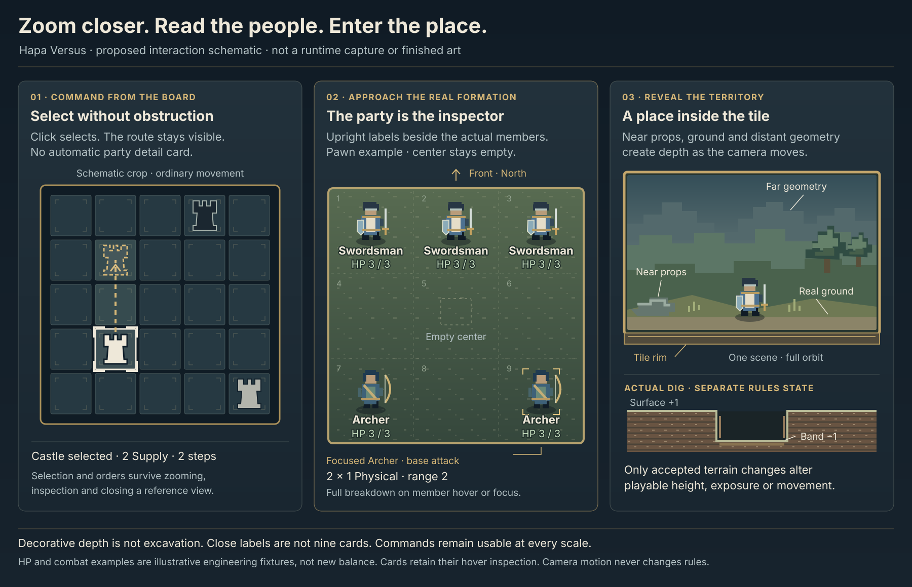

# Human feedback addendum 02 — The battlefield becomes the inspection view

**23 November 2026 · Selected presentation direction from CJ, with explicit implementation defaults.** Applies after [addendum 01](2026-11-22-human-feedback-addendum-01.md). See [review 05](../reviews/2026-11-23-ui-design-review-05.md) for current evidence and [assignment 06](../reviews/2026-11-23-next-agent-assignment-06.md) for delivery order.

## 1. Purpose and authority

CJ's current experience: selecting a party opens a large information Card that covers movement angles. At close zoom, the real members are already large enough to inspect, but their information remains in a separate formation panel. CJ wants the camera approach to reveal each member's type and stats beside the actual figure, and to reveal an environment that feels inhabited, with pixel-world depth and camera parallax inside the territory.

**Selected principle: selecting is for commands; approaching is for understanding. The actual party and its territory become the detail screen.**

This supersedes addendum 01's automatic full-party hover/pin presentation. It preserves large Card hover inspection, contextual definitions, quiet ordinary play, the required decision surface, public intentions, Fire Pit/Mana behavior and the Supply-funded destination policy. It adds no movement, combat, cover, income, terrain or visibility rule. Master Requirements v3 and the current selected profile still govern those facts.

Sections marked **Selected** express CJ's direction or behavior necessary to meet it. Timing, font sizes, focus fitting and technical strategy marked **Working default** may be tuned with evidence. Do not ask CJ to choose pixel thresholds before building the interaction.

## 2. The three reading distances

| Distance / intent | What the player reads | What remains available |
| --- | --- | --- |
| **Overview / ordinary command play** | Chess movement identity, owner, facing, count, meaningful warnings, public endpoint and funded range for the selected party. No automatic composition document. | Select, Supply, move, formation, ability targeting, Orders, Ready, required responses and short reasons for unavailable actions. |
| **Approaching a formation** | The actual members become the composition diagram. Reveal role/type and concise health information as the on-screen space becomes sufficient. Quiet the large crest and heavy ornament. | The same controls, selection and draft orders; public opponent inspection; contextual terms. |
| **Close inspection** | Readable annotations next to individual members, concise combat facts, consequential conditions, local terrain/exposure and environmental detail. One member can reveal a deeper breakdown. | Orbit, tilt, pan, zoom out, return to the prior view, deliberate reference reading and all legal commands. |

These are semantic detail levels, not three mandatory modal screens. The transition should feel continuous. Merely magnifying the existing HUD is insufficient.

### HF2-01 — Separate command selection from information state

**Selected.**

Maintain independent equivalents of:
- command-selected party;
- intentionally inspected party/member or territory;
- transient hover/focus;
- explicitly pinned reference/comparison;
- active command tool.

Clicking a party at normal distance selects it without opening a large inspector or moving the camera. Dismissing information preserves that selection and its orders. Inspecting an opponent does not replace an own party selected for commands.

Use the existing top strip, navigator, Orders, keyboard controls, in-world Card interactions and a small contextual command group. Do not recreate the former permanent inspector to host the relocated actions. Do not make zoom a prerequisite for Supply, movement, formation or ordinary skills.

Keep necessary action information visible at the moment it matters: “Needs a Mount,” inactive column, frozen plan, exact route cost, insufficient Supply, invalidated funding, required response and stale acknowledgment. Long tutorial paragraphs remain in Help or contextual definitions.

### HF2-02 — Preserve Card inspection; change party inspection

**Selected.**

Public Cards still enlarge on hover/focus with their text, resources and actions. No camera approach is required to read a Card. Basin and event explanations remain available.

At overview, a party may show a short identity/state hint. It must not open the full formation/stat/action document merely because the pointer pauses over it.

During ability/Supply targeting, Card dragging and camera dragging, transient inspection must yield to the active interaction. Required response choices still appear deliberately. Existing Card controls must continue to contain their own clicks; do not solve party obstruction by letting clicks pass through active Card buttons.

### HF2-03 — Choose one intentional close-inspection subject

**Selected behavior; working selection defaults.**

Natural wheel/pinch approach over a party or member selects an inspection subject without changing command selection. Reuse the existing F / Focus action to deliberately frame the selected party; provide an equivalent visible and keyboard/touch-accessible control. Panning or zooming toward an opponent can inspect its public facts.

Working defaults:
- Explicit Focus takes priority, followed by the subject under the deliberate zoom gesture; fall back to a visible central subject only when unambiguous.
- Keep the subject stable while the player reads and orbits. Do not switch to another party just because its sprite crosses the pointer.
- Panning clearly away or zooming out releases detailed inspection without altering orders.
- Save the camera pose before an explicit Focus journey and offer a one-step return. Home still means the normal board view.
- Fitting a party should preserve yaw where practical and use the actual rendered height/bounds, with enough surrounding room for labels. A camera angle change must not turn the party.
- Information dismissal, tool cancellation and camera return are separate operations. Escape closes the top information layer first; active tool cancellation and explicit Focus return must remain predictable, without silently deleting accepted/draft orders.

## 3. The actual figures carry their information

### HF2-04 — Use the world formation as the composition view

**Selected.**

Keep each member at its real displayed location. Attach its annotation by stable member ID to the sprite currently shown, including during movement, contact, support, breach and death. Do not spread the formation apart to make labels fit or draw a duplicate group of portraits over it.

At sufficient close distance, each visible member exposes:
1. Role/type and, where available, its actual name.
2. Health in the form the profile really uses.
3. A compact attack/protection summary when space permits.
4. Consequential active conditions.

Show collective facts once at the party/territory edge: Mount/movement family, Supply held and planned, facing, destination, band/exposure and shared pool. Supply is not nine separate resources.

A chess crest remains a movement/party symbol, never an invented ninth member. An empty center remains visibly empty. A member helping another party follows its actual body and retains its home-party identity.

A full nine-member party should reveal nine compact identity/health annotations when properly framed. It must not reveal nine exhaustive stat sheets. Hover/focus on one member expands its combat explanation, source contributions, relevant range/direction visualization and glossary terms.

### HF2-05 — Show truthful, useful statistics

**Selected requirement for correctness.**

The UI must distinguish:
- Current versus maximum member health.
- A shared party health pool versus individual health.
- Base definitions versus applied effects.
- Physical versus Magic channels.
- Front/side/rear/Above/Below coverage where applicable.
- Individual protection versus line/party contribution.
- Conditional attack previews versus guaranteed results.
- Planned versus accepted effects and resource values.

Example using existing engineering content: an Archer's base attack is “2 × 1 Physical; base range 2.” An elevation-aware preview may differ against a particular target. Show the target/context when presenting that adjustment. The fixture Swordsman's shield has directional scope; a single universal shield number would hide the rule.

For the reproduced Bound Standard case, the useful explanation is “Front Physical protection 2: base 1 + Bound Standard 1,” with the correct current profile's scope. Do not substitute an unrelated universal Attack/Defense formula.

Extract shared pure selectors from actual combat logic. Do not create independently calculated values in DOM components, sprites and tooltips. Preserve exact fixed-point arithmetic; format it for humans at the presentation boundary.

During playback, attach facts to the displayed moment. If only final accepted results are available, label them explicitly as results and avoid presenting a future casualty as the current health of a still-living replay body. Prefer a presentation-time member snapshot keyed to actual events.

## 4. Readability and interaction rules

### HF2-06 — Reveal detail when space supports reading

**Selected behavior; working layout defaults.**

Use projected bounds of the actual inspected party and its members in CSS pixels. Include camera pitch, actual height, visible canvas bounds, text scale, open controls and collisions. The current board-center distance heuristic and crest thresholds do not establish readability.

Working defaults:
- Crisp upright text: approximately 14–16 CSS px for core reading at 100% text size, with user scaling honored.
- Consistent entry/exit hysteresis and a short settling interval; no flicker at a threshold.
- Stable label placement rather than per-frame side swapping.
- Expand type/health first, then combat summary when space allows.
- Avoid shrinking text to fit. Collapse less important facts or offer an intentional compact list when space is inadequate.
- A full inspection fit reserves enough space to read the actual formation; extreme foreshortening should expose a fit/reframe affordance.

Use a restrained slate/ink backing or local contrast treatment, short leader lines only where needed, and Hapa typography/material accents. Labels stay sharp outside world bloom and blur. Leave the members and their silhouettes visible.

Passive labels must not introduce large pointer-blocking rectangles. Only intentional controls/definition targets receive input. Wheel/pinch and camera gestures remain usable over passive text. If a deliberate detailed view needs scrolling, its small explicit area may consume scrolling without taking over the surrounding world.

Protect legal target cues and command controls. Do not let a label layout displace the selected destination or hide the target needed by an active action.

### HF2-07 — Preserve world orientation, visibility and accessibility

**Selected.**

- “Front” means the party's actual facing, even when viewed from behind. Keep a restrained facing arrow/ground cue; labels remain upright rather than rotating into the ground.
- Respect selected bands, roofs, occlusion and explicit cutaways. A projected DOM position is not proof that a member is visible.
- Ordinary close zoom is not an automatic x-ray mode. If a member is hidden by the chosen view, provide an intentional visibility cue or accessible roster route without rendering a false body in front of terrain.
- Resolve stacked-party ambiguity explicitly; do not pick a different band silently.
- Preserve ownership with shape/value/label cues, not color alone.
- All detail remains reachable through keyboard and touch equivalents and an explicit compact reading mode. Use the existing navigator where practical.
- Glossary content triggered on hover/focus remains dismissible, pointer-accessible and persistent while being read.
- At 150%/200% text or browser scale, reflow or simplify the annotations; do not clip the only access to a stat or required action.
- Reduced motion removes unnecessary camera easing, drifting decoration and parallax embellishment while retaining depth, state and readable information.

## 5. The territory becomes a window into an inhabited pixel world

### HF2-08 — Keep the board legible while revealing a place

**Selected art direction.**

At a distance, the territory retains its readable frame, alignment and legal grid. Closer in, the interior reveals ground texture, stones, roots, vegetation, ruins, banners or another coherent local environment around the actual party.

The result should feel like approaching a finely made, living Hapa diorama:
- richer brushed-pixel CRPG materials;
- deliberate silhouettes and texture scale;
- warm brass/slate framing;
- restrained color-alignment light;
- lighting, shadow and ground contact that place the figures in the scene.

Close zoom should reveal authored detail, not only enlarge pixels, border glow and a flat beige surface. Reduce heavy grid/ornament emphasis at close range while preserving the readable legal boundary and relevant formation/facing cues.

Camera parallax comes from different depths: near props move more across the view than distant scenery. World features remain in the same place through orbit. A landmark must reveal a plausible side/back or an appropriate directional rendition, rather than always turning its front toward the camera.

### HF2-09 — Scenic depth and gameplay depth remain distinct

**Selected correctness boundary; working rendering approach.**

The “window” describes the visual experience. It does not create a new underground band, teleport a party into another scene or change the scale of a legal step.

Start with one bounded world-space territory environment in the shared scene. The ground stays at its true rules height and the members keep their true positions. Use simple geometry/directional pixel assets for props, suitable billboards for particles, and a constrained scenic backdrop only where its viewing range is honest. Keep neighboring territories and contact strips coherent.

If the base plane must be visually masked or replaced to expose a decorative inset, keep that presentation operation separate from authoritative excavation. The current ground is opaque; placing art behind it alone will not reveal anything.

Do not create ninety independently rendered worlds as the first implementation. A true perspective portal can be investigated later if the working diorama cannot achieve CJ's intended depth. Any engine change follows the Lumina fork workflow; do not edit the vendor checkout.

Decoration must not:
- create collision, cover, impassable terrain, resources or a gameplay landmark without a real rule;
- intercept board picking;
- conceal real open pits, tunnel mouths or selected targets;
- cover the excavation footprint with an opaque scenic floor;
- change mechanical visibility when faded for readability.

### HF2-10 — Digging and enhancement tell the truth visually

**Selected direction implemented against existing state.**

| State | Visual treatment | Required truth |
| --- | --- | --- |
| Planned dig/fill | Clearly marked proposed cut/fill volume; concise cost/work information when inspected. | No hole or reward is treated as completed. |
| Work in progress | Appropriate worker/tool motion, small debris/dust, actual progress cue. | Duration/progress comes from the work state; no fake percentage. |
| Completed open excavation | Real cut face, soil/stone strata, visible floor at its actual band and the correct access geometry. | The surface changes when the accepted terrain change occurs. |
| Roofed tunnel | Tunnel/roof treatment and deliberate viewing cutaway. | Camera closeness does not physically remove the roof or expose the party for income. |
| Raised ground | Coherent mound/rock face, crest and real ramp/cliff treatment. | Movement and elevation remain those in the existing terrain model. |
| Territory enhancement | Local material/emblem/light change plus inspectable source, effect and duration. | No invented bonus; planned and active states differ. |
| Flyer over the scene | Clear ground reference and actual band/height relationship. | It must not appear to stand inside the ground diorama. |

Keep animation focused on the inspected area and useful events. The whole board should not shimmer continuously. Use the existing accepted-event/lifecycle practices so changing view or opening a new match does not replay an old effect.

## 6. Implementation shape and performance

Working approach:
1. Separate inspection state from selection.
2. Extract shared party/member inspection read models.
3. Add a bounded projected label layer using existing anchors and glossary.
4. Extend current camera focus/zoom using actual bounds and heights.
5. Add one bounded territory-dressing layer that respects terrain/cutaway state.
6. Generalize its art recipe only after the interaction and orbit are proven.

Cache and share compatible textures/materials/geometry; simplify distant detail. Update label positions with displayed bodies, but recompute strings only when the underlying facts/context change. Avoid allocating a new DOM tree, texture or render target on every frame. Dispose presentation resources on replacement.

Measure against the same state before and after: interaction latency, zoom-entry stalls, frame CPU/GPU where available, draw calls, textures and DOM/layout work. Report the actual environment and limitations. Vsync-limited frame intervals do not prove rendering headroom.

## 7. Acceptance and contextual decisions

The blocking acceptance cases and delivery order are in assignment 06. No new broad design question needs to block the first implementation.

The next human review should resolve concrete visual choices from a working sample:
- **How much should the board frame recede during close inspection?** The frame currently provides location and game boundaries. Default: keep a thin continuous rim and facing reference while quieting interior grid emphasis; show a stronger-frame alternative only if the first sample loses orientation.
- **How much information should each member show before hover?** CJ wants type and stats visible beside the figures, but nine full sheets would obscure them. Default: role and true health for all visible members, concise combat facts when room permits, one expanded member breakdown at a time.
- **How literal should the “window” become?** A real shallow diorama gives coherent orbit and preserves existing terrain. Default: prove that first; propose a deeper portal effect with a concrete visual comparison only if it fails to feel like a place.

These are understandable review prompts, not cryptic IDs or requests for advance permission.

## References

- Current implementation evidence and exact source links: [review 05](../reviews/2026-11-23-ui-design-review-05.md).
- [Three.js: aligning HTML elements to 3D](https://threejs.org/manual/pages/align-html-elements-to-3d.html) — projection, label overlap, frustum/occlusion and cost considerations.
- [Three.js: CSS2DRenderer](https://threejs.org/docs/pages/CSS2DRenderer.html) — its documented 100% browser/display zoom limitation is a reason to qualify any adoption against the required text-scale behavior.
- [W3C: content on hover or focus](https://www.w3.org/WAI/WCAG22/Understanding/content-on-hover-or-focus.html) — predictable dismissal, persistence and pointer access.

**Design schematic only.** It is not a running-game capture, a finalized art direction or a balance change.

