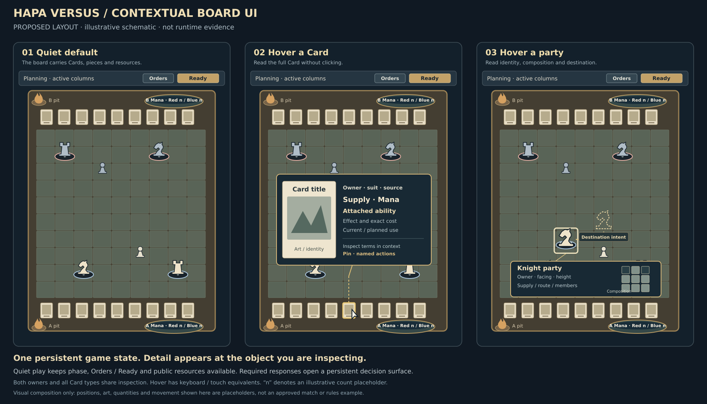

# UI and design review 04 — CJ's contextual-board direction

**22 November 2026 · America/Los_Angeles.** This review combines CJ's latest human feedback with the most recent pushed implementation and check-in. The actionable contract is the [human-feedback addendum](../requirements/2026-11-22-human-feedback-addendum-01.md); the next coding run uses [assignment 05](2026-11-22-next-agent-assignment-05.md).

## Decision

**Make the board the primary place to inspect Cards, parties and Mana. Remove the permanent duplicate hands and large inspector, strengthen chess identity and public destination intent, and enforce CJ's newly selected Supply limit on destination placement.** Use contextual explanation to reduce instructional clutter while keeping active decisions obvious.

This supersedes my previous provisional recommendation to retain the permanent HUD. The previous work still supplies useful content, command paths, state distinctions and correctness protections; those should move into the new interaction system. The former standalone terrain/party beauty study now supports a more concrete goal: a complete Card → party → funded destination → Fire Pit → Mana → ability journey in the game environment.

## What is actually checked in

At this review's repository check, `main` was **`a388bcf9b56fb873eec5862d32fc5dbaaeb092d0`**, our prior review publication. GitHub listed only `main`, no open pull requests, and no implementation response 05. The latest implementation/check-in therefore remains **`164b8dfe46d2b6b8ec0975cc8f53ea5428770230`**, [implementation response 04](2026-11-22-ui-design-response-04.md), with response 03's parallel work included. Engine gitlink remains **`ba838cca09ba43afceda0452b63d28df4cbf7f72`**.

There is no new pushed repair or art scene to credit as completed. Local unpublished progress may exist and must be inspected by the coding agent before acting. This review does not claim access to that checkout or to current Overwatch state.

The [previous independent verification](evidence/2026-11-22/review-03/README.md) remains applicable to the unchanged code: 82 existing tests passed; two controller/rules defects were reproduced; modal focus was a source-supported risk. Those tests were not rerun merely to repeat a result. Response 04's 86-test check and 282 browser assertions remain the implementation author's evidence. This turn adds source/specification analysis and a small actual-rules observation of the current destination policy; it has no fresh running-browser capture. [Current review evidence](evidence/2026-11-22/review-04/README.md)

## What CJ's feedback changes

| Human observation | New implementation direction | What must survive the layout change |
| --- | --- | --- |
| Supply Cards appear on the board and again below it; inspecting them is too effortful. | Board banks become the permanent Card surface. Any public Card opens a large, readable anchored view on hover/focus. | Every Card type/owner, exact identity/resources/effects, lineage, public slot mapping, drag and named actions. |
| The right information column becomes unnecessary once the rules are familiar. | Party composition and details appear contextually; pin only when needed. Collapse the roster by default. | Actual 3×3 slots, member contributions, facing, height/exposure, current/planned resources and usable actions. |
| Small icons prevent the board reading as chess. | Strong recognizable chess standards adapt to zoom, with stable owner/facing cues. Hollow endpoint versions identify every public party's destination. | Real member count/occupancy, empty-center semantics, terrain/layer visibility and world-facing. |
| Destination placement should stop at the Supply limit. | New ordinary destinations require enough assigned Supply for the entire remaining legal route. | Speed/time distinction, continuous debit, interruptions/persistence, explicit free-movement exceptions and old replay compatibility. |
| Mana pools look like an admin dashboard. | Each owner gets a Fire Pit and Mana basin integrated into the board frame, with exact attached counters. | Actual versus planned amounts, multi-color/Rainbow accounting, exclusive Card use, payment/expiration timing and both public pools. |
| Teaching should happen at the relevant term/stat/skill. | One glossary/explanation system reused throughout contextual views and actions. | Required responses, stale-plan acknowledgment, targeting state and Ready remain immediately discoverable. |

**Schematic, not runtime or finished art.** It illustrates quiet play, Card inspection and party inspection. The bank drawing is simplified; the actual camera/access contract includes Minor, Major and row-Enchantment banks for both owners. Symbols illustrate overview identity; actual party members remain part of the scene. Positions, movement and quantities here are placeholders, not a gameplay example.

## Findings and implementation implications

### R4-01 — Removing the ribbons requires making the real Card banks accessible

**P1 integration requirement.** The board already renders/picks Card instances for both owners and all three bank families. However, `BoardView.subject` explicitly excludes banks because the duplicate ribbons expose those Cards. Hiding CSS rows without changing that fit would leave the primary Card interface outside the default framing. `_onHover` also currently records territory hover rather than opening Card/party inspection. [Board source][board] · [Controller source][app]

Implement the shared inspection/selection identity first; fit the actual field/banks/resource objects in the reclaimed viewport; then remove the permanent duplicate surfaces. Check far-bank target acquisition, both seats, complete orbit and zoomed/offscreen navigation. Hover enlargement solves reading, while hit-target/framing work makes the Card reachable.

A sharp DOM view projected from a world anchor can look integrated while keeping text readable. Allow the pointer into it, optional pin/compare and equivalent focus/tap entry. Keep hover, selection, pin and command state distinct. This follows the content-on-hover requirement for predictable dismissal, persistence and pointer access, without opening a focus-stealing modal on hover. [W3C hover/focus guidance](https://www.w3.org/WAI/WCAG22/Understanding/content-on-hover-or-focus.html)

### R4-02 — The endpoint limit is a new selected rule policy

**P1 gameplay amendment.** V3 chapter 6 and Appendix A permit starting a longer route with partial Supply, pausing before arrival and retaining the destination. The code implements that policy. An actual-rules observation confirms that a Castle with zero or two Supply can currently store a four-step destination, and a Knight with two Supply can store its three-step L target. This is not a defect against the old specification. [Observation](evidence/2026-11-22/review-04/current-policy-observation.json) · [Movement source][movement] · [Validation source][match]

The new contract is explicit in addendum section 6: newly placed/replaced destinations must fund the full remaining route from held Supply plus valid preceding planned loads. Preserve Speed as rate, actual-distance spending, later interruptions and already accepted goals. Removing a funding Card invalidates the dependent draft visibly and blocks Ready until repaired; do not silently move the marker or drop an order.

Four integration details matter:

- The bot currently emits moves before its Supply loads. It must plan those dependencies in valid order under the same validator as the human.
- Replacement planning from the next route node omits the unfinished current edge in the simple route cost. Include that prefix/backtrack and exact fractional allowance.
- Configurable Knight route cost and the simulation's distance-based debit can diverge outside baseline prices. Preview, acceptance and actual debit need one consistent quote.
- `setDestination` is also used for automatic free pursuit. Preserve that explicit exception instead of putting an unconditional funding gate into every internal call.

Version the new default policy and dispatch old replay behavior honestly. A new version string alone does not keep a historical partial-Supply replay reproducible. [Bot][bot] · [Replay/session][session]

### R4-03 — Chess identity must explain the party without replacing its truth

**P1 design requirement from CJ.** The current Mount symbol is a small flat plaque beside the formation; Pawns have none. Only the selected party has a route line. The new visual vocabulary must work when several parties move at once. [Board marker/route implementation][board]

At overview, give every party a large stable movement silhouette plus owner/facing/count cues. At closer distance, prioritize actual members and formation. Hover softens overlapping decoration and opens composition. Keep the crest independent of a possibly empty center slot; it is not an additional unit. Do not use Mana color as the sole ownership signal.

Give each current/planned destination the same piece identity in a hollow intent style. Connect the selected/hovered pair; keep other paths quiet. Stack/fan coincident targets with named identities and bands. Public opponent intentions remain inspectable. Arrival, merging, death, a rejected replacement and a retained paused goal must each reconcile the marker with the actual state.

### R4-04 — The Fire Pit must teach conversion without faking resources

**P1 interaction requirement; P2 material/effect refinement.** Reuse the existing Card drag/command path, replacing the `#resources` target with the owner's world Fire Pit. A drop during planning queues a burn; the Card should rest as a ghost offering until accepted. Flame, streams and pool changes follow accepted events. Both owners' exact per-color counts remain public and readable. [Card drag][drag] · [Resource events][match]

The old `_plannedPool` only adds explicit burns and does not subtract planned payments. It cannot become the new “available after this plan” counter unchanged. Derive the projection from valid ordered commands and shared payment logic. Keep actual amounts separate from forecast amounts, including during a response.

Use `card_burned`, `mana_paid`, `mana_expired` and event identity to drive truthful, nonduplicated cosmetics. A multi-color burn produces distinct streams; Rainbow remains its own resource until assigned in payment. Zero-Mana Cards remain zero: the current rules permit burning them, and the UI must disclose that consumption without a gain animation. Reduced motion preserves exact state with quiet static cues.

### R4-05 — Contextual explanations need shared definitions and action-time information

**P1 design/content requirement.** Replace always-on tutorial paragraphs with reusable term/skill/stat explanations. Use installed rules/profile/content as the source. Keep exact modifier breakdowns and lineage reachable. The Card and party views must not become independent copies of the same definitions or introduce generated rules text on every hover.

Keep brief action-state explanations when needed: why a party cannot move, what a Card would sacrifice, the selected route's cost, why Ready is blocked, and what Pass allows to happen. Required responses and changed-plan review open deliberately; they cannot disappear into hover-only discovery. The addendum specifies the interaction states, content hierarchy and non-pointer route in full.

### R4-06 — Prior reliability findings remain relevant to this redesign

**Carry forward, inspect local status first.** No pushed response resolves review 03's three findings yet:

- R3-01: mixed-color response affordability can count Rainbow twice and offer an invalid counter.
- R3-02: New match can retain old response/async work and contaminate the replacement session/replay.
- R3-03: modal sheets have initial focus but no complete focus/background containment.

These are directly relevant to the Fire Pit's payment projection, transient view lifecycle and required decision surfaces. Complete or verify those narrow repairs while establishing the new UI foundation. Preserve their evidence, and do not reimplement local fixes if the agent has already made them. Keep phase-independent concession as the existing separate protocol follow-up.

## What the next run should accomplish

Use separable commits with an end-to-end checkpoint after each substantial step:

1. Reconcile local progress and retain/finish the three reliability repairs.
2. Build shared contextual inspection and bank-aware camera/access, then reclaim the permanent hand/inspector/resource space.
3. Implement strong chess identities, the versioned Supply-funded endpoint rule and public destination markers across every input path/controller.
4. Integrate Fire Pits, exact Mana basins, planned/accepted conversion and payment/expiration effects.
5. Complete the glossary coverage and apply the richer Hapa material/party treatment to that working interaction scene.

The next report is **response 05 if that filename remains unused**. If local response 05 already exists, preserve it and choose the next unused response number, explicitly naming review 04/addendum/assignment 05. The board remains canonical; append evidence and preserve CJ's acceptance role. There is no new broad design question blocking these documented working defaults.

[app]: https://github.com/calderwong/hapa-verseUs-prototype/blob/164b8dfe46d2b6b8ec0975cc8f53ea5428770230/src/hapa/presentation/app.js
[board]: https://github.com/calderwong/hapa-verseUs-prototype/blob/164b8dfe46d2b6b8ec0975cc8f53ea5428770230/src/hapa/presentation/board-view.js
[movement]: https://github.com/calderwong/hapa-verseUs-prototype/blob/164b8dfe46d2b6b8ec0975cc8f53ea5428770230/src/hapa/rules/movement.js
[match]: https://github.com/calderwong/hapa-verseUs-prototype/blob/164b8dfe46d2b6b8ec0975cc8f53ea5428770230/src/hapa/rules/match.js
[bot]: https://github.com/calderwong/hapa-verseUs-prototype/blob/164b8dfe46d2b6b8ec0975cc8f53ea5428770230/src/hapa/controllers/heuristic-bot.js
[session]: https://github.com/calderwong/hapa-verseUs-prototype/blob/164b8dfe46d2b6b8ec0975cc8f53ea5428770230/src/hapa/rules/session.js
[drag]: https://github.com/calderwong/hapa-verseUs-prototype/blob/164b8dfe46d2b6b8ec0975cc8f53ea5428770230/src/hapa/presentation/card-drag.js
