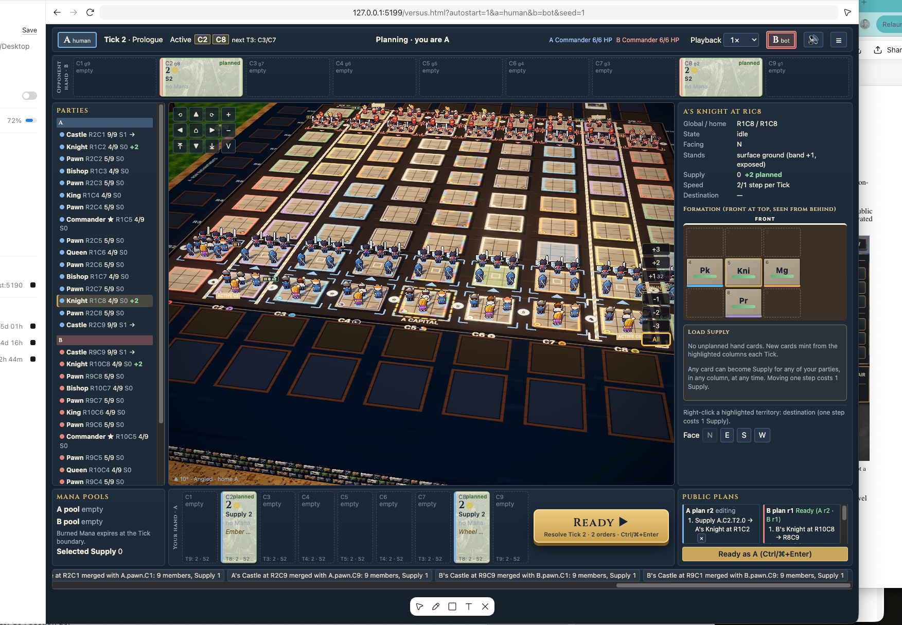

# UI and design review — 22 November 2026

## Read this first

This review combines CJ's prototype screenshot, the independent first-impression design feedback, and the subsequent source review of both private repositories. It is a handoff for a local coding agent and a durable reference for the next review.

**Recommended next iteration:** make the existing spatial selection, public planning, Card identity, and screen composition agree with one another. Preserve the useful implementation already present. Begin by reproducing the interaction risks, then improve the most important player journey in small, reviewable changes.

**Evidence scope:** the reviewer inspected the screenshot and committed source. The reviewer did not launch this application, run its tests, observe hover or motion, or verify the visual quality of a revised build. Source traces below identify specific risks; their exact runtime consequences remain to be reproduced. No finding in this document means that a fix has been implemented or accepted.

**Freshness:** review baseline is prototype main at **af6977d295dd0970a744bb65281f7ec4ea8c1457** and engine hapa at **ba838cca09ba43afceda0452b63d28df4cbf7f72**. The prototype's vendor/lumina gitlink matches that engine commit. Both heads were checked again before preparing this handoff and were unchanged. Compare current local and remote work before applying any recommendation. Newer fixes or unpushed local changes may change a finding.

**Authority:** Master Requirements v3 governs gameplay; Design Companion v1 proposes presentation; References Master v1 supplies implementation advice. This review adds observations, implementation findings, and recommended visual trials. It does not silently change Card economics, public information, movement, terrain legality, or agreement semantics. CJ's latest instructions govern priorities and scope. The Overwatch board **hapa-versus** remains the canonical task tracker; this document is not a second board. CJ accepts work as Done.

See [review workflow](README.md), [implementation report template](IMPLEMENTATION_REPORT_TEMPLATE.md), [repository guidance](../../AGENTS.md), and [requirements](../requirements/master-requirements-v3.txt).

## Original screenshot and provenance

The image above is the unmodified screenshot supplied by CJ, copied to a stable filename. Browser/document-viewer chrome surrounding the game is not part of the UI critique.

- Original name: Screenshot 2026-11-22 at 1.11.45 PM.png (the uploaded filename uses a narrow nonbreaking space before PM).
- Original bytes: **2,056,758**.
- SHA-256: **2340165f3fb663bbe8f9182bf8eace8ab7445b38471775577b513172e5044d65**.
- Visible scenario: local Human A versus Bot B, seed 1, Tick 2 / Prologue, active columns C2 and C8, selected A Knight at R1C8.
- The URL is a local development URL. The screenshot alone does not establish the exact running commit, CSS viewport, device pixel ratio, camera pitch, input behavior, or asset-index revision.
- Camera text showing 10 degrees reports **bearing/yaw**, not elevation. Do not infer a 10-degree pitch from this image.
- Pushed source and locally synced Tarot image bytes are separate evidence. The latter are intentionally outside the repository.

## First impression: what to preserve and what to improve

The screenshot presents a recognizable miniature battlefield inside a dense development-style interface. The board and the player's current decision need greater visual priority.

Preserve these strengths:

1. Several small members sharing a territory make the party concept tangible and distinctive.
2. Opposing armies are easy to recognize at first glance.
3. The local 3×3 formation inspector is a useful explanation of the party system.
4. A prospective Supply change is already visible as a planned value.
5. Public plans, resource state, coordinates, and history support explanation and verification.
6. Warm board surfaces, slate structure, and brass accents provide a coherent starting palette.

The screen gives similarly strong framing to the roster, inspector, two banks, resources, plans, history, camera controls, and layer controls. The prominent Ready button, pale formation cells, and dense roster compete with the battlefield. Bright owner brackets compete with selection. The foreground reserve area consumes substantial visual space while the far army is compressed. Cards are narrow and pale, and ability names truncate. These are screenshot observations, not proof that the underlying features are absent.

The intended direction is **a ceremonial table containing a living landscape**: tactile terrain, expressive miniature parties, recognizable Cards, luminous but bounded alignment effects, and exact tactical information. Carry forward the Companion's brushed-pixel/comic direction. Faces, Card illustration, and typography need clarity at their actual display sizes.

### Corrections after inspecting the code

| Initial concern | What already exists | Revised instruction |
| --- | --- | --- |
| Camera readability and discoverability | 56-degree home elevation, 84-degree tactical view, orbit, tilt, pan, cursor zoom, focus and home | Improve subject framing and discoverability; evaluate the existing modes |
| Card-to-party meaning | Drag preview with current/planned/resulting Supply, valid targets, travel estimate, opportunity cost and timing explanation | Make the existing journey easier to discover and keep its meaning visible after drop |
| Ownership and party identity | Single/double brackets, disc/ring bases, facing arrows, Mount crests and Commander identification | Tune their relative emphasis and tactical-distance legibility |
| Terrain depth | Hills, ramps, open pits, roofed passages, flyers, height filtering and automatic underground cutaway | Verify picking/visibility and improve the schematic material treatment |
| Hapa Card art | Optional Avatar Builder Tarot Deck integration with suit/rank lookup and attribution | Improve presentation and make the art fixture reproducible for review |
| Effects and sound | Selection/drop effects, Supply feedback, event effects, sound and partial reduced-motion behavior | Separate planned versus completed meaning and complete the relevant accessibility paths |

Sources: [camera][camera], [Card dragging][drag], [markers][markers], [terrain][terrain], [renditions][renditions], [art sync][art-sync].

## Priorities and finding index

P0 means reproduce and address an interaction-contract or spatial-trust risk first. P1 means the next usability and comprehension pass. P2 means bounded art-direction work after those foundations are stable. These are sequencing recommendations, not new launch gates. Carry deferred work forward visibly.

| ID | Priority | Finding | Initial evidence |
| --- | --- | --- | --- |
| UX-01 | P0 | A frozen own plan can become editable when Ready is stale in the local UI | Static reachable path; browser reproduction required |
| UX-02 | P0 | Ready keyboard shortcut can re-enter resolution during a response pause | Static reachable path; exact consequence untested |
| UX-03 | P0 | Picking and tactical overlays assume the original flat ground | Source implementation; elevated/covered cases need browser checks |
| UX-04 | P0 | Decorative ground may obscure the deeper playable volume | Source geometry/material relationship; visual reproduction required |
| UX-05 | P1 | Opposing Card ribbons reverse physical-column order and use different column centers | Screenshot, source and Companion comparison |
| UX-06 | P1 | Fixed HUD regions and duplicate Ready controls compress the decision space | Screenshot and source |
| UX-07 | P1 | Home-camera framing favors near reserves and does not fit the tactical subject to viewport | Screenshot and source |
| UX-08 | P1 | Card anatomy and artwork presentation vary across hand, drag, bank and inspector | Screenshot and source |
| UX-09 | P1 | Planned Supply and resolved Supply use similar completion feedback | Source; player interpretation needs observation |
| UX-10 | P1 | Persistent owner markers compete with selection and activation | Screenshot and source |
| UX-11 | P2 | Terrain needs a coherent physical material and action vocabulary | Screenshot, schematic renderer and design recommendation |
| UX-12 | P2 | Party art and collectible renditions need a controlled identity/orbit trial | Source hooks and design recommendation |
| UX-13 | P1 | Primary labels, action discovery and explanations need a player-oriented hierarchy | Screenshot, source and Companion comparison |
| UX-14 | P1 | Keyboard, enlarged text and reduced-motion behavior need journey-level verification | Partial implementation visible in source; browser checks required |

## UX-01 — Keep the player's own plan frozen after Ready

**Context.** Ready has two related meanings: the player's own orders become frozen, and the player acknowledges a particular pair of public plans. If the opponent changes their plan, only the acknowledgment becomes stale. The player's own orders must remain frozen.

**Finding.** PhaseAgreement.receive() rejects plan edits after that seat has a Ready record. Its test explicitly covers the opponent changing their plan. The local application maintains another readiness mechanism. _setPlan() has no own-plan freeze guard; _addCommand() routes into it; the visible plan-delete control remains available for the current human while playback is absent. Card dragging also lacks the same freeze boundary.

**Reproduction inferred from source.** Start Human versus Human. A queues an order and presses Ready. B changes its plan and presses Ready. The interface returns to A because A's acknowledgment is stale. Attempt to delete A's earlier order with its visible × control or add another order.

**Recommended change.** Use one shared interpretation of agreement state at the command-mutation boundary and in every input affordance. Reuse the existing agreement semantics. Show “Your plan is frozen. Review the opponent's changes” and “Acknowledge updated plan.” The user must still be able to inspect both plans. Do not add an Unready action that reopens orders without a separately defined protocol change.

**Acceptance.** A's command list and own plan revision stay unchanged after first Ready. Only acknowledgment of the revised pair changes. Clicking, dragging, shortcuts, Supply buttons and delete controls obey the same rule. Record the before/after plan revisions and commands.

Sources: [local plan/Ready code][app-ready], [plan controls][app-plan], [protocol freeze][agreement], [existing protocol test][protocol-test], [Companion Ready semantics][companion-ready].

## UX-02 — Prevent Ready from starting a second resolution during a response

**Context.** A human spell response is an intentional pause inside resolution. Normal planning and Ready input must not start another resolution while that response awaits a choice.

**Finding.** The visible Ready buttons disable themselves for pendingChoice. Ctrl/Command+Enter directly calls _pressReady(), which checks playback and outcome but does not share the pending-response guard. _tryResolve() checks current Ready pairs without an in-progress latch. The response is awaited before playback begins; the original Ready pair can still be current. The rules generator does not independently reject this re-entry at its entry point. The source establishes a re-entry path; resulting state changes have not been observed in a browser.

**Recommended change.** Centralize allowed actions by phase for buttons, shortcuts, plan edits and drag actions. Add a single-resolution guard with reliable cleanup. Keep required response controls available while normal Ready and plan mutation are blocked.

**Acceptance.** Open a human response window and repeatedly press the Ready shortcut, including while holding the key. No second resolution begins and no duplicate events, consumption or Tick advancement occur. Responding or passing resumes exactly one sequence. Compare resulting replay/state with the same sequence without extra key presses.

Sources: [keyboard entry][app-keys], [Ready/resolution entry][app-ready], [response pause][app-response], [rules generator][resolve-tick].

## UX-03 — Make selection, targeting and overlays agree with visible height

**Context.** The same horizontal territory can contain raised terrain, flyers or underground occupants. Players should select the thing they can see and understand the surface to which an action applies.

**Finding.** BoardView.pick() intersects only the original ground mesh, converts that point to board XY, and chooses nearby living members/parties by horizontal coordinates. It does not consult band, selected layer or sprite visibility. The app calls this directly for selection and targeting. Automatic cutaway occurs after a party has been chosen; it does not correct the original pick. Selection, destination, hover and route overlays also use constant world heights near zero.

**Recommended change.** Establish presentation-level pick proxies or surface queries carrying stable member, party, territory and band identities. Resolve ambiguous stacked targets deliberately. Use the same surface/height information for selection, hover, routes, legal-destination fills and target feedback. Camera focus on a selected elevated/underground subject should consider its visible height. These presentation queries must not become a replacement for authoritative rules collision.

**Acceptance.** Use the terrain fixture and a controlled case with occupants sharing horizontal space on different bands. From home, tactical and rotated views, select the intended flyer and covered member. Hidden layers must not silently win the selection. Markers and routes sit on the meaningful surfaces and remain readable. Record selected IDs, bands and camera states, not just a successful-looking screenshot.

Sources: [picker and overlays][pick], [app pointer flow][app-pointer], [camera focus][camera], [terrain fixture][fixtures].

## UX-04 — Keep decorative scenery outside the visible excavation volume

**Context.** A decorative meadow should frame the board without covering its playable underground spaces.

**Finding.** scenery.js draws a meadow and path across the board footprint around world Y −1.6. Terrain bands −2 and −3 have floor heights −1.8 and −2.7. The cutaway changes the board/hill materials without changing those decorative planes. This creates a plausible occlusion conflict. It is a source-based hypothesis until the exact scene is viewed.

**Recommended change.** Reproduce the deep cutaway with scenery enabled and disabled. If confirmed, exclude the excavation footprint from opaque decorative planes or make those planes participate in the same cutaway policy. Preserve the decorative environment outside that footprint.

**Acceptance.** The existing −2 tunnel fixture and a −3 inspection case show the intended floors and occupants without decorative ground hiding them. Compare the same camera and layer settings with scenery enabled/disabled. Turning scenery or cutaway on/off changes no rules state.

Sources: [scenery planes][scenery], [band heights and cutaway][terrain], [fixture][fixtures].

## UX-05 — Align both public banks to the same physical columns

**Context.** The interface teaches territory → column → Card. Comparing the two players' resources is easier when corresponding physical columns line up. A player's home-relative column alias is a label; it does not change the physical territory.

**Finding.** _renderHand() iterates local columns 1–9 separately for each owning seat. With A viewing, the own ribbon runs global 1–9 and the opponent ribbon global 9–1. The screenshot's opponent C1/global9 label reflects this. No CSS reversal compensates. The Companion specifies the same physical-column comparison order for both ribbons. Their grid centers also differ: the opponent spans the full layout while the own ribbon shares its center region with the large Ready button.

**Recommended change.** Derive both ribbons' physical sequence from the controlling viewSeat. Display owner-relative aliases and global addresses where needed. Align the nine physical-column centers, or provide an equally explicit comparison cue in a responsive layout. Treat world-bank Cards and ribbon Cards as views of the same instances. Add a restrained hover/focus association to the source bank and column.

**Acceptance.** For viewer A and viewer B, each corresponding ribbon position refers to the same global column. Own-hand number keys 1–9 still select fixed home positions. Orbiting does not reorder the bank under the pointer. The opponent's complete public Card information remains inspectable.

Sources: [hand mapping][app-hand], [CSS layout][css-layout], [Companion identity/order][companion-layout].

## UX-06 — Give the battlefield and current decision more usable screen space

**Context.** The screenshot shows the roster, inspector, two banks, resources, plans, history, camera and layer controls at once. Most receive similarly strong boxes and borders. The large Ready control and bright formation cells draw attention while important battlefield content remains small.

**Finding.** The layout uses fixed 220/340-pixel side columns and fixed 48/86/150/40-pixel supporting rows. Nine own-hand slots divide the width left after a large Ready button. The second Ready button invokes the same method. The narrow breakpoint hides the roster and collapses its grid column, which also contains resources; verify that the Mana information and Burn drop target remain usable. Small body labels and truncated Cards are being used to fit the density.

**Recommended change.** Reserve a readable hand area and one primary Ready action. Organize information into:

- Always available at a glance: current phase/activation, participant/Commander condition, essential resources, agreement status and required action.
- Contextual: selected party/member/Card, available actions, prospective changes and plan differences.
- Expandable detail: full roster, raw IDs/revisions, deep history and extended rule explanations.

Collapse the roster into an accessible drawer before compressing the battlefield. Make the inspector deliberate at smaller widths. Preserve access to all nine bank slots and public plans. Keep resources and required response buttons reachable. Use an explicit text-size/reflow policy.

**Design responsibility.** The original Companion's eight-region layout was a reference proposal. The implementation follows much of its zoning, while its intended responsive and readability behavior remains incomplete. Use the live prototype to refine the proposal.

**Acceptance.** Review the same scenario at 1600×1000, 1280×720 and the user's actual window, plus enlarged UI text. No critical action or Mana drop target is clipped or reduced to an unusable strip. Empty banks are quiet but identifiable. One primary Ready control describes the current action. Detailed information remains discoverable.

Sources: [grid and breakpoint][css-layout], [Card grid][css-cards], [Ready duplication][app-plan], [Companion responsive guidance][companion-layout].

## UX-07 — Fit the tactical subject to the available viewport

**Context.** The screenshot devotes considerable space to empty near reserves and dark foreground while the opposing army is crowded at the far edge.

**Finding.** The camera already has a 56-degree home elevation and 84-degree tactical view. home() shifts focus 7% of board size toward the near bank and uses a fixed distance multiplier. It does not fit a declared tactical subject to the viewport aspect ratio. The painted surface includes twelve member-widths of margin at each end and six at each side. The screenshot's 10-degree readout is bearing. Its actual pitch cannot be recovered from the still image alone. Depth of field is already disabled by the app.

**Recommended change.** Define the default subject as playable territory plus a deliberate reserve allowance. Fit that subject within the actual available viewport, including panel/layout changes. Compare neutral centering with the current near-bank bias. Keep orbit, focus, home and tactical controls; make their purpose recognizable. Avoid treating a default-pitch adjustment as a complete framing solution.

**Acceptance.** From each seat's home view, identify and select a specified near and far party. Repeat after resizing and opening/closing contextual UI. A full orbit preserves world identity/facing and has a dependable return home. The selected party remains understandable in tactical view, where footprint/role treatment may carry more information than an upright sprite.

Sources: [camera][camera], [board margins][ground], [app rendering settings][app-engine].

## UX-08 — Establish one recognizable Card anatomy across every view

**Context.** Cards should be readable tactical objects and desirable Hapa artifacts. The screenshot shows pale artwork, narrow faces and ellipsized names. The same Card should remain recognizable in a bank, during drag, and in inspection.

**Finding.** Final hand CSS applies 22% artwork opacity behind text. Ability titles use a single-line ellipsis. _renderHand() draws HTML tiles; drawCardCanvas() uses a distinct canvas design for dragging/world banks; _cardPanel() combines text with a small art-credit image. The compact opponent face omits the visible ability label, though inspection/title exposes information. Local art lookup is suit/rank-based and can accompany different attached ability definitions.

**Recommended change.** Define compact, normal and inspection variants with shared suit/rank, resource, ability and owner identity. Put artwork in a bounded region and text on deliberate readable surfaces. Expose the full name/ability through selection and keyboard focus. Preserve exact Mana quantities and distinguish an actual zero from compact overflow. Keep Tarot face identity separate from attached gameplay ability identity. Retain attribution and inspectable provenance.

**Acceptance.** Follow one Card through its own bank, opponent inspection, world bank, drag and detail view. Its identity and quantities remain consistent. Rich art is visible without obscuring the decision. Missing local art produces an intentional fallback. Record the actual rendition index and image hashes used for visual review.

Sources: [Card CSS][css-cards], [final art treatment][css-art], [hand][app-hand], [canvas renderer][card-canvas], [inspector][card-panel], [rendition pipeline][renditions].

## UX-09 — Give planned actions and completed actions different feedback

**Context.** Planning should feel responsive while making clear that a proposed resource change has not yet resolved.

**Finding.** A successful Supply drag calls fx.supply with a +Supply label, burst and coin sound during planning. Playback calls the same effect for the authoritative supply_loaded event. Text distinguishes them, but the similar celebration may imply completion twice.

**Recommended change.** Use a restrained placement cue for planning: a persistent reserved-use label such as “Supply → Knight C8,” a dashed/queued relationship and “+2 planned.” Reserve the stronger landing effect and confirmed total for the resolved event. Cancellation removes only the proposed relationship. Apply the same timing vocabulary to Burns, spells, digging and persistent effects.

**Acceptance.** Before input, after planning and after resolution, a reviewer can name the same Card, recipient, cost and timing. A planned Card is not visually represented as irreversibly resolved. The completed event is distinct and appears once. Compare motion and reduced-motion variants.

Sources: [drop feedback][drag], [resolved Supply event][supply-event], [effects][fx].

## UX-10 — Tune the existing visual vocabulary before adding more markers

**Context.** Ownership, alignment, activation, selection, legal destinations and queued orders are different facts. Red/Blue also have alignment meanings, so ownership must remain recognizable through redundant shapes.

**Finding.** Owner A/B already uses single/double brackets and disc/ring member bases. Mount crests, facing arrows, empty-center markers, helper/breach markers and planned Supply tokens also exist. Persistent party brackets use high opacity; their structure competes with the selected-party treatment in the screenshot.

**Recommended change.** Make ownership a quiet persistent baseline; reserve the strongest outline for selection. Let active-column markers communicate the current opportunity without washing out terrain. Show destination markers during the relevant action and a distinct path/endpoint for proposed travel. Keep alignment in a consistent strip/emblem location. Retain the existing shape redundancy and improve crest legibility at overview distance.

**Acceptance.** At ordinary play distance, identify owner, party movement role, facing, active column, selection and planned destination without consulting the roster for every fact. Repeat with reduced color distinction and a rotated camera. An effect's visible footprint and source remain explainable.

Sources: [party markers][markers], [selection overlays][pick], [alignment emblems][palette].

## UX-11 — Make terrain, digging and enhancement feel physically coherent

**Context.** The screenshot reads as inset pads on a dark platform. The intended cubic battlefield should make earth, support, depth and manipulated territory tangible.

**Finding.** Terrain support exists, but its visual construction is schematic: box-like hills, plank ramps, inward-facing pit geometry, surface patches/dashed edges for covered passages, and a painted base plane. A material pass is justified after selection and cutaway behavior are dependable.

**Recommended change.** Build one art-quality scene with ordinary ground, raised territory, a trench and a roofed passage. Establish thickness, strata, cut edges, contact shadows and a shared surface treatment. Preserve grid/formation-slot readability on altered surfaces.

For digging, show the proposed affected volume, work underway, and the completed void/support state as distinct stages. For enhancements, connect source → affected surface/entity → pending/resolved state → inspectable result. Row, column, bound-party and terrain effects need different bounded treatments. Use alignment color with a glyph or pattern. Do not encode an unapproved bonus, duration, collapse rule or mining reward through art.

**Acceptance.** A reviewer can distinguish exposed ground from covered occupation, trace an enhancement to its source, and state which tiles/surfaces it affects from both sides of the board. Cosmetics and cutaway do not change the state digest. Any new playable enhancement receives an explicit versioned definition and fixture before its art promises a mechanical effect.

Sources: [terrain renderer][terrain], [scenery][scenery], [design authority](../requirements/design-companion-v1.txt), [mechanical authority](../requirements/master-requirements-v3.txt).

## UX-12 — Prove one Hapa party and rendition through a full camera orbit

**Context.** The miniature groups are a strength. Their role, ownership, facing and meaningful footprint must remain understandable as art becomes richer.

**Finding.** Procedural characters are already adapted by archetype, Mount and owner. gear.js adds visible equipment; its placement attempts to preserve anatomical shield/weapon sides through facing changes. These hooks are useful but do not establish that every view and animation is visually correct.

**Recommended change.** Art-direct one asymmetric party with a shield bearer and ranged member, then inspect front/back/opposed views and animation transitions. Compare source-detail density with actual overview scale. Use shared role/facing cues and a deliberate distant representation where needed. Develop the Hapa character/material treatment on this slice before scaling the roster.

Collectible variations may change costume, portrait and materials while preserving recognizable role, owner, facing, source effect and exact meaningful boundary. Record source attribution, rendition identity, scale, anchors, allowed mirroring and view convention. Keep production art with its owner; do not bulk-copy another project's media to this repository.

**Acceptance.** Full orbit and animation transitions produce no unexplained hand swaps, foot jumps or misleading apparent target area. Base and expressive variants show the same recorded action and rule outcome. Capture the actual asset provenance used.

Sources: [equipment][gear], [board character setup][board], [renditions][renditions], [repository ownership](../../AGENTS.md).

## UX-13 — Present the next decision in plain language and teach through inspection

**Context.** The screen asks a newcomer to decode R1C8, 4/9, S0, role abbreviations, coordinate pairs and plan revisions at once. Exact identifiers are useful, but identity and decision should lead.

**Recommended change.** Lead with “Knight,” owner and current state; place exact coordinates and raw IDs in a consistent detail layer. Use explanations such as “4 members · capacity 9” and “Supply 0 → 2 planned” where they aid interpretation. Pair role icons with full names. Distinguish world-facing from camera-up in the formation view.

Make the existing drag interaction discoverable through a first-use invitation and a labeled alternative. Keep fast right-click staging while exposing Move and its prospective route through the UI. Public plans should explain added/removed/changed orders in ordinary language while preserving exact revision details. Participant identity and Commander condition should establish the match's stakes more clearly than A/B test labels alone.

Use event inspection/replay to explain causes: the originating Card, resource change, affected party, incoming face or territory frontier. Keep full history available without making a horizontal debug strip the primary teaching surface.

**Acceptance.** A first-time player can answer “What is active? What have I selected? What can I do? What will Ready commit or acknowledge?” Then they can explain one resolved action through inspection. Camera rotation never changes the party's actual facing or the player's identity.

Sources: [inspector and actions][inspector], [input flow][app-pointer], [match bar and history][app-summary], [Companion](../requirements/design-companion-v1.txt).

## UX-14 — Verify the same journey with keyboard, larger text and reduced motion

**Context.** Readability and control are part of the intended experience. A shortcut or CSS media query alone is not evidence that a whole journey works.

**Finding.** Several controls have labels/focus styling and there are reduced-motion paths for Card flight/return, effects, hover and Ready animation. Some selectable roster/Card/formation elements are click-driven divs. BoardView.update() still animates the drop-ring pulse and Supply-token pop unconditionally. The fixed HUD and compact text need reflow verification.

**Recommended change.** Give meaningful interactive elements appropriate keyboard semantics, visible focus and complete accessible names. Provide keyboard routes to party selection, Card actions, public-plan review and required responses. Keep camera controls distinguishable from commands, and ensure scrolling panels does not manipulate the board. Apply the user's reduced-motion preference to all related cosmetic motion; retain visible confirmation and state changes. Every essential sound cue needs a visible equivalent.

**Acceptance.** Complete the main journey without dragging, then without relying on sound, then with reduced motion and enlarged text. No focus trap, offscreen response action, missing resource access, or ambiguous confirmation. Check representative color-reduced views. Report actual coverage; automated checks do not certify the whole experience.

Sources: [keyboard routing][app-keys], [DOM helper](../../src/hapa/presentation/dom.js), [HUD elements][app-hand], [motion paths][drag], [board update][board-motion], [CSS](../../src/hapa/presentation/versus.css).

## Recommended implementation sequence and evidence scenes

1. **Reconcile current work.** Read the local Hapa grounding, AGENTS.md, latest review index and Overwatch state. Compare current commits and worktree with the review baseline. Mark a finding already fixed only with the relevant commit and evidence.
2. **Reproduce UX-01 through UX-04.** Write expected behavior from the requirements before changing code. Fix confirmed interaction/visibility defects with bounded checks.
3. **Polish one decision journey.** Address bank mapping, readable layout, camera composition, Card identity and planned/resolved feedback as a coherent slice.
4. **Prove the terrain and party look.** Use the existing fixtures and actual local rendition set, with known camera/viewport settings.
5. **Return a reviewable report.** Keep the full queue visible, link implementation commits and evidence to finding IDs, update the Overwatch record through its existing append-only workflow, and request CJ's review through the established process.

### Scene A — Opening Card-to-Knight journey

Open the visible Human A versus Bot B seed-1 match. Record the exact Tick and selected party. Select a Knight, inspect its formation, assign a Card as Supply, read the planned change, stage one destination, review the plan, become Ready, and observe the resolved result.

Capture before input, planned state and resolved state. The same Card and recipient must be traceable through all three. Compare home and rotated views. Keep rule quantities and outcomes stable while improving presentation.

### Scene B — Frozen plan and opponent revision

Use Human versus Human. A stages and becomes Ready. B revises and becomes Ready. A reviews the new opposing plan and acknowledges it while its own orders remain frozen. Record revisions and test mouse, keyboard and Card controls.

### Scene C — Human spell response

Prepare a legal spell/response case using existing definitions and resources. During the response window, repeat the Ready shortcut. Resolve or pass once. Verify one resolution, one resource-consumption sequence and a replayable result.

### Scene D — Terrain and selection

Use the terrain diagnostic fixture and one controlled stacked-height case. Inspect the raised surface, flyer, exposed pit and covered occupant from both home directions and several yaw angles. Check markers, target IDs and scenery-enabled cutaway.

### Scene E — Readability and access

Repeat the main interaction at 1600×1000, 1280×720 and the actual user window, with enlarged text and reduced motion. Check all nine bank positions, resource access, public plans and response controls.

The current npm run check script runs headless rules tests, a bot match, a two-process peer match and a build. It does not exercise the browser UI or prove visual quality. Run it for appropriate implementation changes, then observe the changed journey and report each result separately. [Check script][check]

## What the next reviewer needs

Use the report template rather than a bare “done” message. Supply exact application commit and engine pin, finding IDs addressed, independent expected behavior, reproduction steps, observed outcomes, actual command results, bounded screenshots or clips, viewport/DPR, camera/layer state, and rendition identity where relevant. Identify remaining uncertainty and work explicitly deferred.

A passing automated check, a visually pleasing image, an implemented change, a reviewer finding verified, and CJ accepting Done are separate claims. Keep those distinctions intact.

## Pinned source register

These links cite the reviewed snapshot. Rebase the observations onto current source before editing; line positions may move.

[app-ready]: https://github.com/calderwong/hapa-verseUs-prototype/blob/af6977d295dd0970a744bb65281f7ec4ea8c1457/src/hapa/presentation/app.js#L217-L289
[app-plan]: https://github.com/calderwong/hapa-verseUs-prototype/blob/af6977d295dd0970a744bb65281f7ec4ea8c1457/src/hapa/presentation/app.js#L784-L820
[app-keys]: https://github.com/calderwong/hapa-verseUs-prototype/blob/af6977d295dd0970a744bb65281f7ec4ea8c1457/src/hapa/presentation/app.js#L380-L406
[app-response]: https://github.com/calderwong/hapa-verseUs-prototype/blob/af6977d295dd0970a744bb65281f7ec4ea8c1457/src/hapa/presentation/app.js#L370-L376
[agreement]: https://github.com/calderwong/hapa-verseUs-prototype/blob/af6977d295dd0970a744bb65281f7ec4ea8c1457/src/hapa/protocol/agreement.js#L28-L69
[protocol-test]: https://github.com/calderwong/hapa-verseUs-prototype/blob/af6977d295dd0970a744bb65281f7ec4ea8c1457/tests/hapa/protocol.test.js#L18-L35
[resolve-tick]: https://github.com/calderwong/hapa-verseUs-prototype/blob/af6977d295dd0970a744bb65281f7ec4ea8c1457/src/hapa/rules/match.js#L354-L372
[app-pointer]: https://github.com/calderwong/hapa-verseUs-prototype/blob/af6977d295dd0970a744bb65281f7ec4ea8c1457/src/hapa/presentation/app.js#L409-L607
[pick]: https://github.com/calderwong/hapa-verseUs-prototype/blob/af6977d295dd0970a744bb65281f7ec4ea8c1457/src/hapa/presentation/board-view.js#L410-L463
[camera]: https://github.com/calderwong/hapa-verseUs-prototype/blob/af6977d295dd0970a744bb65281f7ec4ea8c1457/src/hapa/presentation/camera.js#L20-L125
[ground]: https://github.com/calderwong/hapa-verseUs-prototype/blob/af6977d295dd0970a744bb65281f7ec4ea8c1457/src/hapa/presentation/ground-painter.js#L11-L29
[terrain]: https://github.com/calderwong/hapa-verseUs-prototype/blob/af6977d295dd0970a744bb65281f7ec4ea8c1457/src/hapa/presentation/terrain-view.js
[scenery]: https://github.com/calderwong/hapa-verseUs-prototype/blob/af6977d295dd0970a744bb65281f7ec4ea8c1457/src/hapa/presentation/scenery.js#L15-L69
[fixtures]: https://github.com/calderwong/hapa-verseUs-prototype/blob/af6977d295dd0970a744bb65281f7ec4ea8c1457/fixtures/hapa/ui-fixtures.js
[app-hand]: https://github.com/calderwong/hapa-verseUs-prototype/blob/af6977d295dd0970a744bb65281f7ec4ea8c1457/src/hapa/presentation/app.js#L722-L752
[css-layout]: https://github.com/calderwong/hapa-verseUs-prototype/blob/af6977d295dd0970a744bb65281f7ec4ea8c1457/src/hapa/presentation/versus.css#L11-L30
[css-cards]: https://github.com/calderwong/hapa-verseUs-prototype/blob/af6977d295dd0970a744bb65281f7ec4ea8c1457/src/hapa/presentation/versus.css#L53-L69
[css-art]: https://github.com/calderwong/hapa-verseUs-prototype/blob/af6977d295dd0970a744bb65281f7ec4ea8c1457/src/hapa/presentation/versus.css#L196-L209
[companion-layout]: https://github.com/calderwong/hapa-verseUs-prototype/blob/af6977d295dd0970a744bb65281f7ec4ea8c1457/docs/requirements/design-companion-v1.txt#L315-L356
[companion-ready]: https://github.com/calderwong/hapa-verseUs-prototype/blob/af6977d295dd0970a744bb65281f7ec4ea8c1457/docs/requirements/design-companion-v1.txt#L418-L428
[app-engine]: https://github.com/calderwong/hapa-verseUs-prototype/blob/af6977d295dd0970a744bb65281f7ec4ea8c1457/src/hapa/presentation/app.js#L75-L98
[card-canvas]: https://github.com/calderwong/hapa-verseUs-prototype/blob/af6977d295dd0970a744bb65281f7ec4ea8c1457/src/hapa/presentation/app.js#L1036-L1090
[card-panel]: https://github.com/calderwong/hapa-verseUs-prototype/blob/af6977d295dd0970a744bb65281f7ec4ea8c1457/src/hapa/presentation/app.js#L950-L973
[renditions]: https://github.com/calderwong/hapa-verseUs-prototype/blob/af6977d295dd0970a744bb65281f7ec4ea8c1457/src/hapa/presentation/renditions.js
[art-sync]: https://github.com/calderwong/hapa-verseUs-prototype/blob/af6977d295dd0970a744bb65281f7ec4ea8c1457/tools/hapa/sync-tarot-art.mjs
[drag]: https://github.com/calderwong/hapa-verseUs-prototype/blob/af6977d295dd0970a744bb65281f7ec4ea8c1457/src/hapa/presentation/card-drag.js
[supply-event]: https://github.com/calderwong/hapa-verseUs-prototype/blob/af6977d295dd0970a744bb65281f7ec4ea8c1457/src/hapa/presentation/app.js#L310-L319
[fx]: https://github.com/calderwong/hapa-verseUs-prototype/blob/af6977d295dd0970a744bb65281f7ec4ea8c1457/src/hapa/presentation/fx.js
[markers]: https://github.com/calderwong/hapa-verseUs-prototype/blob/af6977d295dd0970a744bb65281f7ec4ea8c1457/src/hapa/presentation/board-view.js#L334-L380
[palette]: https://github.com/calderwong/hapa-verseUs-prototype/blob/af6977d295dd0970a744bb65281f7ec4ea8c1457/src/hapa/presentation/palette.js
[gear]: https://github.com/calderwong/hapa-verseUs-prototype/blob/af6977d295dd0970a744bb65281f7ec4ea8c1457/src/hapa/presentation/gear.js
[board]: https://github.com/calderwong/hapa-verseUs-prototype/blob/af6977d295dd0970a744bb65281f7ec4ea8c1457/src/hapa/presentation/board-view.js
[board-motion]: https://github.com/calderwong/hapa-verseUs-prototype/blob/af6977d295dd0970a744bb65281f7ec4ea8c1457/src/hapa/presentation/board-view.js#L383-L405
[inspector]: https://github.com/calderwong/hapa-verseUs-prototype/blob/af6977d295dd0970a744bb65281f7ec4ea8c1457/src/hapa/presentation/app.js#L833-L985
[app-summary]: https://github.com/calderwong/hapa-verseUs-prototype/blob/af6977d295dd0970a744bb65281f7ec4ea8c1457/src/hapa/presentation/app.js#L659-L830
[check]: https://github.com/calderwong/hapa-verseUs-prototype/blob/af6977d295dd0970a744bb65281f7ec4ea8c1457/tools/hapa/check.mjs
