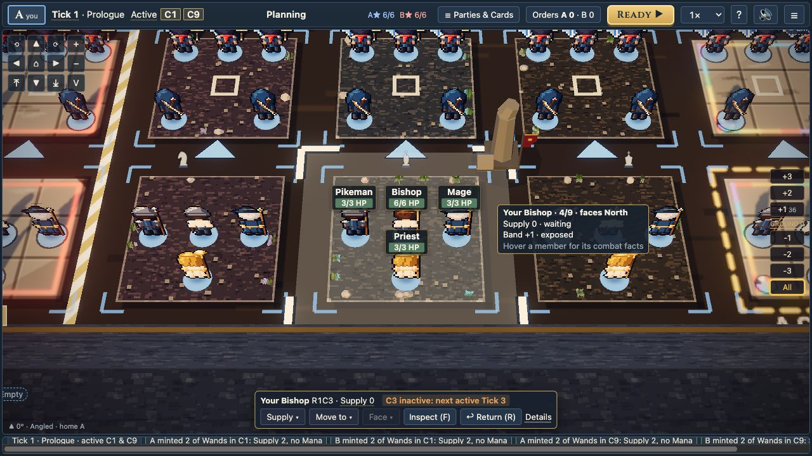
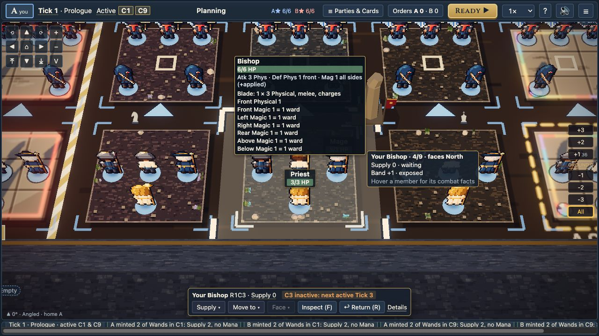

# UI and design review 06 — Keep the formation visible and its facts true

**23 November 2026 · Review of implementation response 06.**

**Verdict:** the selection/inspection direction is working and should be preserved. Ordinary board selection now leaves a usable command surface, and intentional close inspection makes the actual members readable. The next iteration should complete that interaction consistently, correct the information shown during combat and terrain changes, and finish one territory as the visual benchmark. This is a reviewer recommendation, not CJ's acceptance to Done.

## 1. Baseline, authority and evidence

| Item | Reviewed value |
| --- | --- |
| Repository | `calderwong/hapa-verseUs-prototype` |
| Pushed `main` | `53481b90f0909f16108b30b163acb69c8649d6ea` |
| Implementation revision | `95c88bf3dbb412df8388f99391ed293d5ae6ed44` |
| Implementation range | `eda7ed3` through `95c88bf`; response/report commit `53481b90` |
| Previous review baseline | `b747d118bbb857d0ea08f98696d0714428d2f106`, implementation `fc6df0d` |
| Engine gitlink | `ba838cca09ba43afceda0452b63d28df4cbf7f72`, unchanged |
| Default profile | `hapa_open_10x9_v3_02` |
| Governing presentation direction | [Human feedback addendum 02](../requirements/2026-11-23-human-feedback-addendum-02.md), preserving compatible [addendum 01](../requirements/2026-11-22-human-feedback-addendum-01.md) behavior |

Read [response 06](2026-11-23-ui-design-response-06.md) as the implementer's account. This review independently inspected the changed source, seven checked-in JPGs, regression/performance reports and targeted reproduction cases. The 83 extracted source/evidence text files used for local inspection matched their remote Git blobs. A subset of 104 headless tests passed; four protocol tests require unavailable `hypercore-crypto` and were not independently run. The full check, peer/smoke/build results and 270/270 browser assertions remain implementer-reported results, supported by the checked-in reports.

The reviewer also reached the running local app through the connected browser, opened a fresh seeded match, and checked selection, close inspection and opponent navigator activation. Three captures were made at **1280×720 CSS pixels**. The live menu exposed profile `hapa_open_10x9_v3_02`, but no commit or dirty-tree identity: these are direct observations of the running app, not proof that its files exactly match `95c88bf`. Source-pinned reproductions independently explain the relevant behaviors. The temporary viewport override was restored; no Ready, concession or match resolution was submitted during this live review.

The checked-in journey videos and scripts were inventoried. The video bytes were unavailable through the review connector, so this review does not claim to have watched those recordings or independently verified their continuous motion. Current Overwatch state, unpublished local changes and local grounding outside this repository were not read. No board status or CJ acceptance was changed.

Detailed commands, limitations, captures and executable probes are in the [review evidence](evidence/2026-11-23/review-06/README.md). The next implementation scope is [assignment 07](2026-11-23-next-agent-assignment-07.md). This review changes no game rules or profile semantics.

## 2. Progress worth keeping

| Previous goal | What the new work establishes | Remaining qualification |
| --- | --- | --- |
| Select a party without a large document | Board selection now exposes a compact command group, with an inactive-column reason when appropriate. The live ordinary selection did not open the old composition document. | The navigator still replaces command selection and moves the camera when reading an opponent. |
| Make the actual formation the composition view | Close inspection shows upright role and HP labels beside the real figures. Four-member captures at 0° and 135° are readable. The supplied nine-member still shows nine distinct compact labels. | Expanded text covers other members; edge containment, larger text and keyboard equivalents remain incomplete. The nine-member still is 1600×1000, not proof at 1280×720. |
| Separate inspection from commands | `selected`, `pinned` and `inspectParty` now have distinct jobs. Focus/Return and wheel inspection have explicit state. Passive labels let camera input through. | Apply those contracts to every input path and reconcile Home/Return state. |
| Explain actual combat facts | The pure inspection module shares protection and ranged calculations with combat and can explain applied effects such as Bound Standard. | Playback mixes earlier health with later facts; detail caching can preserve obsolete text; line contributions need clearer scope. |
| Reveal a place inside the territory | The environment adds ground material, small stones, tufts and an asymmetric depth landmark without a separate rendered world. | Terrain mutation/cutaway behavior has gaps. The current scene establishes placement, while a finished Hapa environment still needs an art pass. |
| Supply reviewable evidence | The response includes source pins, before/after stills, regression reports, negative-control failures, journey scripts and bounded performance measurements. | Add checks for the defects below, and use actual text scaling and relevant viewport sizes rather than label counts alone. |

The reduced permanent UI and the compact identity/health layer are the strongest improvements. Preserve them. At the standard close view, the individual soldiers are now the subject of the screen; that is the intended experience.

*Reviewer live capture, 1280×720. Source revision of the running app was not exposed. The selected friendly Bishop remains in the bottom command group.*

## 3. Findings and required outcomes

### R6-01 — Expanded facts still cover the people being inspected

**P1 · Directly observed in the live app and checked-in stills; layout gaps confirmed in source.** Related requirements: HF2-04, HF2-06, HF2-07.

At close range, hovering a Bishop opens a dark block over the other front-row labels. The supplied nine-member Archer capture is more severe: the expanded panel obscures portions of several other labels and bodies. The member information has moved closer to the figures, but expanding it still takes their visual space away. Pointer transparency prevents an input obstruction; it does not prevent a visual obstruction.

`MemberLabels.update` checks whether an anchor point is inside the canvas and then places the entire label above that point. It does not measure the text rectangle, reserve room for the command group or prevent overlap with bodies and neighboring labels. The collective summary is always positioned beyond the rightmost member and can be outside the viewport. An isolated source probe renders a summary at x=980 in a 960px host without hiding or repositioning it. The root container clips overflow.

The role heading is 14px, while HP is 12px and combat/detail text is 12.5px. The approximately 14–16px core-reading target in the addendum was a working default, but the current solution needs evidence of readability and reflow before using smaller values as its answer to density.

**Required outcome:** preserve the compact role/health layer and protect the projected formation, relevant target cues and command controls from the expanded readout. Use the actual measured text footprint and available space. Place one deeper explanation in a stable adjacent area with an unmistakable source cue; if there is insufficient room, offer an intentional compact reading view that preserves command selection. Do not spread the figures apart or shrink the text further to fit.

Group repeated information. For example, six identical ward rows can initially read “Magic protection 1 on all six faces, from the party Mage,” with a deliberate way to inspect the directional breakdown. Preserve source identity and real exceptions. A player should be able to compare two soldiers without the first soldier's explanation hiding the second.

The passive layer may remain pointer-transparent, but the player also needs a deliberate keyboard/touch route to the same detailed facts and glossary. The current `aria-hidden` layer and pointer hover alone are not that route. Preserve Card hover behavior separately.

**Acceptance:** a four-member and a full nine-member formation, one member expanded, at 1280×720 and a larger viewport; 0°/45°/90°/135° plus a complete orbit; low pitch and screen-edge positions; a visible command group; 150% and 200% text/browser scaling. Core health and role must stay readable, the expanded explanation must not cover the inspected formation, collective facts must remain reachable, and required controls must remain operable. Check rectangles and captures, not merely the number of DOM nodes.

Sources: [member-labels.js at reviewed revision](https://github.com/calderwong/hapa-verseUs-prototype/blob/53481b90f0909f16108b30b163acb69c8649d6ea/src/hapa/presentation/member-labels.js), [versus.css](https://github.com/calderwong/hapa-verseUs-prototype/blob/53481b90f0909f16108b30b163acb69c8649d6ea/src/hapa/presentation/versus.css), [supplied expanded Archer capture](evidence/2026-11-23/response-06/regress/after-95c88bf/z03-expanded-member.jpg).

*Reviewer live capture, 1280×720. Compare with the preceding compact view. This is a visible layout issue even though the overlay lets pointer input pass through.*

### R6-02 — Reading an enemy through the navigator replaces the party being commanded

**P1 · Live reproduction and actual-source callback reproduction.** Related requirements: HF2-01, HF2-03, HF2-07.

Reproduction: select the friendly Bishop at R1C3, open Parties & Cards, activate B's Bishop at R10C7, and close the navigator. The command group now belongs to **B's Bishop**, and the camera has moved to it. The earlier friendly selection is lost. The source callback sets `selected` to every party row and calls `_focusSelection()` regardless of ownership or inspection intent.

**Required outcome:** make selection and intentional inspection mean the same thing through the board, navigator, keyboard and touch controls. Reading an enemy preserves the friendly command selection and existing orders. An explicit Inspect/Focus action may move the camera and establish a Return pose; ordinary selection must not implicitly do so. Keep access to public enemy information.

Two smaller camera inconsistencies belong in this same focused repair:

- The visible Home button only calls `cam.home()`, while keyboard Home also clears the inspection and saved Return state. A later Focus/Return journey can therefore return to an older non-home pose. Route both through one app-level transition.
- The party hit now supplies its real height to wheel zoom, but `BoardCamera.zoom()` interpolates only x/z. An elevated or underground subject therefore drifts relative to the cursor. A representative isolated projection demonstrates the discrepancy; it is not a measured live-game pixel budget. Correct the real-height anchoring and qualify it on a hilltop, flyer and tunnel cutaway.

**Acceptance:** select a friendly party and queue a legal order; use the keyboard navigator to inspect an enemy; dismiss/return; issue another command to the original friendly party without reselecting it. Preserve both orders. Test non-home view → Focus → visible Home → Focus → Return, and repeat with keyboard Home. Verify wheel approach on non-surface bands without changing the selected party or chosen layer unexpectedly.

Sources: [app.js, `_renderRoster`, `_renderCamPad`, `_focusInspect`, `_returnCamera`](https://github.com/calderwong/hapa-verseUs-prototype/blob/53481b90f0909f16108b30b163acb69c8649d6ea/src/hapa/presentation/app.js), [camera.js](https://github.com/calderwong/hapa-verseUs-prototype/blob/53481b90f0909f16108b30b163acb69c8649d6ea/src/hapa/presentation/camera.js), [live result](evidence/2026-11-23/review-06/live-navigator-replaces-selection.jpg), [interaction probe results](evidence/2026-11-23/review-06/interaction-results.json).

### R6-03 — Combat inspection combines facts from different moments

**P1 · Reproduced through a legal, funded default-profile Tick.** Related requirements: HF2-04, HF2-05.

The new health snapshot is a useful start, but it reconstructs only member HP and alive flags. Protection, conditions, equipment, membership and collective party facts still come from the fully resolved state. The resulting explanation can contradict the battle the player is watching.

In the reproduction, a Swordsman kills a front Mage at first contact, quantum 250. For the event prefix before first contact, the inspection read model reports the Mage alive at **3 HP**. However, the same read-model call gives the nearby Archer **0 Magic protection instead of the Mage's 1-point ward**, and the party facts count **2 living members instead of 3**. These are independently reproduced read-model outputs; this review did not record that combat frame in a browser. They demonstrate how a future death can affect the explanation before its displayed event.

The existing pooled-health profile has a related failure: invoking the actual card-hit routine and inspecting with zero events shown returns a shared pool of **13/15 instead of 15/15**, and the headcount includes the later maintenance casualty. This is a direct rules/read-model reproduction, not a browser-issued command. It is a compatibility case, not a request to change the default health rules.

There is also a source-confirmed early gate in `_updateLabels`: final `p.alive`/`retired` determines whether any labels are shown before the snapshot is consulted. A party eliminated later in the Tick can lose inspection for its earlier still-living interval. This gate was identified in source; its rendered behavior should be included in the next browser fixture.

**Required outcome:** all facts presented as current must refer to the same displayed moment as the bodies. Include membership, shared pools, ward providers and conditions, with position/exposure/terrain context where used. Keep this reconstruction in the presentation/read-model boundary; do not mutate authoritative state to animate it. If a fact cannot yet be reconstructed, label it explicitly as the final accepted result or withhold that current claim. Do not show it beside a replay body as though it already applies.

**Acceptance:** pause immediately before and after the Mage's death, after the relevant exchange and at playback end. Verify role/HP, living count, ward, conditions and surviving labels together. Add pooled-health and party-elimination cases. Final displayed facts must converge to the accepted state; changing playback speed, pausing or starting a new match must not leak another moment's facts.

Sources: [inspection.js](https://github.com/calderwong/hapa-verseUs-prototype/blob/53481b90f0909f16108b30b163acb69c8649d6ea/src/hapa/rules/inspection.js), `app.js::_labelFacts/_updateLabels`, [actual-rules results](evidence/2026-11-23/review-06/inspection-terrain-results.json), [portable probe](evidence/2026-11-23/review-06/inspection-terrain-probe.mjs).

### R6-04 — An open member explanation can retain obsolete details

**P1 for cache correctness; P2 for legacy line-profile wording.** Related requirement: HF2-05.

`_memberText()` builds a target-dependent power/range/blocked preview, condition list and protection-source explanation. Its cache key includes only member ID, HP text, compact combat text, alive status and enemy ID. `MemberLabels` replaces the rendered content only when that key, expansion state or detail level changes.

An isolated probe executes the real text-builder and label-cache methods, substituting two different preview results for the same target. The newly built detail changes from power 1/range 2 to power 2/range 3/blocked, but the rendered label retains the old version because the key is unchanged. Condition-only or contribution-source changes with unchanged totals have the same missing dependencies. This is a source-method reproduction, not a recorded live combat transition.

**Required outcome:** invalidate rendered detail whenever any displayed fact or target context changes. Use a complete stable signature or explicit model revisions. Update anchors independently. Avoid solving the cache problem by rebuilding every member's full DOM on every frame; the current text builder already constructs detail nodes before checking whether they are needed.

Make the displayed scope equally explicit. In the existing line-defense profile, the reproduction gives a member contribution of **1**, actual attacked-front-line protection of **3**, and an unused whole-party helper value of **4**. These are different quantities. Label an unqualified member value as its contribution; derive an applied line preview using the actual reached line. Do not replace the member value with the all-members helper. Show a target-specific preview only with clear target/context; a remote automatically chosen enemy should not look like an intended or legal attack.

**Acceptance:** leave a member expanded while the same target changes elevation or sky exposure, and while a consequential condition or source changes without changing HP or the compact protection total. Text must refresh without requiring pointer exit/re-entry. In the line profile, compare the explanation to a real exchange using three front shields; distinguish contribution 1 from applied line protection 3. Preserve base-versus-applied and planned-versus-accepted labels.

Sources: `app.js::_memberText`, `member-labels.js::update`, `inspection.js::partyLineProtection`, [interaction results](evidence/2026-11-23/review-06/interaction-results.json), [line-combat results](evidence/2026-11-23/review-06/inspection-terrain-results.json).

### R6-05 — Scenery does not always update when real terrain changes

**P1 for excavation invalidation; P2 for raised-ground cutaway.** Related requirements: HF2-07, HF2-09, HF2-10.

The environment correctly attempts to cut transparent cells out of its ground texture, but its cache key includes the **number** of terrain-cell entries rather than their contents or a revision. Excavating a previously filled cube changes an existing entry from solid to empty without changing that count.

The reproduction validates and completes real excavation work, then runs the checked-in diorama synchronization method with drawing stubbed. The cube becomes empty, the key remains unchanged, and the environment performs **zero rebuilds**, retaining the earlier closed-cell mask. The stale geometry input is directly reproduced; an opaque decorative floor covering the new opening is the source-supported rendering consequence, not a separately observed live pit capture. The one-Tick task does not provide an intervening running-work key change to repair this case.

A second source-method reproduction shows that selecting band +1 leaves +2 hill decorations fully opaque, while the terrain view makes the higher hill translucent. The environment hides only when the cutaway is below +1, rather than considering the actual height of each relevant decoration.

**Required outcome:** invalidate scenic geometry from the relevant terrain content/revision and keep its visibility consistent with real terrain and the chosen cutaway. Cover solid→empty and empty→solid transitions on existing entries, repeated excavation/fill, and higher terrain viewed from a lower selected band. Scope invalidation to the inspected neighborhood where practical; do not rebuild the whole environment every frame.

**Acceptance:** stay focused on the same territory while digging an already recorded filled surface cell; the actual hole and decorative mask must change at the accepted event. Fill and dig it again. Show that the empty opening, picking target and authoritative state agree. On a +2 hill, select +1 and an underground cutaway; scenery must follow the deliberate visibility policy without changing mechanical cover, exposure or collision.

Sources: [territory-diorama.js](https://github.com/calderwong/hapa-verseUs-prototype/blob/53481b90f0909f16108b30b163acb69c8649d6ea/src/hapa/presentation/territory-diorama.js), [terrain rules](https://github.com/calderwong/hapa-verseUs-prototype/blob/53481b90f0909f16108b30b163acb69c8649d6ea/src/hapa/rules/terrain.js), [terrain-view.js](https://github.com/calderwong/hapa-verseUs-prototype/blob/53481b90f0909f16108b30b163acb69c8649d6ea/src/hapa/presentation/terrain-view.js), [reproduction results](evidence/2026-11-23/review-06/inspection-terrain-results.json).

### R6-06 — Finish one territory as the Hapa art benchmark

**P2 · Visual judgment from the reviewed captures and live close view.** Related requirements: HF2-08, HF2-09, HF2-10.

The dirt, tufts, stones and asymmetric pillar make the surface more inhabited. The scene still reads primarily as decorated plates. The broad pale selection apron, large arrows, bright border pieces and faceted beige pillar carry more visual weight than the small ground details. The pillar's material treatment also feels separate from the richer pixel sprites. This is consistent with the implementer's description of a procedural placement study.

On the hill capture, **HILLTOP +2**, **HILL +2** and **RAMP** stack across the front of the territory. They cover ground-contact space and compete with the member annotations. The precise mechanical information should remain available, but three prominent signs are unnecessary.

**Next art outcome:** finish one coherent place using the existing scene and real heights. A weathered shrine courtyard is a suitable working example: deliberate ground composition, sprite-compatible stone/wood/cloth materials, small foreground detail, a recognizable landmark with a plausible side and back, and convincing contact/shadow treatment. This is a presentation example, not new lore, collision or a gameplay rule.

At close distance, quiet redundant bracket/arrow emphasis and keep one clear territorial rim and facing cue. Give height one primary label; make the ramp cue smaller and local to the access geometry. Keep color alignment restrained so it does not compete with ownership, movement targets or active effects. The neighboring tiles should support a sense of place while preserving their boundaries.

Use this same authored scene to prove default overview, close inspection, 45° orbit steps, raised ground, an opening and a roofed cutaway. Prefer existing owned assets and the established asset pipeline. Do not require a new portal renderer, ninety separate worlds, new effects rules or an engine migration to finish this sample. The “window into a pixel world” remains the visual goal; the current shallow diorama is still a reasonable way to pursue it.

**Acceptance:** show the same party and territory before/after at the same camera settings, with and without member detail. The figures remain the focal point, their feet and playable openings stay readable, depth remains coherent as the camera turns, and the material language belongs with the sprites. CJ can then judge the concrete art result before more recipes are built.

Source: [hill capture](evidence/2026-11-23/response-06/states/after-95c88bf-A-hill-2-close.jpg), [orbit135 capture](evidence/2026-11-23/response-06/states/after-95c88bf-A-mount.C3-3-close-orbit135.jpg), and the live captures above.

## 4. Verification and remaining boundaries

The implementer's regression report records 270 passing assertions at a clean `95c88bf`, and the sabotage report records the two intended failures. Those are valuable checks. They do not contradict this review: a count-of-labels or simple HP progression assertion does not test label overlap, ward-provider timing, a same-target detail-cache change or a mutation with an unchanged terrain-cell count.

The supplied performance JSON shows 16.7ms median frame intervals before and after in the stated vsync-limited environment. It also records 1,316→1,391 close-view geometries, 140→144 textures and 532→513 DOM elements; orbit script CPU rises from 882.4ms to 1,076.8ms in that scripted run. These are observations from the implementer's sample, not a performance acceptance target. Draw calls/GPU headroom are not established: the final postprocess pass makes the recorded call count unsuitable for that claim. Reuse the same bounded measurement after fixing the layout/cache work; expand profiling only for a concrete remaining concern.

Carry the response's explicitly unverified cases forward: keyboard/touch equivalents, actual enlarged text, helper-away bodies, flyer/open-pit inspection, pause/resume and Major/row Card cases. Add a low-angle wall/hill occlusion case; `sprite.visible` plus a roof special case does not by itself establish that a DOM label is attached to a visually exposed body. Reduced motion should also apply consistently to camera transitions. These are qualification targets, not claims that every case has been observed to fail.

The handoff index's old copyable instruction still pointed to review 04/assignment 05 and automatic party inspection. This publication updates that instruction to the current brief so a new coding session receives the correct direction.

## 5. Next delivery

Implement [assignment 07](2026-11-23-next-agent-assignment-07.md) in small coherent changes: first factual/terrain correctness, then consistent unobstructed inspection, then one finished territory sample. Preserve the funded movement policy, Card inspection, Fire Pit/Mana accounting, public plans, response windows, Ready freeze and replay/agreement protections. Publish the next unused response number, expected 07, with revision-pinned evidence and explicit remaining gaps. Update the existing Overwatch cards through the local workflow and leave acceptance to CJ.

There is no new blocking design question for CJ. The next human decision is best made from the corrected close view and the finished territory sample.
