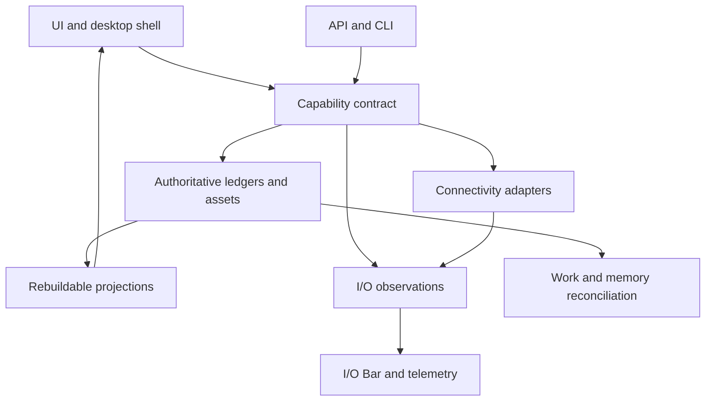

# Base Hapa Node Standard

**Standard ID:** `hapa.base-node`  
**Version:** `0.1.0-draft.1`  
**Prepared:** 2026-11-27  
**Document status:** initial, reviewable specification; not a certification of existing nodes  
**Designated standards custodian:** Hapa Second Brain  
**Publication state:** `bootstrap_source_only` until the real Second Brain ingestion and governance receipts exist

## Read this first

A Hapa Node is a useful application or service that owns a clear capability, preserves attributable history, can be operated by people and programs, and participates in the Hapa ecosystem through explicit contracts.

**Meeting the Hapa Node Standard means more than using Hypercore or putting “Hapa” in a name.** A node must satisfy all seven obligations below, the supporting requirements in this document, and the relevant acceptance cases for an exact standard version and implementation. Missing capabilities remain visible adoption work. A copied document, a manifest, or a passing schema check is not evidence that the application works.

This version formalizes CJ's seven requested obligations. The details, defaults, supporting requirements, schemas, and maintenance process are the initial design proposed to make those obligations implementable. They remain inspectable and revisable through the governance process. This publication does not activate services, register installations, sign a release, certify nodes, or enable a scheduler.

| Obligation | What a conforming node provides | What makes the claim credible |
| --- | --- | --- |
| 1. Verifiable persistence | Append-only, cryptographically verifiable, peer-transferable authoritative ledgers; optional stores for speed and usability | Writer/authority bindings, durable original content, replay and transfer evidence |
| 2. Work ownership | Its own Hapa Kanban Board and a Hapa Quest Keeper registration | Actual board and registry references, source-linked work history, accepted binding evidence |
| 3. Four interaction surfaces | UI, CLI, API, and desktop shell with capability parity | A capability matrix and common operation fixtures exercised through the surfaces |
| 4. Explanation and provenance | Standard documentation and the history from need and first implementation to current state | Traceable requirements, decisions, source/builds, outcomes, corrections and known gaps |
| 5. Common telemetry | Hapa Telemetry registration and shared terminology, plus relevant domain metrics | Defined measurements, coverage, privacy policy and registration evidence |
| 6. Memory participation | Second Brain registration, Wiki entries, and durable documentation/memory update triggers | Source-linked entries, delivery receipts and visible pending work |
| 7. Inspectable I/O | A common top/bottom, expandable, hideable I/O Bar with a detailed ledger view | Shared observations across UI/API/CLI/shell; accurate route, identity, rate and outcome claims |

The complete profile comprises this document, [I/O Bar](IO_BAR.md), [governance and syndication](GOVERNANCE.md), [conformance catalog](CONFORMANCE.md), the schemas/templates, and the exact file manifest in `release.json`. Keep the bundle together.

## 1. Scope, terms and normative language

**MUST** identifies a required property of a node claiming conformance to the eventual released contract. **SHOULD** identifies a recommendation whose departure needs a recorded reason. **MAY** identifies an optional implementation choice. Within this draft these terms express the proposed contract, not a claim that it has already been released or implemented.

The standard applies to an independently operated Hapa application or service. Its repository declares whether it contains one node, several nodes, supporting libraries, documentation, or an archived reference. A library does not need a fabricated UI or desktop executable. An independently running service cannot avoid the four-surface requirement by calling itself a library; a small management UI and desktop management surface can satisfy its human interaction needs.

A monorepo declares each independent node and its own work, registrations and capabilities. Several nodes may share a Kanban engine, shell, service process or storage adapter. Each node still has an unambiguous owner and scope. A private installation is not a new public product and need not be publicly catalogued. Definition registration and private runtime registration are separate.

| Term | Meaning |
| --- | --- |
| Node definition | Maintained product/service and its capability contract |
| Node instance | One installation or deployment, with a data home and private operating state |
| Subject/authority | Person, organization, agent or delegated principal allowed to act |
| Resource | A particular document, game, Card, job, collection or other domain object |
| Ledger | Authenticated, append-only history under an explicit writer and retention policy |
| Projection | Rebuildable view of authoritative records, such as a SQL table or search index |
| Durable intent | Locally recoverable requested work whose final domain acceptance may still be pending |
| Capability | Versioned operation with declared inputs, outputs, authority, side effects and evidence |
| Registration | Accepted service-owned binding; distinct from a request, configuration or discovery result |
| Standard release | Immutable specification bundle with an authorized release record |
| Conformance evidence | Scoped observations supporting named requirements for a named build and environment |

The stable requirement identifiers in this document are the keys used by the [42-case requirement catalog](conformance-catalog.json). Individual requirements can have several acceptance cases. Catalog entries are requirements, not test results.

## 2. Architectural shape

The shared architecture has a small number of boundaries. A domain operation contract owns behavior and authorization. UI, CLI, API and shell expose it. Accepted events and original content go to the authoritative storage layer. Projections make them convenient to query. Connectivity adapters move authorized data. Observers produce telemetry and I/O records. Coordination adapters reconcile work, memory and standards without making ordinary local operations depend on remote registries.

These are responsibilities, not a mandate to create nine packages or nine processes. Start with shared schemas, fixtures and a small set of reusable adapters. Extract more runtime code after real consumers establish the boundary. The standard does not require a universal Hapa daemon, one programming language, one UI framework, a newly operated VPS, a blockchain consensus network, or an external token.

Domain authority stays with its owner. A game owns its rules; a collaborative editor owns its merge and undo semantics; a memory node owns its retrieval and publication policy. Common infrastructure cannot invent domain acceptance.

## 3. Pillar 1 — authoritative persistence

### HN-PERSIST-01: verifiable, append-only, peer-transferable truth

A node MUST retain authoritative accepted application history in append-only records with cryptographic integrity and authenticated writer/authority binding. Authorized peers MUST be able to transfer and verify those records without depending exclusively on the original mutable database or a particular hosted endpoint. Hypercore is the established Hapa construction; another adapter must document equivalent properties and interoperability boundaries rather than claim equivalence from its name.

Every record or its authenticated containing feed MUST bind schema/version, resource namespace, writer/authority, stable operation identity, history position and integrity data. The adapter MUST declare encoding, hash/signature profile, key binding, sequencing/fork policy and verification behavior. A hash alone neither authenticates a writer nor proves a statement true. Public verification material can travel; private signing keys and bearer secrets MUST remain under separate secret custody.

Application corrections, supersession, cancellation tombstones, permission changes and retirement MUST append attributable records. A library's truncate/reset API is not permission to rewrite accepted Hapa history. Multiwriter applications MUST declare their merge/admission rules and what ordering they guarantee; wall-clock timestamps MUST NOT be treated as a trustworthy global order.

The node MUST distinguish cryptographic integrity, authenticity, authorization, availability and retention. None implies all the others. A signed head does not prove that a receiver has all of its blocks. Permanence is a custody and recovery policy supported by retained copies; a content hash by itself is not a promise of indefinite availability.

### HN-PERSIST-02: durable intent and original content

Before reporting user work as durably saved, a node MUST have a recovery path for the accepted operation and its original content. The receipt MUST name the guarantee actually made: staged locally, appended locally, admitted to the resource, applied to a projection, received elsewhere, or held under a retention commitment.

An image, recording, video, document attachment or generated artifact requires recoverable original bytes, not only a metadata pointer or a renderer cache. A durable spool and stable retry intent MAY precede final blob admission. Until verified transfer completes, the node MUST retain the necessary original, expose pending status and retry after supported interruption. Content references MUST identify digest algorithm/value, byte length, media type, custody and locator/verification state. Private signing/decryption keys, bearer secrets and restricted read capabilities MUST NOT be embedded in public references. Deliberate publication of public verification material or an approved read locator follows the source's disclosure policy.

Uncertain writes MUST reconcile by stable operation identity. The node MUST NOT clear pending intent merely because a request was sent or a timeout expired. Locally durable work that is excluded by a permission cut MUST remain recoverable as local work, with the distinction visible.

### HN-PERSIST-03: optional stores and projection recovery

Nodes MAY use SQLite, PostgreSQL, Redis, search/vector indexes, local files, snapshots, browser storage and other stores for performance and usability. The node MUST publish a persistence map classifying each store:

| Class | Rule |
| --- | --- |
| Authoritative ledger/content | Accepted history and original content under declared integrity/custody rules |
| Durable staging | Recoverable uncommitted intent or originals, with reconciliation rules |
| Projection/index | Rebuildable from named source cuts and projection version |
| Cache/ephemeral | Disposable without losing accepted domain work; clearly labeled |
| Secret custody | Keys and credentials protected separately; not ordinary transferable history |

A snapshot MUST identify its source cut/checkpoint, schema and projector version. Rebuild or migration MUST not silently omit unavailable source history. Limits, gaps and corruption yield an explicit incomplete/recovery state. “Rebuildable” requires a demonstrated reconstruction procedure for the claimed state; an undocumented second database is not automatically a projection.

### HN-PERSIST-04: preservation through change

Schema evolution and migrations MUST preserve original records, attribution and interpretation. A transformation appends a new version with lineage rather than changing the historical meaning of existing signatures. Repairs MUST retain evidence of the problem and correction. Normal reset, reinstall, update or provider replacement MUST NOT silently generate a new identity or discard accepted history.

Authoritative and required audit history remains append-only. High-rate telemetry and presence MAY be classified as ephemeral at collection time under a published policy; that does not authorize later reclassifying accepted application history as disposable. Access revocation changes future authority and disclosure; it cannot guarantee recall of previously shared plaintext. Any separately authorized content-removal or key-destruction process must describe its actual scope and limits without rewriting provenance.

## 4. Pillar 2 — board and Quest Keeper

### HN-WORK-01: one identifiable board per node

Every node MUST have its own Hapa Kanban Board scope, with actual board/project ID, owner, visibility, source links and append-only task history. Multiple boards MAY share the existing board engine. The node's UI/docs, API and CLI MUST provide a way to discover its board. A GitHub issue can be a linked implementation task; it does not substitute for the Hapa Board or prove that the board was updated.

Tasks SHOULD link requirement → implementation → evidence → review/acceptance. Preserve the distinction between agent-reported completion, reviewer verification and the product owner's acceptance. A board records work and approval evidence; it does not grant tool permissions, spending authority or execution authority.

### HN-WORK-02: Quest Keeper binding

Each node MUST register with Hapa Quest Keeper using its existing node identity, repository/source owner, purpose, capability summary, lifecycle state and board reference. The binding MUST be confirmed by an owner-issued receipt or an authenticated readback of the owning registry record. Do not invent a new endpoint or duplicate a board merely because an existing integration is temporarily unavailable.

### HN-WORK-03: honest, recoverable reconciliation

Registration state MUST distinguish `unknown`, `not_configured`, `pending`, `accepted`, `rejected`, `stale` and `revoked`. Reachability is separate: an accepted registration can be temporarily unreachable. Durable update intents MUST use stable IDs and bounded retries, surviving restart without duplicate records. Required coordination-service outages MUST not prevent otherwise supported local work. A pending integration is still an adoption gap.

## 5. Pillar 3 — UI, CLI, API and desktop shell

### HN-SURFACE-01: all four surfaces

Every node MUST provide a usable UI, scriptable CLI, versioned API and desktop shell or desktop management client. A service's UI can be a compact operator panel. A shell can host the same UI and native adapter. The API can be in-process, IPC, a local socket or authenticated loopback HTTP; it need not expose an Internet server.

A browser-only export, embedded viewer or remote presentation MAY have a reduced profile, identified clearly. The full node cannot use that profile to waive the four-surface obligation. Platform support MUST be declared, with honest unsupported and temporarily unavailable states.

### HN-SURFACE-02: semantic feature parity

Parity means equivalent authorized capabilities, validation, outcomes, side effects, error/cancellation semantics and inspectable state. It does not mean identical gestures. Dragging a diagram object has an API/CLI operation with equivalent coordinates and validation. Choosing a game participant has an equivalent semantic command. A visual preview may be represented by an inspectable state or render/export operation in a terminal.

Every domain capability MUST appear in a parity matrix. Missing mappings are gaps, not hidden exceptions. The same authority policy applies through each surface; the CLI must not become an accidental shortcut around UI permissions. Common fixtures SHOULD exercise the shared behavior, with targeted surface checks for routing, input/output, errors and packaging.

### HN-SURFACE-03: discoverable capability contracts

A capability declaration MUST contain a stable ID and version, purpose, input/output schemas, required authority and scope, side effects, durable operation/receipt semantics, idempotency and cancellation behavior, resource limits, supported runtime profiles and surface mappings.

Every node MUST expose these common responsibilities through named local mappings:

| Responsibility | Required information or action |
| --- | --- |
| Identity and capabilities | Definition/instance identity, actual authority bindings, supported versions and surfaces |
| Health and lifecycle | Readiness, degradation, failed dependencies, pending work, last observation |
| Ledger/provenance | Inspect, verify and export authorized history with coverage and source references |
| I/O | Status, query, bounded subscription, details and redacted export |
| Settings and permissions | Inspect/update authorized settings with the same policy across surfaces |
| Registrations | Accepted, pending and failed bindings; evidence and reconciliation status |
| Standard | Exact target/adopted version, requirements, gaps, evidence and update status |
| Support/recovery | Redacted diagnostics and documented backup/restore/recovery operations |

These are contract responsibilities, **not assertions that an endpoint with a particular path already exists**. Adapters map existing routes and CLI commands. Preserve working versioned interfaces; add aliases or migrations deliberately. A minimal health response can be public within its declared boundary; sensitive capabilities, records and writes require appropriate authentication/authorization. Loopback is a locality default, not an authorization proof.

## 6. Pillar 4 — documentation, explanation and 0-to-1 history

### HN-DOCS-01: repository documentation kit

Each node repository MUST contain an offline-readable pinned copy of this standard bundle, a `hapa-standard.json` adoption sidecar, a readable `docs/HAPA_NODE.md` index, and links from README and agent/contributor instructions. Existing `hapa-node.json` identities remain intact; the sidecar augments them.

The index MUST link the purpose/need, requirements, architecture and ownership boundaries, capability/parity matrix, API/CLI/UI/shell usage, persistence/recovery map, security/privacy policy, telemetry and I/O profile, board/registrations, current release/runbook, provenance history, conformance evidence and open gaps. Equivalent existing files are acceptable; do not create an empty duplicate bureaucracy.

Node-specific choices and deviations belong in local adoption documents. Mirrored normative files MUST remain byte-identical to their pinned release. The repository can retain multiple versions while its adoption sidecar names the active target and adopted version separately.

### HN-DOCS-02: lineage from need to current state

The node MUST retain a traceable development history: originating need → selected requirements → decisions and alternatives → implementation/source/build → verification → outcome/acceptance → later correction. Record meaningful 0-to-1 turns and subsequent changes with actor, available source/turn reference, time, artifact identity, decision and evidence.

A useful provenance record explains what was requested, what changed, why it was selected, where it exists and how it was checked. It need not expose private conversations, credentials, hidden reasoning or unrelated operator history. Summaries identify their source and whether they are contemporaneous, reconstructed or inferred. Missing original turns remain unknown; plausible reconstruction MUST NOT be presented as original evidence.

### HN-DOCS-03: current explanation and evidence discipline

Keep a concise current index without rewriting historical reports to describe later work. Claims MUST distinguish proposed, selected, implemented, tested, packaged, independently connected and human accepted. An implementation statement records source; a test statement records the actual environment and observed result. “Core” means ecosystem importance, not general production readiness.

Use focused verification while assembling work, then qualify a coherent integrated candidate. Reuse unaffected evidence; a file edit, documentation copy or new commit alone is not a reason to repeat every test. Contradictory evidence creates a visible correction or gap rather than a reassuring aggregate status.

## 7. Pillar 5 — telemetry

### HN-TELEM-01: Hapa Telemetry participation

Each node MUST have an accepted Hapa Telemetry catalog/binding record describing its identity, capabilities, telemetry schema, supported observations, collection/export policy and real adapter. Runtime instances remain within their authorized local/private scope. Registration does not grant a collector access to all data or consent to public fleet tracking.

### HN-TELEM-02: shared vocabulary and measurements

The common telemetry contract MUST include definition/instance/build identity; lifecycle/readiness; operation, attempt and resource correlation; connections and observed route; queue/backpressure; storage/durability/recovery; error/retry/cancel outcomes; registrations; standard freshness; and I/O coverage. Domain extensions MAY add match/tick, edit/merge, model/job or knowledge-ingestion measurements under a namespaced schema.

| Measurement family | Minimum useful values | Interpretation rule |
| --- | --- | --- |
| Runtime | lifecycle, generation, uptime, build, last observation | “Ready” belongs to the actual current generation |
| Operations | requested, pending, completed, rejected, cancelled, unknown | Count named logical operations separately from attempts |
| I/O | inbound/outbound bytes and rate, messages/operations, route | Declare byte boundary, unit, aggregation window and coverage |
| Storage | ledger position/checkpoint, retained bytes, pending originals, projection lag | A head/length is not proof of content availability |
| Recovery | retry count, oldest pending age, last failure, recovery action | Unknown outcome remains reconcilable |
| Dependencies | required/optional availability and last successful use | Optional failures do not imply the whole node failed |
| Governance | registration states, standards check time/version, doc queue | Configuration is not accepted registration or successful delivery |
| Telemetry itself | dropped/coalesced count, collection state, export state | No-data, measured zero, stale and not instrumented are different |

Use explicit units, local monotonic durations where possible and bounded cardinality. Keep full peer/resource IDs out of high-cardinality metric labels; use authorized event detail instead. Financial/model cost values MAY be reported, but unknown costs stay unknown and telemetry does not authorize spending. Map compatible fields to OpenTelemetry where useful; Hapa's state/admission/retention meanings remain explicit [E2].

### HN-TELEM-03: privacy, limits and availability

Local observation MUST work without a central collector. Record what is collected, sampled, persisted, exported and never collected. Default public diagnostics MUST redact secrets, invitations, private payloads and sensitive paths/endpoints. Remote export requires an explicit destination, field and disclosure policy.

Telemetry MUST have bounded queues, memory/disk use and backoff, visible coverage loss, and a nonrecursive export policy. Collector failure must not block an otherwise valid local edit, save or game action. Failure of a required authoritative commit is a separate domain error and MUST NOT be hidden as mere telemetry degradation.

## 8. Pillar 6 — Second Brain and Wiki

### HN-MEMORY-01: real, source-linked entries

Each node MUST be registered in Hapa Second Brain and have a Hapa Wiki entry with its purpose, owner, capabilities, documentation, current status, provenance, work/registrations and standards pin. Use actual owner-returned IDs or authenticated owner readbacks. A repository file prepared for ingestion is not an ingested article. Entry visibility MUST match its source permissions.

### HN-MEMORY-02: update triggers with durable delivery

Append a documentation/memory update intent on initial registration, a selected requirement/architecture change, capability or schema change, release, material verification result, incident/correction, ownership/provider change, or standard adoption/deviation. Bind the intent to source revisions and destination scope. Coalesce repetitive observations; do not create a Wiki edit for every telemetry sample.

The queue MUST survive supported interruptions, deduplicate retries, show pending/rejected/failed deliveries and retain authentic receipts. Recovery MUST drain newly arrived work without requiring another user action. A generated summary is a proposal until accepted under the owner's policy. Publishing to another destination is governed by its disclosure policy.

### HN-MEMORY-03: source custody and scoped retrieval

Second Brain holds source-linked memory and the canonical history of **this standard**. The Wiki publishes its readable projection. This explicit ownership choice supersedes older Wiki-canon wording only for the Base Hapa Node Standard; other domain canon and the existing Hapa connectivity contract keep their owners.

Indexing, search, summarization, a Card or a mirror does not transfer source ownership or authority. Preserve source revisions, attribution, access constraints, uncertainty and conflicts. A public entry can describe a private capability without copying its private evidence. Purpose-scoped retrieval is preferred to indiscriminate corpus synchronization.

## 9. Pillar 7 — the I/O Bar

The [I/O Bar profile](IO_BAR.md) is part of this standard. It defines HN-IO-01 through HN-IO-08.

Every node UI and desktop shell MUST offer a compact strip with top/bottom placement, expansion, hiding/restoration and pause/resume. The expanded view MUST expose searchable/paged event history, sender/recipient, direction, type, measured size/rate, actual route and inspectable evidence. UI preferences persist per device and do not silently change network permissions or collection policy.

Three primary classes preserve CJ's requested visual distinction:

| Class | Meaning | Reference visual token |
| --- | --- | --- |
| LOCAL | Authenticated Hapa node-to-node exchange in an established local scope | Cyan, LOCAL label and linked-node icon |
| P2P | Decentralized Hapa peer exchange under its resource protocol | Violet, P2P label and network icon |
| SERVICE | Centralized application/service role exchanging with a node | Amber, SERVICE label and server icon |
| UNKNOWN / OTHER | Relationship or evidence is insufficient, or another I/O kind applies | Neutral gray and explicit explanation |

These colors communicate traffic type, not safety or severity. A peer exchange through a blind relay stays P2P with a “Relayed” route badge. A central API remains SERVICE even on a direct connection. A local proxy does not prove the final destination is local. Internal disk I/O can have a separate optional filter.

The bar MUST distinguish transport send, local receive, verification, admission, application, durable append, peer receipt and retention. It MUST NOT turn one into another. A Hypercore public/read key, discovery key, transport key, real supported DID and endpoint URL have separate typed meanings [E1, E3]. Full values are inspectable only within their proper disclosure scope; URLs remain inert until an explicit permitted action.

The event stream and query/export responsibilities are shared with API and CLI. The ticker is a view of evidence, not its owner. The profile requires keyboard access, reduced motion, non-color labels, pause/hide and readable stationary detail [E4, E5].

## 10. Supporting requirements recommended for every node

These 15 requirements make the seven pillars reliable. They are proposed baseline clauses in this draft, not a claim of prior fleet-wide adoption.

| Requirement | Contract |
| --- | --- |
| HN-IDENTITY-01 | Separate definition, instance, subject, resource, writer/feed, transport, session and locator identities; authenticate the bindings that an operation relies on. Preserve existing namespaces and signature meanings. |
| HN-IDENTITY-02 | Document identity/key backup, rotation, revocation and recovery. An unknown key at a familiar URL does not establish continuity. Reinstall must not silently replace the user's identity. |
| HN-AUTH-01 | Scope capabilities and invitations by application/resource/role/version; validate untrusted input and enforce the same authority boundary through every surface. A connected peer is not automatically a member. |
| HN-AUTH-02 | Give mutations stable scoped operation IDs. Identical retries reconcile; conflicting reuse is rejected. Recheck admission at execution/commit boundaries and preserve excluded local work without falsely accepting it. |
| HN-LIFECYCLE-01 | Bound startup and requests. Settle waiting work on ready, fatal exit, timeout and shutdown; identify the service generation and expose recovery. |
| HN-LIFECYCLE-02 | Apply the same activation/cancellation rules to first connect, resend, reconnect, recovery and late callbacks. Retired generations cannot resurrect cancelled authority. Cancellation after a committed effect reports that effect honestly. |
| HN-LIFECYCLE-03 | Recover durable queues and originals after supported interruption. Drain work arriving during an existing drain; use backoff without losing wakeups or requiring an extra user action. |
| HN-CONNECT-01 | Separate identity, discovery, transport, relay, gateway and replica/archive roles. Use current adopted eligibility on new dials/retries; bind caches to descriptor/key revisions. Provider change preserves identity and history. |
| HN-CONNECT-02 | Declare runtime-specific transports and fallback behavior. A browser client cannot claim native DHT support from a UI badge. Multiple routes are extensible; no single operated VPS is an intrinsic base requirement. |
| HN-PORTABLE-01 | Provide authorized verifiable export/backup/restore of useful state, required assets, schema versions and custody references. Mark missing content and test a restore on a supported second instance. |
| HN-PORTABLE-02 | Qualify the declared installable desktop delivery on the platforms actually claimed. Bind package, source, hash and observed journey; distinguish same-machine, independent-machine/network and human acceptance evidence. |
| HN-UPDATE-01 | Keep the exact standard bundle and its hashes locally, with separate target and adopted pins. Normative mirrors are not silently edited. |
| HN-UPDATE-02 | Implement the recurring/event-driven checks and durable reconciliation in the governance profile, with actual last-attempt/success/next-due state and catch-up behavior. |
| HN-UPDATE-03 | Verify authority and whole-bundle integrity before adoption. Reject altered same-version content, unauthorized downgrade and conflicting release branches. Receipt of a document never executes it. |
| HN-UPDATE-04 | Record deviations, migrations, withdrawals and rollback as new attributable decisions; preserve historical evidence and report unresolved obligations. |

These boundaries also define useful shared modules: identity/contact resolution, durable intent/outbox, capability invocation, I/O observation/redaction, evidence records, registration adapters and standards checking. A proposed module name does not assert that a shared implementation exists.

For a declared ordinary-user desktop profile, the distributed artifact MUST launch with its required runtime bundled or installed through its documented normal setup; it must not unexpectedly require a source checkout, development server or developer toolchain. Durable instance data and keys belong in a stable user-owned data home outside the replaceable installation bundle and transient working directory. Updates preserve that identity and data. A developer/source-run profile may have different prerequisites, labeled clearly.

The existing [Hapa connectivity v0.1](https://github.com/calderwong/hapa-verseUs-prototype/blob/main/docs/protocols/hapa-connectivity-v0.1.md) remains a separate versioned contract. This document adopts compatible concepts without changing its byte-identical mirrors, wire versions, authority or the active game/editor implementation assignments.

## 11. What “meets the standard” means

Maintain four independent states:

1. **Standard:** draft, released, superseded or withdrawn.
2. **Adoption:** unassessed, targeting, adopted, migration pending or retired.
3. **Implementation:** planned, partial, implemented or blocked per requirement.
4. **Evidence:** not tested, pass, fail, stale or justified not applicable per acceptance case.

A node may say **“targets Base Hapa Node 0.1.0-draft.1”** when its mirror and adoption record exist. It may say **“passes these draft requirements in this scope”** with corresponding evidence. It MUST NOT call a draft a ratified release or use one passing fixture to certify the whole application.

For a released version, **“meets Base Hapa Node vX”** requires all applicable MUST requirements, all four surfaces, the required accepted registrations and a complete evidence report tied to source/build, platform and profile. A documented exemption or migration gap is conditional/partial adoption, not full conformance. Conditional asset or external-network tests apply only when that capability is claimed; entire pillars cannot be marked not applicable for convenience.

Evidence types are declared in the catalog: `source_inspection`, `schema_fixture`, `controlled_integration`, `runtime_integration`, `native_runtime`, `cross_surface_integration`, `accessibility_inspection`, `installed_package`, `independent_devices`, `independent_networks`, `owner_receipt`, `human_acceptance` and `claim_specific_journey`. The last category must name the actual observed boundary. They are categories, not an automatic ranking that makes later evidence prove every earlier property. For example, an installed UI screenshot does not prove peer retention, animation performance or independent-network connectivity.

Each result MUST record requirement/case, source/build/artifact, environment, method, actual observations, evidence references and material limits. `pass` without evidence is invalid. Reuse remains valid only while relevant implementation/dependency/environment assumptions hold. Changes invalidate affected evidence, not necessarily the entire fleet.

## 12. Initial adoption and migration

Start with a source inventory. Preserve the existing node ID, board, services, successful workflows and ownership boundaries. Add the standard mirror and local adoption sidecar, map existing evidence to the 42 requirements, and create a small grouped backlog for actual gaps. Do not rename keys, replace data stores or rewrite a UI just to match a template.

Suggested order:

1. Pin the standard and publish honest current scope, registrations and parity.
2. Close authoritative persistence, identity, durable intent and lifecycle gaps.
3. Map common capability/telemetry contracts; instrument actual transport/domain boundaries.
4. Add the I/O Bar and use the same query/evidence paths from CLI/API/shell.
5. Connect Second Brain, Wiki, Telemetry and Quest Keeper through their actual adapters and receipts.
6. Qualify one coherent candidate, record adoption and reconcile the current documentation.

For existing nodes whose primary data lives in a mutable database, design a staged migration with a verifiable baseline/import record and future ledger writes. Label imported history with its actual origin and uncertainty; do not fabricate historical signatures or claim a mutable snapshot was always append-only. Keep the original store until the recovery and migration plan has been verified and any retirement is separately authorized.

The first publication is source documentation. Second Brain's local runtime, signed standards history, recurring check runner and ecosystem-wide adoption require the explicit implementation handoff alongside this bundle. Documentation distribution must not be confused with a live memory write or with every repository having adopted the standard.

## 13. Deferred extensions

Useful later profiles include interoperable job leases/cancellation, Card/artifact packaging, multi-device identity recovery, retention agreements, mobile surfaces, agent delegation budgets, and richer network topology views. They SHOULD build on this contract and their existing owner protocols. Do not require universal model execution, an Avatar, a particular merge algorithm, public discovery, global consensus, external tokens or a new hosted server for every node.

## Sources and rationale

This is an original Hapa design grounded in CJ's seven requirements, existing public node contracts and generic lessons from the current connectivity work. Exact source commits and the limits of the initial inspection are in [SOURCES.md](SOURCES.md). Sources establish existing facts; recommendations and defaults here are design decisions.

- **E1:** [Hypercore reference](https://docs.pears.com/p2p/reference/building-blocks/hypercore/) — log and key semantics; it does not certify an application.
- **E2:** [OpenTelemetry Logs Data Model](https://opentelemetry.io/docs/specs/otel/logs/data-model/) — interoperability vocabulary, including origin versus observed time.
- **E3:** [W3C DID Core](https://www.w3.org/TR/did-core/) — typed DID/method concepts; this draft creates no DID method.
- **E4:** [W3C Pause, Stop, Hide](https://www.w3.org/WAI/WCAG22/Understanding/pause-stop-hide.html).
- **E5:** [W3C Use of Color](https://www.w3.org/WAI/WCAG22/Understanding/use-of-color.html).

